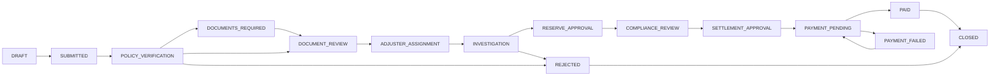

# HarborPoint Claims Hub — Database Reference

> Generated on 2026-10-27 from the live PostgreSQL schema (migrations up to `20261027000014`) and a scan of `server/src`. Table structure, keys, constraints, triggers, indexes and RLS policy names come straight from the database catalog; purpose, joins and usage come from reading the code. Where the code or schema does not define something, the text says so.

Companion documents: [DATABASE.md](DATABASE.md) (setup, migrations, operations), [API.md](API.md) (endpoints), [PRD-enterprise-hub.md](PRD-enterprise-hub.md) (requirements).

## Contents

1. [At a glance](#at-a-glance)
2. [Conventions shared by all tables](#conventions-shared-by-all-tables)
3. [Entity relationship diagram](#entity-relationship-diagram)
4. [How the database supports the claim workflow](#how-the-database-supports-the-claim-workflow)
5. [How the application reads data: joins and lookups](#how-the-application-reads-data-joins-and-lookups)
6. [Table reference](#table-reference)
   - [Identity, roles and authority](#identity): [`auth.users`](#auth-users), [`users`](#public-users), [`roles`](#public-roles), [`user_roles`](#public-user-roles), [`user_attributes`](#public-user-attributes), [`authority_limits`](#public-authority-limits), [`consents`](#public-consents)
   - [Configuration and reference data](#configuration): [`segment_config`](#public-segment-config), [`claim_status_transitions`](#public-claim-status-transitions), [`fraud_reason_codes`](#public-fraud-reason-codes), [`source_precedence`](#public-source-precedence), [`app_meta.schema_migrations`](#app-meta-schema-migrations)
   - [Policies and payees](#policies): [`policies`](#public-policies), [`policy_snapshots`](#public-policy-snapshots), [`policy_renewal_requests`](#public-policy-renewal-requests), [`payees`](#public-payees)
   - [Claims core](#claims): [`claims`](#public-claims), [`claim_parties`](#public-claim-parties), [`claim_assignments`](#public-claim-assignments), [`claim_status_history`](#public-claim-status-history), [`claim_notes`](#public-claim-notes), [`coverage_results`](#public-coverage-results), [`sla_clocks`](#public-sla-clocks)
   - [Documents and artifact requirements](#documents): [`artifact_requirements`](#public-artifact-requirements), [`documents`](#public-documents), [`document_versions`](#public-document-versions), [`document_files`](#public-document-files)
   - [Tasks, reminders and notifications](#work): [`tasks`](#public-tasks), [`task_sources`](#public-task-sources), [`claim_reminders`](#public-claim-reminders), [`notifications`](#public-notifications)
   - [Evaluation, reserves, reviews and fraud](#evaluation): [`evaluations`](#public-evaluations), [`reserves`](#public-reserves), [`reviews`](#public-reviews), [`claim_fraud_flags`](#public-claim-fraud-flags)
   - [Settlement and payment](#payment): [`payments`](#public-payments), [`settlement_approval_steps`](#public-settlement-approval-steps), [`payment_blocks`](#public-payment-blocks), [`payment_attempts`](#public-payment-attempts)
   - [Closure and recovery](#closure): [`closure_requests`](#public-closure-requests), [`recoveries`](#public-recoveries)
   - [Integration](#integration): [`integration_sync_runs`](#public-integration-sync-runs), [`claim_xref`](#public-claim-xref)
   - [AI runs and audit trail](#ai-audit): [`ai_runs`](#public-ai-runs), [`audit_logs`](#public-audit-logs)
7. [Database functions and triggers](#database-functions-and-triggers)
8. [Gaps and undefined details](#gaps-and-undefined-details)
9. [Keeping this document current](#keeping-this-document-current)

## At a glance

| | |
|---|---|
| Database | PostgreSQL 14 or later (tested on 17 and 18). No Supabase, no ORM. |
| Schemas | `public` (business data, 43 tables), `auth` (credentials, 1 table), `app_meta` (migration ledger, 1 table) |
| Tables | 45 tables, 631 columns, 129 foreign keys. No views. |
| Partitioned | [`ai_runs`](#public-ai-runs), [`audit_logs`](#public-audit-logs), by month (50 partitions created ahead by `create_monthly_partitions`) |
| Sequence | `public.claim_number_seq` (starts at 1000) feeds `next_claim_number()`, which issues numbers like `HPC-2026-001042`. |
| Access | The API connects as one database user and runs each request in a transaction with `request.jwt.claims` set, so `auth.uid()` returns the signed-in user. Row-level security is enabled on every `public` table for the `authenticated` and `anon` roles. The API also checks permissions in code (`shared/permissions.js`) and limits rows to the caller's claim scope (`services/access.service.js`). |
| Schema source | `database/migrations/*.sql`, applied in name order by `server/src/db/migrate.js`; `database/seed.sql` (roles) is re-applied on every migrate. |

## Conventions shared by all tables

- **Keys.** Every table has a `uuid` primary key `id` defaulting to `gen_random_uuid()`, except `roles` (`code`), `user_attributes` (`user_id`), `fraud_reason_codes` (`code`), `task_sources` (`source_system, external_ref`), `app_meta.schema_migrations` (`name`) and the two partitioned tables, whose keys include the partition column (`audit_logs (id, occurred_at)`, `ai_runs (id, created_at)`).
- **Money** is `numeric(14,2)` with a `currency` column defaulting to `INR` (Indian rupees; migration 0014 changed the code from `USD`, amounts were not converted). **Times** are `timestamptz`.
- **Enumerations** are `text` columns with a `CHECK (col = ANY (ARRAY[...]))` constraint, not PostgreSQL enum types. Allowed values are listed under each table's constraints.
- **Row timestamps.** Tables with `updated_at` have a `*_set_updated_at` trigger (`set_updated_at()`).
- **Optimistic locking.** Tables with a `version` column have a `*_bump_version` trigger (`bump_version()`). The API sends the version it read and updates `where version = $n`; zero rows updated returns `409 VERSION_CONFLICT`.
- **Who changed it.** `created_by`, `updated_by`, `requested_by`, `decided_by` and similar columns reference `public.users(id)`. They are listed under each table but left out of the diagram to keep it readable.
- **Deletes.** The application deletes almost nothing (only role grants). Child rows of a claim use `ON DELETE CASCADE` so test and demo data can be removed cleanly; audit and history tables block deletes with triggers.
- **Sensitive data.** Contact details (`claim_parties.contact`) and bank details (`payees.bank_details_enc`) are encrypted by the API with AES-256-GCM (`FIELD_ENCRYPTION_KEY`); the database never sees the plaintext. `payees.bank_details_hash` is an HMAC used to spot duplicate accounts.
- **Join style.** The repository helper (`server/src/db/repository.js`) reads one table at a time; related rows are mostly fetched with a second batched query (`where id = any($1)`) and combined in JavaScript. Hand-written SQL joins are used where a report or check needs them. Both kinds are listed per table.

In the column tables: **PK** primary key, **FK →** foreign key target, **UQ** unique, **✱** the column is not read or written by any application code (see [Gaps](#gaps-and-undefined-details)).

## Entity relationship diagram

Every foreign key in the database, drawn from the referenced table (left) to the referencing table (right) and labelled with the referencing column. `||` means the reference is required, `|o` that it is optional; `o{` many, `o|` at most one.

To keep the diagram readable it leaves out the "who did it" references to `users` (`created_by`, `updated_by`, `reviewed_by`, `approved_by` and similar, 50+ in total). They are listed in each table's relationships. It keeps the user references that define ownership: customer, owner, adjuster, assignee, task owner, consent subject, notification recipient and role grants.

```mermaid
erDiagram
    auth_users ||--o| users : "id"
    roles ||--o{ user_roles : "role_code"
    users ||--o{ user_roles : "user_id"
    users ||--o| user_attributes : "user_id"
    roles ||--o{ authority_limits : "role"
    claims |o--o{ consents : "claim_id"
    users ||--o{ consents : "subject_id"
    payees |o--o{ policies : "payee_id"
    claims ||--o{ policy_snapshots : "claim_id"
    policies ||--o{ policy_snapshots : "policy_id"
    policies ||--o{ policy_renewal_requests : "policy_id"
    tasks |o--o{ policy_renewal_requests : "task_id"
    users |o--o{ claims : "assigned_adjuster_id"
    users |o--o{ claims : "assigned_owner_id"
    users ||--o{ claims : "customer_id"
    policies |o--o{ claims : "policy_id"
    policy_snapshots |o--o{ claims : "policy_snapshot_id"
    claims |o--o{ claims : "possible_duplicate_of"
    claims ||--o{ claim_parties : "claim_id"
    users ||--o{ claim_assignments : "assignee_id"
    claims ||--o{ claim_assignments : "claim_id"
    claims ||--o{ claim_status_history : "claim_id"
    claims ||--o{ claim_notes : "claim_id"
    claims ||--o{ coverage_results : "claim_id"
    policy_snapshots |o--o{ coverage_results : "snapshot_id"
    claims ||--o{ sla_clocks : "claim_id"
    documents |o--o{ artifact_requirements : "document_id"
    claims ||--o{ artifact_requirements : "claim_id"
    artifact_requirements |o--o{ documents : "artifact_requirement_id"
    claims ||--o{ documents : "claim_id"
    documents ||--o{ document_versions : "document_id"
    users |o--o{ tasks : "owner_user_id"
    claims |o--o{ tasks : "claim_id"
    tasks ||--o| task_sources : "task_id"
    claims ||--o{ claim_reminders : "claim_id"
    notifications |o--o{ claim_reminders : "notification_id"
    claims |o--o{ notifications : "claim_id"
    users ||--o{ notifications : "recipient_id"
    claims ||--o{ evaluations : "claim_id"
    documents |o--o{ evaluations : "denial_letter_doc_id"
    claims ||--o{ reserves : "claim_id"
    evaluations |o--o{ reserves : "evaluation_id"
    claims ||--o{ reviews : "claim_id"
    claims ||--o{ claim_fraud_flags : "claim_id"
    fraud_reason_codes ||--o{ claim_fraud_flags : "code"
    reviews |o--o{ claim_fraud_flags : "review_id"
    claims ||--o{ payments : "claim_id"
    evaluations |o--o{ payments : "evaluation_id"
    payees |o--o{ payments : "payee_id"
    authority_limits |o--o{ settlement_approval_steps : "authority_limit_id"
    payments ||--o{ settlement_approval_steps : "payment_id"
    roles ||--o{ settlement_approval_steps : "required_role"
    tasks |o--o{ payment_blocks : "owner_task_id"
    payments ||--o{ payment_blocks : "payment_id"
    payments ||--o{ payment_attempts : "payment_id"
    claims ||--o{ closure_requests : "claim_id"
    claims ||--o{ recoveries : "claim_id"
    claims ||--o{ claim_xref : "claim_id"
    claims ||--o{ ai_runs : "claim_id"
    documents |o--o{ ai_runs : "document_id"
```



Relationships that exist in the data but have **no foreign key** (they are not drawn):

| From | To | Why there is no foreign key |
|---|---|---|
| `reviews.subject_id` + `subject_type` | `reserves.id`, `evaluations.id`, `closure_requests.id` | Polymorphic: one column points at different tables depending on `subject_type`. |
| `audit_logs.entity_id` + `entity_type`, `audit_logs.claim_id` | any table, `claims.id` | Polymorphic, and audit rows must outlive the records they describe. |
| `claim_fraud_flags.ai_run_ref`, `coverage_results.ai_run_ref`, `reserves.ai_run_ref` | `ai_runs.id` | `ai_runs` is partitioned; a foreign key into it would need the partition key (`created_at`) as well. |
| `documents.storage_key`, `document_versions.storage_key` | `document_files.storage_key` | The file and its metadata are written in the same transaction by `storage.service.js`. |

## How the database supports the claim workflow

The claim moves through statuses held in `claims.status`. Every change goes through `transitionClaim()` (`server/src/services/workflow.service.js`), which in one transaction: updates `claims`, inserts `claim_status_history`, stops and starts `sla_clocks`, creates `tasks`, writes `audit_logs` and inserts `notifications`. The `enforce_claim_status_rules` trigger then checks the move against `claim_status_transitions` and recomputes `claims.stage`.



Side paths: any open status can go to `ON_HOLD` (the previous status is kept in `claims.hold_from_status`) and back. A claim can be `REJECTED` from coverage verification through settlement approval, and `WITHDRAWN` from draft through investigation; both then go to `CLOSED`. `CLOSED` and `REJECTED` claims can be `REOPENED` (counted in `claims.reopen_count`). Investigation can send a claim back to `DOCUMENTS_REQUIRED`, and later stages can return it to `INVESTIGATION`. The full list of 67 permitted moves is in [`claim_status_transitions`](#public-claim-status-transitions).

| Step | Who | Tables written | Notes |
|---|---|---|---|
| 1. Registration and consent | Customer | `auth.users` → (trigger) `users`, `user_roles` (`CLIENT`), `consents` (`PRIVACY_NOTICE`) | A self-registered account gets the `CLIENT` role automatically; staff accounts are created by Compliance & Security. |
| 2. Draft claim | Customer, or Claims Operations Manager on their behalf | `claims` (status `DRAFT`, `draft_step` 1–6), `claim_parties` (claimant contact, encrypted) | `POST /policies/eligibility` reads `policies` first to confirm the policy is active and the loss date is in period. |
| 3. Submission | Customer | `claims` (number from `claim_number_seq`, `opened_at`, `severity`, `due_date`), `policy_snapshots`, `consents` (`CLAIM_DECLARATION`), `artifact_requirements` (one per required document from `segment_config`), `documents` + `document_versions` + `document_files` (uploads), `claim_status_history`, `sla_clocks` (acknowledgement + intake), `audit_logs` | `submission_key` makes a repeated submit return the same claim. |
| 4. Intake routing | System | `claims.assigned_owner_id`, `claim_assignments` (`OPERATIONS_OWNER`, `assigned_by` null), `tasks` (intake task), `notifications`, `audit_logs` (`CLAIM_AUTO_ASSIGNED`, actor `SYSTEM`) | Picks the active Claims Operations Manager with the fewest open claims and tasks (a joined query over `users`, `user_roles`, `claims`, `tasks`). If nobody holds the role, the task waits in the role queue and Claims Managers are notified. |
| 5. Coverage and payee at intake | Claims Operations Manager | `coverage_results` (and `claims.coverage_result`), `payees` (created or changed, `UNVERIFIED`), `policies.payee_id`, `payees.verification_status` (`VERIFIED` by a second person) | The claim cannot leave `POLICY_VERIFICATION` without a covered result and a verified payee. |
| 6. Documents | Customer, Document Reviewer | `artifact_requirements` (`REQUESTED` → `RECEIVED` → `ACCEPTED`/`REJECTED`/`WAIVED`), `documents` (`PENDING_REVIEW` → `ACCEPTED`/`REJECTED`), `document_versions`, `document_files`, `claim_reminders` (drafted, approved by a person), `ai_runs` (extraction) | A rejected document re-opens its requirement and creates a task. A document exception (`claims.document_exception_*`) waives what is missing. |
| 7. Adjuster assignment | Claims Manager | `claims.assigned_adjuster_id`, `claim_assignments` (`ADJUSTER`), `tasks` | Assignee pickers use `user_roles JOIN users`; the workload view joins `claims` to user ids. |
| 8. Investigation and evaluation | Adjuster | `evaluations` (versioned), `claim_notes`, `recoveries` (if a third party is liable) | A returned evaluation gets a new version; old versions stay. |
| 9. Reserve | Adjuster, Claims Manager | `reserves` (`POSTED` within the adjuster's `effective_limit()`, otherwise `PENDING_REVIEW`), `reviews` (`RESERVE` checkpoint), `authority_limits`, `user_attributes` | `enforce_review_rules` checks the reviewer's role and limit; `reserves_protect_ledger` stops posted amounts changing. |
| 10. Compliance review | Compliance & Security | `reviews` (`COMPLIANCE`, checklist, `hold_active`), `claim_fraud_flags` → (trigger) `claims.fraud_score` | An active hold (`has_active_compliance_hold()`) blocks settlement and payment. |
| 11. Settlement approval | Assigned adjuster (within their limit) or Claims Manager | `payments` (`PENDING_APPROVAL`), `settlement_approval_steps` (role chosen from `authority_limits`), `reviews` | An adjuster step can be decided only by the claim's assigned adjuster; a Claims Manager step not by the preparer (`enforce_settlement_step`). A claim has at most one active payment (`payments_one_active` index). |
| 12. Payment | Payment Operator | `payments` (`PENDING` → `PROCESSING` → `PAID` or `FAILED`), `payment_attempts` (idempotency key), `payment_blocks`, `reserves` (`PAYMENT_ISSUED` entry) | The approver cannot issue (`enforce_issuer_not_approver`); a payee that is not verified or a bank change opens a block (`enforce_payment_rules`). |
| 13. Reconciliation | Payment Operator | `payments` (`RECONCILED`, `reconciled_by`, `reconciliation_reference`) |  |
| 14. Closure | Adjuster, Claims Manager | `closure_requests`, `reviews` (`CLOSURE`), `claims` (`CLOSED`, `closure_reason`, `closed_at`), `reserves` (`CLOSURE_RELEASE`), `sla_clocks` stopped | A claim cannot close while a `blocking` task is open or a payment is unsettled (`enforce_claim_status_rules`). |
| 15. After closure | Adjuster, Data Engineer, Compliance & Security | `recoveries`, `claims` (`REOPENED`), `claim_xref`, `integration_sync_runs`, `audit_logs` (`verify_audit_chain()`) |  |

Running alongside every step:

- `sla_clocks` time each stage; the SLA sweep (every 15 minutes) sets `breached_at` and raises `claims.escalation_level`. Clocks pause while the customer owes documents or the claim is on hold.
- `tasks` give every outstanding activity an owner; the overdue sweep and unclaimed-task escalation read `segment_config` (`unclaimed_task_escalation_hours`).
- `audit_logs` receive one hash-chained row per change, in the same transaction as the change.
- `notifications` tell the customer and staff what happened; customers see only `claim_status_history` rows marked `customer_visible`.

## How the application reads data: joins and lookups

### SQL joins in the code

Every hand-written join in `server/src`, found by searching for `join` in SQL strings. INNER JOIN keeps only matching rows; LEFT JOIN keeps every row of the left table.

| Where | Tables and join type | Joining columns | Purpose |
|---|---|---|---|
| `modules/assignments/assignments.service.js` | `user_roles` INNER JOIN `users` | `users.id = user_roles.user_id` | List active people holding a role (assignee picker). |
| `modules/assignments/assignments.service.js` | `users` INNER JOIN `user_roles`; `unnest(ids)` INNER JOIN `claims` | `claims.assigned_owner_id / assigned_adjuster_id / assigned_reviewer_id = u.id` | Team workload: open claims per person. |
| `modules/customers/customers.service.js` | `policies` LEFT JOIN `payees` | `payees.id = policies.payee_id` | Customer record: policies with payout account (policies without a payee still listed). |
| `modules/customers/customers.service.js` | `claims` LEFT JOIN `policies` | `policies.id = claims.policy_id` | Customer record: claim history with policy numbers. |
| `modules/customers/customers.service.js` | `documents` INNER JOIN `claims` (2 queries) | `claims.id = documents.claim_id` | Customer record documents and document download, limited to that customer's submitted claims. |
| `modules/reports/reports.service.js` | `tasks` LEFT JOIN `users` | `users.id = tasks.owner_user_id` | Overdue tasks by owner; role-queue tasks have no user. |
| `modules/reports/reports.service.js` | `reviews` INNER JOIN `reserves` | `reserves.id = reviews.subject_id` (polymorphic, `checkpoint_type = RESERVE`) | Reserve approval turnaround. |
| `modules/reports/reports.service.js` | `settlement_approval_steps` INNER JOIN `payments` (2 queries) | `payments.id = settlement_approval_steps.payment_id` | Settlement turnaround; approver productivity. |
| `modules/reports/reports.service.js` | `payment_attempts` INNER JOIN `payments` | `payments.id = payment_attempts.payment_id` | Payment success rate. |
| `modules/reports/reports.service.js` | `claims` INNER JOIN `payments` | `payments.claim_id = claims.id and payments.issued_at is not null` | Cycle time for paid claims (also subtracts `sla_clocks` waiting time in a subquery). |
| `modules/reports/reports.service.js` | `user_roles` INNER JOIN `users` LEFT JOIN `claims` | `claims.assigned_adjuster_id = users.id` | Adjuster workload, including adjusters with no claims. |
| `modules/reports/reports.service.js` | `users` INNER JOIN `user_roles` | `user_roles.user_id = users.id` | Names for approver productivity. |
| `modules/settlements/settlements.service.js` | `settlement_approval_steps` INNER JOIN `payments` | `payments.id = settlement_approval_steps.payment_id` | Decision history for settlements. |
| `modules/tasks/tasks.service.js` | `tasks` LEFT JOIN `claims` | `claims.id = tasks.claim_id` | Unclaimed queue-task escalation needs the claim's segment; general tasks have no claim. |
| `services/intakeRouting.service.js` | `users` INNER JOIN `user_roles` (2 queries) + correlated subqueries on `claims`, `tasks` | `user_roles.user_id = users.id and role_code = CLAIMS_OPS_MANAGER` | Pick the least-loaded Claims Operations Manager; check a preferred owner still holds the role. |
| `services/notification.service.js` | `user_roles` INNER JOIN `users` | `users.id = user_roles.user_id and users.is_active` | `userIdsWithRole()`: who to notify for a role. |
| `middleware/auth.js` | `users` + `user_roles` (two lookups) | by user id | Build the signed-in actor on every request. |

### Joins inside the database

| Function or trigger | Tables | How |
|---|---|---|
| `can_access_claim(claim_id)` (RLS) | `claims`, `claim_assignments`, `payments` | EXISTS sub-queries: an adjuster was ever assigned the claim; a Payment Operator's claim has a payment. |
| `effective_limit(user, type, segment)` | `user_attributes`, `authority_limits`, `user_roles` | User override, otherwise the highest limit across the user's roles (`authority_limits.role IN (select role_code from user_roles …)`). |
| `has_role`, `has_any_role` | `user_roles`, `users` | EXISTS on an active user with the role. |
| `enforce_claim_status_rules` | `claim_status_transitions`, `tasks`, `payments` | Checks the (from, to) pair exists; on closing, no open blocking tasks and no unsettled payment. |
| `enforce_payment_rules` | `payees`, `payment_blocks`, `settlement_approval_steps` | Before issue: payee verified, no open block, all steps approved. |
| `enforce_review_rules`, `enforce_settlement_step` | `claims`, `reserves`, `payments`, `user_roles` | Reviewer holds the required role and enough authority; preparer is not the approver. |
| `recompute_fraud_score` | `claim_fraud_flags`, `claims` | Sums open flag contributions onto `claims.fraud_score`. |

### Batched lookups in the application

Most screens load a page of rows and then fetch related rows with one extra query per related table (`findMany(table, { id: [...] })`), joining them in JavaScript. This keeps every query on one table and lets the claim-scope filter apply to the parent query. The main ones:

| Parent rows | Related table fetched | Matching | Module |
|---|---|---|---|
| any (created_by, owner, approver …) | `users` | `id in (…)` | `services/presenters.js` (`profileMap`) |
| claims | `policies`, `claim_parties` | `policies.id in (claims.policy_id)`, `claim_parties.claim_id in (claims.id)` | `modules/claims`, `services/presenters.js` |
| tasks, reserves, payments, settlements, reminders, audit logs, compliance reviews, claim xref | `claims` | `claims.id in (…claim_id)` | the matching module |
| payments, settlements, policies | `payees` | `payees.id in (…payee_id)` | `modules/payments`, `modules/settlements`, `modules/policies` |
| payments | `payment_attempts`, `payment_blocks`, `settlement_approval_steps` | `payment_id in (…)` | `modules/payments`, `modules/settlements` |
| reserves | `evaluations` | `evaluations.id in (…evaluation_id)` | `modules/reserves` |
| compliance reviews | `claim_fraud_flags` | `claim_id in (…)` | `modules/compliance` |
| users (admin list) | `user_roles`, `user_attributes` | `user_id in (…)` | `modules/admin` |

## Table reference

<a id="identity"></a>

### Identity, roles and authority

Who can sign in, which roles they hold, how much money they may approve, and what they consented to.

<a id="auth-users"></a>

#### `auth.users`

**Purpose.** The API's credential store: one row per account that can sign in, with the email, the password hash and profile metadata. It lives in its own `auth` schema so credentials are kept apart from business data.

**Why it exists.** Sign-in needs a password hash that no application query ever returns. Every `public.users` row is created from a row here by the `handle_new_auth_user` trigger.

**Columns**

| Column | Type | Null | Default | Key |
|---|---|---|---|---|
| `id` | uuid | not null | `gen_random_uuid()` | PK |
| `email` | text | null |  | UQ |
| `encrypted_password` | text | null |  |  |
| `raw_user_meta_data` | jsonb | not null | `{}` |  |
| `raw_app_meta_data` | jsonb | not null | `{}` |  |
| `email_confirmed_at` | timestamptz | null |  |  |
| `created_at` | timestamptz | not null | `now()` |  |

**Relationships**

Referenced by:

- [`users`](#public-users).`id` → this table

**Joined tables**

| Joined with | Join type | Joining columns | Purpose | Where |
|---|---|---|---|---|
| `users` | Trigger (not a query join) | `auth.users.id = public.users.id` | `handle_new_auth_user` inserts the matching `public.users` row and, for self-registration, the `CLIENT` role. | migrations 0002 / 0007 |

**Usage in the application**

- Created by `services/authProvider.js` on registration (`POST /auth/register`) and when Compliance & Security creates staff (`POST /admin/users`); `raw_app_meta_data.provisioned_staff = true` marks staff so no `CLIENT` role is granted.
- Read at sign-in (`POST /auth/login`) to verify the password: scrypt hashes, or bcrypt hashes imported from Supabase, which are upgraded to scrypt on the next successful login.
- Updated by password reset (`POST /auth/reset-password`). Never deleted by the application.

| Module (`server/`) | Operations |
|---|---|
| `src/services/authProvider.js` | create, read, update |

Also used by: `scripts/import-supabase.js` (read).

**Triggers:** `on_auth_user_created` (after insert, `handle_new_auth_user()`).

**Indexes:** `users_email_key` unique (email).

**Row-level security policies:** none (no direct access for the `authenticated` role).

**Sample queries**

_Accounts that cannot sign in with a password (for example imported magic-link users)_

```sql
select u.email, u.created_at
from auth.users u
where coalesce(u.encrypted_password, '') = ''
order by u.created_at;
```

_Accounts still on an imported bcrypt hash_

```sql
select a.email, p.full_name
from auth.users a
join public.users p on p.id = a.id
where a.encrypted_password like '$2%';
```

**Gaps**

- There is no `last_sign_in_at` or failed-attempt counter; sign-in attempts are only rate-limited in memory per API instance.

<a id="public-users"></a>

#### `public.users`

**Purpose.** The profile of every person in the system, customers and staff alike: name, email, phone and whether the account is active. Its primary key is the same id as `auth.users`.

**Why it exists.** Almost every table points here to record who created, owns, approved or changed something.

**Columns**

| Column | Type | Null | Default | Key |
|---|---|---|---|---|
| `id` | uuid | not null |  | PK, FK → `auth.users.id` |
| `email` | text | not null |  |  |
| `full_name` | text | not null |  |  |
| `phone` | text | null |  |  |
| `is_active` | boolean | not null | `true` |  |
| `created_at` | timestamptz | not null | `now()` |  |
| `updated_at` | timestamptz | not null | `now()` |  |
| `version` | integer | not null | `1` |  |
| `updated_by` | uuid | null |  | FK → `users.id` |

**Relationships**

References:

- `id` → [`auth.users`](#auth-users).`id` (on delete cascade)
- `updated_by` → [`users`](#public-users).`id`

Referenced by 78 foreign keys:

- [`ai_runs`](#public-ai-runs): `decided_by`, `requested_by`
- [`artifact_requirements`](#public-artifact-requirements): `requested_by`, `responded_by`
- [`authority_limits`](#public-authority-limits): `created_by`, `approved_by`
- [`claim_assignments`](#public-claim-assignments): `assignee_id`, `assigned_by`
- [`claim_fraud_flags`](#public-claim-fraud-flags): `created_by`, `resolved_by`
- [`claim_notes`](#public-claim-notes): `author_id`
- [`claim_parties`](#public-claim-parties): `created_by`
- [`claim_reminders`](#public-claim-reminders): `decided_by`, `recipient_id`, `created_by`
- [`claim_status_history`](#public-claim-status-history): `changed_by`
- [`claims`](#public-claims): `document_exception_by`, `assigned_reviewer_id`, `assigned_adjuster_id`, `assigned_owner_id`, `customer_id`, `updated_by`, `created_by`
- [`closure_requests`](#public-closure-requests): `requested_by`, `decided_by`
- [`consents`](#public-consents): `subject_id`
- [`coverage_results`](#public-coverage-results): `reviewed_by`
- [`document_versions`](#public-document-versions): `reviewed_by`, `uploaded_by`
- [`documents`](#public-documents): `reviewer_id`, `uploaded_by`, `reviewed_by`
- [`evaluations`](#public-evaluations): `adjuster_id`, `reviewed_by`
- [`integration_sync_runs`](#public-integration-sync-runs): `triggered_by`
- [`notifications`](#public-notifications): `recipient_id`
- [`payees`](#public-payees): `verified_by`, `customer_id`, `updated_by`, `created_by`, `bank_details_changed_by`
- [`payment_attempts`](#public-payment-attempts): `initiated_by`
- [`payment_blocks`](#public-payment-blocks): `opened_by`, `resolved_by`
- [`payments`](#public-payments): `requested_by`, `reconciled_by`, `created_by`, `updated_by`, `approved_by`
- [`policies`](#public-policies): `created_by`, `updated_by`, `insured_id`
- [`policy_renewal_requests`](#public-policy-renewal-requests): `requested_by`, `decided_by`
- [`policy_snapshots`](#public-policy-snapshots): `captured_by`
- [`recoveries`](#public-recoveries): `updated_by`, `created_by`
- [`reserves`](#public-reserves): `created_by`, `updated_by`, `set_by`, `approved_by`
- [`reviews`](#public-reviews): `created_by`, `requested_by`, `reviewer_id`, `decided_by`, `hold_placed_by`
- [`segment_config`](#public-segment-config): `proposed_by`, `approved_by`
- [`settlement_approval_steps`](#public-settlement-approval-steps): `approver_id`
- [`source_precedence`](#public-source-precedence): `updated_by`
- [`tasks`](#public-tasks): `created_by`, `completed_by`, `owner_user_id`
- [`user_attributes`](#public-user-attributes): `user_id`, `updated_by`
- [`user_roles`](#public-user-roles): `user_id`, `granted_by`
- [`users`](#public-users): `updated_by`

**Joined tables**

| Joined with | Join type | Joining columns | Purpose | Where |
|---|---|---|---|---|
| `user_roles` | INNER JOIN | `user_roles.user_id = users.id` | Active users holding a role: assignee pickers, notification recipients, intake routing, team workload. | assignments.service.js, notification.service.js, intakeRouting.service.js, reports.service.js |
| `tasks` | LEFT JOIN (users on the right) | `users.id = tasks.owner_user_id` | Overdue tasks by owner name in reports; unowned queue tasks still appear. | reports.service.js |
| `any table` | Application lookup | `users.id IN (…ids)` | `profileMap` batch-loads names for created_by, owner, approver and similar columns, then attaches them in code. | services/presenters.js |

**Usage in the application**

- Created only by the `handle_new_auth_user` trigger (never inserted directly).
- Read on every request by `middleware/auth.js` (with `user_roles`) to build the signed-in actor, and by `services/presenters.js` (`profileMap`) to turn user ids into names.
- Updated by `PATCH /auth/me` (name, phone) and by `PATCH /admin/users/:id` (`is_active`).

| Module (`server/`) | Operations |
|---|---|
| `src/middleware/auth.js` | read |
| `src/modules/admin/admin.service.js` | read, update |
| `src/modules/assignments/assignments.service.js` | read |
| `src/modules/auth/auth.service.js` | read, update |
| `src/modules/claims/claims.service.js` | read |
| `src/modules/customers/customers.service.js` | read |
| `src/modules/reports/reports.service.js` | read |
| `src/services/intakeRouting.service.js` | read |
| `src/services/notification.service.js` | read |
| `src/services/presenters.js` | read |

Also used by: `src/seed/demoData.js` (read, update).

Database functions that read or write it: `handle_new_auth_user()`, `has_any_role()`, `has_role()`.

**Triggers:** `users_bump_version` (before update, `bump_version()`); `users_set_updated_at` (before update, `set_updated_at()`).

**Indexes:** `users_email_key` unique (lower(email)).

**Row-level security policies:** `users_read`, `users_update_own`.

**Sample queries**

_Staff with their roles_

```sql
select u.full_name, u.email, string_agg(ur.role_code, ', ' order by ur.role_code) as roles
from public.users u
join public.user_roles ur on ur.user_id = u.id
where u.is_active and ur.role_code <> 'CLIENT'
group by u.id, u.full_name, u.email
order by u.full_name;
```

<a id="public-roles"></a>

#### `public.roles`

**Purpose.** The list of role codes and their display names: `CLIENT`, `CLAIMS_OPS_MANAGER`, `OPS_MANAGER` (Claims Manager), `ADJUSTER`, `DOCUMENT_REVIEWER`, `PAYMENT_OPERATOR`, `DATA_ENGINEER`, `COMPLIANCE_SECURITY`.

**Why it exists.** Gives role codes a foreign-key target so a grant or an authority limit cannot name a role that does not exist.

**Columns**

| Column | Type | Null | Default | Key |
|---|---|---|---|---|
| `id` | uuid | not null | `gen_random_uuid()` | PK |
| `code` | text | not null |  | UQ |
| `name` | text | not null |  |  |
| `description` | text | null |  |  |
| `is_staff` | boolean | not null | `true` |  |
| `created_at` | timestamptz | not null | `now()` |  |

**Relationships**

Referenced by:

- [`authority_limits`](#public-authority-limits).`role` → this table
- [`settlement_approval_steps`](#public-settlement-approval-steps).`required_role` → this table
- [`user_roles`](#public-user-roles).`role_code` → this table

**Joined tables**

| Joined with | Join type | Joining columns | Purpose | Where |
|---|---|---|---|---|
| `user_roles` | Foreign key only | `user_roles.role_code = roles.code` | Validates grants; no query joins the two. | schema |

**Usage in the application**

- Seeded by `database/seed.sql` on every start (insert or update) and by migrations 0007 and 0010.
- Read by `GET /admin/roles` for the Users & Roles screen. What each role may do is defined in code (`shared/permissions.js`), not in this table.

| Module (`server/`) | Operations |
|---|---|
| `src/modules/admin/admin.service.js` | read |

**Indexes:** `roles_code_key` unique (code).

**Row-level security policies:** `roles_read`.

**Sample queries**

_How many active people hold each role_

```sql
select r.code, r.name, count(u.id) as people
from public.roles r
left join public.user_roles ur on ur.role_code = r.code
left join public.users u on u.id = ur.user_id and u.is_active
group by r.code, r.name
order by r.code;
```

<a id="public-user-roles"></a>

#### `public.user_roles`

**Purpose.** Role grants: which user holds which role. A user may hold several roles and switch workspace in the app.

**Why it exists.** Every permission check, claim-scope rule and RLS policy starts from a user's roles.

**Columns**

| Column | Type | Null | Default | Key |
|---|---|---|---|---|
| `id` | uuid | not null | `gen_random_uuid()` | PK |
| `user_id` | uuid | not null |  | FK → `users.id` |
| `role_code` | text | not null |  | FK → `roles.code` |
| `granted_by` | uuid | null |  | FK → `users.id` |
| `granted_at` | timestamptz | not null | `now()` |  |
| `created_at` | timestamptz | not null | `now()` |  |

**Constraints**

- Unique (`user_id`, `role_code`)

**Relationships**

References:

- `granted_by` → [`users`](#public-users).`id`
- `role_code` → [`roles`](#public-roles).`code`
- `user_id` → [`users`](#public-users).`id` (on delete cascade)

**Joined tables**

| Joined with | Join type | Joining columns | Purpose | Where |
|---|---|---|---|---|
| `users` | INNER JOIN | `users.id = user_roles.user_id` | Only active users count as holders of a role. | notification.service.js (`userIdsWithRole`), assignments.service.js, intakeRouting.service.js, reports.service.js |
| `claims` | LEFT JOIN | `claims.assigned_adjuster_id = users.id` | Adjuster workload report: every adjuster, including those with no claims. | reports.service.js |

**Usage in the application**

- Created by `POST /admin/users` and `POST /admin/users/:id/roles` (Compliance & Security, never for themselves) and by the `handle_new_auth_user` trigger (`CLIENT` on self-registration).
- Deleted by `DELETE /admin/users/:id/roles/:roleCode`.
- Read on every request (`middleware/auth.js`), by the database helpers `has_role`, `has_any_role` and `effective_limit`, and by the approval triggers.

| Module (`server/`) | Operations |
|---|---|
| `src/middleware/auth.js` | read |
| `src/modules/admin/admin.service.js` | create, read, delete |
| `src/modules/assignments/assignments.service.js` | read |
| `src/modules/customers/customers.service.js` | read |
| `src/modules/documents/documents.service.js` | read |
| `src/modules/reports/reports.service.js` | read |
| `src/modules/tasks/tasks.service.js` | read |
| `src/services/intakeRouting.service.js` | read |
| `src/services/notification.service.js` | read |

Also used by: `src/seed/demoData.js` (create, read, delete).

Database functions that read or write it: `effective_limit()`, `enforce_review_rules()`, `enforce_settlement_step()`, `handle_new_auth_user()`, `has_any_role()`, `has_role()`.

**Indexes:** `user_roles_role_idx` (role_code); `user_roles_user_id_role_code_key` unique (user_id, role_code).

**Row-level security policies:** `user_roles_admin_delete`, `user_roles_admin_insert`, `user_roles_admin_update`, `user_roles_read`.

**Sample queries**

_Active Claims Operations Managers and their open claims (the intake routing input)_

```sql
select u.full_name,
       (select count(*) from public.claims c
         where c.assigned_owner_id = u.id
           and c.status not in ('DRAFT', 'PAID', 'CLOSED', 'REJECTED', 'WITHDRAWN')) as open_claims
from public.users u
join public.user_roles ur on ur.user_id = u.id and ur.role_code = 'CLAIMS_OPS_MANAGER'
where u.is_active
order by open_claims, u.full_name;
```

<a id="public-user-attributes"></a>

#### `public.user_attributes`

**Purpose.** Per-user attributes used for attribute-based access: personal reserve and settlement authority overrides, region and team.

**Why it exists.** Lets one Claims Manager approve more (or less) than the role default without a new role.

**Columns**

| Column | Type | Null | Default | Key |
|---|---|---|---|---|
| `user_id` | uuid | not null |  | PK, FK → `users.id` |
| `reserve_limit` | numeric(14,2) | null |  |  |
| `settlement_limit` | numeric(14,2) | null |  |  |
| `currency` | character(3) | not null | `INR` |  |
| `region` | text | null |  |  |
| `team_id` | text | null |  |  |
| `created_at` | timestamptz | not null | `now()` |  |
| `updated_at` | timestamptz | not null | `now()` |  |
| `updated_by` | uuid | null |  | FK → `users.id` |
| `version` | integer | not null | `1` |  |

**Constraints**

- `CHECK (((reserve_limit IS NULL) OR (reserve_limit >= (0))))`
- `CHECK (((settlement_limit IS NULL) OR (settlement_limit >= (0))))`

**Relationships**

References:

- `updated_by` → [`users`](#public-users).`id`
- `user_id` → [`users`](#public-users).`id` (on delete cascade)

**Joined tables**

| Joined with | Join type | Joining columns | Purpose | Where |
|---|---|---|---|---|
| `authority_limits` | Function (COALESCE over two lookups) | `user_attributes.user_id = :user; authority_limits.role in the user's roles` | `effective_limit()` returns the user override if set, otherwise the highest role default for the segment. | migration 0007 |

**Usage in the application**

- Created and updated by `POST /admin/users`, `POST /admin/users/:id/roles` and `PUT /admin/users/:id/attributes`. A null limit means "use the role default".
- Read by the database function `effective_limit(user, type, segment)`, which every reserve and settlement approval uses.

| Module (`server/`) | Operations |
|---|---|
| `src/modules/admin/admin.service.js` | create, read, update |

Also used by: `src/seed/demoData.js` (create, delete).

Database functions that read or write it: `effective_limit()`.

**Triggers:** `user_attributes_bump_version` (before update, `bump_version()`); `user_attributes_set_updated_at` (before update, `set_updated_at()`).

**Row-level security policies:** `user_attributes_read`.

**Sample queries**

_Effective authority of every Claims Manager_

```sql
select u.full_name,
       public.effective_limit(u.id, 'RESERVE', 'PERSONAL') as reserve_personal,
       public.effective_limit(u.id, 'SETTLEMENT', 'PERSONAL') as settlement_personal,
       ua.reserve_limit as reserve_override
from public.users u
join public.user_roles ur on ur.user_id = u.id and ur.role_code = 'OPS_MANAGER'
left join public.user_attributes ua on ua.user_id = u.id
order by u.full_name;
```

<a id="public-authority-limits"></a>

#### `public.authority_limits`

**Purpose.** Default monetary authority per role, segment and limit type (`RESERVE` or `SETTLEMENT`), with an effective-date range.

**Why it exists.** Approval routing depends on it: a reserve within the adjuster's limit posts directly; a settlement within the adjuster's limit is approved by the claim's assigned adjuster, otherwise by a Claims Manager.

**Columns**

| Column | Type | Null | Default | Key |
|---|---|---|---|---|
| `id` | uuid | not null | `gen_random_uuid()` | PK |
| `role` | text | not null |  | FK → `roles.code` |
| `segment` | text | not null |  |  |
| `coverage_line` | text | not null | `*` |  |
| `limit_type` | text | not null |  |  |
| `max_amount` | numeric(14,2) | not null |  |  |
| `currency` | character(3) | not null | `INR` |  |
| `effective_from` | timestamptz | not null | `now()` |  |
| `effective_to` | timestamptz | null |  |  |
| `created_by` | uuid | null |  | FK → `users.id` |
| `approved_by` | uuid | null |  | FK → `users.id` |
| `created_at` | timestamptz | not null | `now()` |  |

**Constraints**

- `CHECK (((effective_to IS NULL) OR (effective_to > effective_from)))`
- `CHECK (((created_by IS NULL) OR (approved_by IS NULL) OR (created_by <> approved_by)))`
- `CHECK ((limit_type = ANY (ARRAY['RESERVE', 'SETTLEMENT'])))`
- `CHECK ((max_amount > (0)))`
- `CHECK ((segment = ANY (ARRAY['PERSONAL', 'COMMERCIAL'])))`

**Relationships**

References:

- `approved_by` → [`users`](#public-users).`id`
- `created_by` → [`users`](#public-users).`id`
- `role` → [`roles`](#public-roles).`code`

Referenced by:

- [`settlement_approval_steps`](#public-settlement-approval-steps).`authority_limit_id` → this table

**Joined tables**

Not joined with other tables in application code; it is read on its own.

**Usage in the application**

- Seeded by migration 0007 (Adjuster 15k/30k reserve, Claims Manager 250k/1M reserve and settlement). Migration 0012 added Adjuster 15k/30k settlement limits and ended the Payment Operator 10k/25k settlement limits (`effective_to` set; the rows are kept as history).
- Read by `effective_limit()`, by `services/config.service.js` (`settlementApproverRole`) and by `GET /config/authority-limits`.
- There is no API to change it yet (see gaps).

| Module (`server/`) | Operations |
|---|---|
| `src/modules/config/config.service.js` | read |
| `src/services/config.service.js` | read |

Database functions that read or write it: `effective_limit()`.

**Indexes:** `authority_limits_current` unique (role, segment, coverage_line, limit_type) partial.

**Row-level security policies:** `authority_limits_read`.

**Sample queries**

_Current limits_

```sql
select role, segment, limit_type, max_amount, currency
from public.authority_limits
where effective_to is null
order by limit_type, segment, max_amount;
```

**Gaps**

- No endpoint creates or ends authority limits; changes need SQL. The `created_by <> approved_by` check is in place for when one is added.
- `coverage_line` defaults to `*`; per-coverage-line limits are modelled but not used by `effective_limit()`.

<a id="public-consents"></a>

#### `public.consents`

**Purpose.** Consent decisions per person: the privacy notice at registration, the claim declaration at submission, and channel consents, each with the notice version shown.

**Why it exists.** Proof of what a customer agreed to and when (PRD §2A).

**Columns**

| Column | Type | Null | Default | Key |
|---|---|---|---|---|
| `id` | uuid | not null | `gen_random_uuid()` | PK |
| `subject_id` | uuid | not null |  | FK → `users.id` |
| `claim_id` | uuid | null |  | FK → `claims.id` |
| `consent_type` | text | not null |  |  |
| `notice_version` | text | not null |  |  |
| `granted` | boolean | not null |  |  |
| `channel` | text | not null | `WEB` |  |
| `recorded_at` | timestamptz | not null | `now()` |  |
| `withdrawn_at` | timestamptz | null |  |  |

**Constraints**

- `CHECK ((consent_type = ANY (ARRAY['PRIVACY_NOTICE', 'CLAIM_DECLARATION', 'CHANNEL_EMAIL', 'CHANNEL_SMS', 'CHANNEL_PUSH', 'LOCATION', 'AUDIO_RECORDING'])))`

**Relationships**

References:

- `claim_id` → [`claims`](#public-claims).`id` (on delete cascade)
- `subject_id` → [`users`](#public-users).`id` (on delete cascade)

**Joined tables**

Not joined with other tables in application code; it is read on its own.

**Usage in the application**

- Created by `POST /auth/register` (`PRIVACY_NOTICE`), by claim submission (`CLAIM_DECLARATION`, with `claim_id`) and by `POST /auth/me/consents`. Withdrawal sets `withdrawn_at` and adds a new row.
- Read by `GET /auth/me/consents` and on the customer-records detail page.

| Module (`server/`) | Operations |
|---|---|
| `src/modules/auth/auth.service.js` | create, read, update |
| `src/modules/claims/claims.service.js` | create |
| `src/modules/customers/customers.service.js` | read |

Also used by: `src/seed/demoData.js` (create).

**Indexes:** `consents_subject_idx` (subject_id, consent_type, recorded_at DESC).

**Row-level security policies:** `consents_read`.

**Sample queries**

_Customers without a current privacy-notice consent_

```sql
select u.email
from public.users u
join public.user_roles ur on ur.user_id = u.id and ur.role_code = 'CLIENT'
where not exists (
  select 1 from public.consents c
  where c.subject_id = u.id and c.consent_type = 'PRIVACY_NOTICE' and c.granted and c.withdrawn_at is null);
```

<a id="configuration"></a>

### Configuration and reference data

Rules the workflow reads at run time, changed by configuration rather than code.

<a id="public-segment-config"></a>

#### `public.segment_config`

**Purpose.** Versioned settings per segment (`PERSONAL`, `COMMERCIAL`): required documents per claim type, SLA hours per status, severity thresholds, fraud review threshold and unclaimed-task escalation time.

**Why it exists.** Lets the business change rules without a release; every change needs a second person to approve it.

**Columns**

| Column | Type | Null | Default | Key |
|---|---|---|---|---|
| `id` | uuid | not null | `gen_random_uuid()` | PK |
| `segment` | text | not null |  |  |
| `config_key` | text | not null |  |  |
| `config_value` | jsonb | not null |  |  |
| `version` | integer | not null | `1` |  |
| `status` | text | not null | `PROPOSED` |  |
| `effective_from` | timestamptz | null |  |  |
| `effective_to` | timestamptz | null |  |  |
| `notes` | text | null |  |  |
| `proposed_by` | uuid | null |  | FK → `users.id` |
| `proposed_at` ✱ | timestamptz | not null | `now()` |  |
| `approved_by` | uuid | null |  | FK → `users.id` |
| `approved_at` | timestamptz | null |  |  |

**Constraints**

- Unique (`segment`, `config_key`, `version`)
- `CHECK (((status <> 'ACTIVE') OR (proposed_by IS NULL) OR ((approved_by IS NOT NULL) AND (approved_by <> proposed_by))))`
- `CHECK (((status <> 'ACTIVE') OR (effective_from IS NOT NULL)))`
- `CHECK ((segment = ANY (ARRAY['PERSONAL', 'COMMERCIAL'])))`
- `CHECK ((status = ANY (ARRAY['PROPOSED', 'ACTIVE', 'RETIRED', 'REJECTED'])))`

**Relationships**

References:

- `approved_by` → [`users`](#public-users).`id`
- `proposed_by` → [`users`](#public-users).`id`

**Joined tables**

Not joined with other tables in application code; it is read on its own.

**Usage in the application**

- Seeded by migration 0007. Proposals are created by `POST /config/segments` (status `PROPOSED`); `POST /config/segments/:id/decision` approves (the active version becomes `RETIRED`) or rejects. The proposer cannot decide.
- Read by `services/config.service.js` on submission (required documents, severity) and on every stage change (SLA hours).

| Module (`server/`) | Operations |
|---|---|
| `src/modules/config/config.service.js` | create, read, update |
| `src/services/config.service.js` | read |

**Indexes:** `segment_config_one_active` unique (segment, config_key) partial; `segment_config_segment_config_key_version_key` unique (segment, config_key, version).

**Row-level security policies:** `segment_config_read`.

**Sample queries**

_Active configuration_

```sql
select segment, config_key, version, config_value
from public.segment_config
where status = 'ACTIVE'
order by segment, config_key;
```

**Gaps**

- `fraud_review_threshold` is stored and editable but no code routes claims on it yet.

<a id="public-claim-status-transitions"></a>

#### `public.claim_status_transitions`

**Purpose.** Every permitted status change (from, to), the roles allowed to make it, whether a reason is required, and whether only the system may make it.

**Why it exists.** The `enforce_claim_status_rules` trigger rejects any status change not listed here, so the workflow holds even if the API is bypassed.

**Columns**

| Column | Type | Null | Default | Key |
|---|---|---|---|---|
| `from_status` | text | not null |  | PK |
| `to_status` | text | not null |  | PK |
| `allowed_roles` ✱ | text[] | not null |  |  |
| `requires_reason` | boolean | not null | `false` |  |
| `system_only` | boolean | not null | `false` |  |

**Constraints**

- Primary key (`from_status`, `to_status`)

**Relationships**

No foreign keys in or out.

**Joined tables**

Not joined with other tables in application code; it is read on its own.

**Usage in the application**

- Generated from `shared/workflow.js` by `npm run db:transitions-sql` into a migration (latest: 0013), which deletes and reinserts all 67 rows.
- Read only by the database trigger. The API enforces the same rules from `shared/workflow.js` directly.

_No application module reads or writes this table through SQL or the repository helper._

Also used by: `scripts/generate-transition-sql.js` (create, delete).

Database functions that read or write it: `enforce_claim_status_rules()`.

**Row-level security policies:** `transitions_read`.

**Sample queries**

_Where can a claim in coverage verification go, and who can move it?_

```sql
select to_status, allowed_roles, requires_reason
from public.claim_status_transitions
where from_status = 'POLICY_VERIFICATION'
order by to_status;
```

**Gaps**

- The trigger checks only that the (from, to) pair exists; `allowed_roles` is not enforced in the database because the API connects as one database user.

<a id="public-fraud-reason-codes"></a>

#### `public.fraud_reason_codes`

**Purpose.** The approved list of fraud reasons (sanctions match, PEP match, fraud indicator, late notification, high value, suspected duplicate, inconsistent statements, other) and the weight each adds to a claim's fraud score.

**Why it exists.** Keeps fraud scoring explainable: a score is always the sum of named, weighted reasons.

**Columns**

| Column | Type | Null | Default | Key |
|---|---|---|---|---|
| `code` | text | not null |  | PK |
| `description` | text | not null |  |  |
| `category` | text | not null |  |  |
| `weight` | smallint | not null |  |  |
| `active` | boolean | not null | `true` |  |
| `version` | integer | not null | `1` |  |
| `created_at` | timestamptz | not null | `now()` |  |

**Constraints**

- `CHECK (((weight >= 0) AND (weight <= 100)))`

**Relationships**

Referenced by:

- [`claim_fraud_flags`](#public-claim-fraud-flags).`code` → this table

**Joined tables**

| Joined with | Join type | Joining columns | Purpose | Where |
|---|---|---|---|---|
| `claim_fraud_flags` | Foreign key; trigger uses the weight | `claim_fraud_flags.code = fraud_reason_codes.code` | Each flag stores its contribution; `recompute_fraud_score` sums open flags onto the claim. | migration 0007 |

**Usage in the application**

- Seeded by migration 0007. Read by `GET /config/fraud-reason-codes` and when compliance records flags.

| Module (`server/`) | Operations |
|---|---|
| `src/modules/compliance/compliance.service.js` | read |
| `src/modules/config/config.service.js` | read |

**Row-level security policies:** `fraud_reason_codes_read`.

**Sample queries**

_How often each reason is flagged_

```sql
select r.code, r.weight, count(f.id) as flags, count(f.id) filter (where not f.resolved) as open_flags
from public.fraud_reason_codes r
left join public.claim_fraud_flags f on f.code = r.code
group by r.code, r.weight
order by r.weight desc;
```

<a id="public-source-precedence"></a>

#### `public.source_precedence`

**Purpose.** Which source system wins for each group of fields when systems disagree (source wins, hub wins, latest wins, manual review).

**Why it exists.** Conflict rules for synchronising with the policy, payment, document and legacy systems (PRD §6.6).

**Columns**

| Column | Type | Null | Default | Key |
|---|---|---|---|---|
| `field_group` | text | not null |  | PK |
| `source_system` | text | not null |  | PK |
| `rank` | integer | not null |  |  |
| `rule` | text | not null |  |  |
| `updated_by` | uuid | null |  | FK → `users.id` |
| `updated_at` | timestamptz | not null | `now()` |  |

**Constraints**

- Primary key (`field_group`, `source_system`)
- `CHECK ((rank >= 1))`
- `CHECK ((rule = ANY (ARRAY['SOURCE_WINS', 'HUB_WINS', 'LATEST_WINS', 'MANUAL_REVIEW'])))`

**Relationships**

References:

- `updated_by` → [`users`](#public-users).`id`

**Joined tables**

Not joined with other tables in application code; it is read on its own.

**Usage in the application**

- Seeded by migration 0007. Read and updated (upsert) by `GET/PUT /integrations/source-precedence` (Data Engineer).

| Module (`server/`) | Operations |
|---|---|
| `src/modules/integrations/integrations.service.js` | create, read |

**Row-level security policies:** `source_precedence_read`.

**Sample queries**

_Precedence rules_

```sql
select field_group, source_system, rank, rule
from public.source_precedence
order by field_group, rank;
```

**Gaps**

- No sync job reads these rules yet; they document the agreed behaviour for future connectors.

<a id="app-meta-schema-migrations"></a>

#### `app_meta.schema_migrations`

**Purpose.** The migration ledger: which files from `database/migrations/` have been applied, and when.

**Why it exists.** Lets the API apply only pending migrations at start, and lets `npm run db:status` report the schema version.

**Columns**

| Column | Type | Null | Default | Key |
|---|---|---|---|---|
| `name` | text | not null |  | PK |
| `applied_at` | timestamptz | not null | `now()` |  |

**Relationships**

No foreign keys in or out.

**Joined tables**

Not joined with other tables in application code; it is read on its own.

**Usage in the application**

- Written and read only by `server/src/db/migrate.js` (`npm run db:migrate`, or at API start when `DB_MIGRATE_ON_START=true`).

| Module (`server/`) | Operations |
|---|---|
| `src/db/migrate.js` | create, read |

Also used by: `scripts/db.js` (read); `scripts/import-supabase.js` (create).

**Row-level security policies:** none (no direct access for the `authenticated` role).

**Sample queries**

_Applied migrations_

```sql
select name, applied_at from app_meta.schema_migrations order by name;
```

<a id="policies"></a>

### Policies and payees

The insurance contracts claims are made against, the copy frozen for each claim, renewal requests, and the accounts settlements are paid to.

<a id="public-policies"></a>

#### `public.policies`

**Purpose.** Insurance contracts: policy number, insured customer, type, segment, period, sum insured, deductible, coverages and the payee for payouts.

**Why it exists.** Every claim is made against a policy; eligibility and coverage start here.

**Columns**

| Column | Type | Null | Default | Key |
|---|---|---|---|---|
| `id` | uuid | not null | `gen_random_uuid()` | PK |
| `external_policy_no` | text | not null |  | UQ |
| `insured_id` | uuid | not null |  | FK → `users.id` |
| `policy_type` | text | not null |  |  |
| `insured_name` | text | not null |  |  |
| `status` | text | not null | `ACTIVE` |  |
| `effective_date` | date | not null |  |  |
| `expiry_date` | date | not null |  |  |
| `sum_insured` | numeric(14,2) | not null |  |  |
| `deductible` | numeric(14,2) | not null | `0` |  |
| `premium` | numeric(14,2) | not null | `0` |  |
| `insured_asset` | text | null |  |  |
| `coverage_summary` | text | null |  |  |
| `created_at` | timestamptz | not null | `now()` |  |
| `updated_at` | timestamptz | not null | `now()` |  |
| `segment` | text | not null | `PERSONAL` |  |
| `coverages` | jsonb | not null | `[]` |  |
| `limits` | jsonb | not null | `{}` |  |
| `deductibles` | jsonb | not null | `{}` |  |
| `exclusions` | jsonb | not null | `[]` |  |
| `payee_id` | uuid | null |  | FK → `payees.id` |
| `source_system` | text | not null | `HUB` |  |
| `source_synced_at` ✱ | timestamptz | null |  |  |
| `version` | integer | not null | `1` |  |
| `created_by` | uuid | null |  | FK → `users.id` |
| `updated_by` | uuid | null |  | FK → `users.id` |

**Constraints**

- `CHECK ((expiry_date > effective_date))`
- `CHECK ((deductible >= (0)))`
- `CHECK ((policy_type = ANY (ARRAY['MOTOR', 'PROPERTY', 'HEALTH', 'TRAVEL', 'LIABILITY'])))`
- `CHECK ((premium >= (0)))`
- `CHECK ((segment = ANY (ARRAY['PERSONAL', 'COMMERCIAL'])))`
- `CHECK ((status = ANY (ARRAY['ACTIVE', 'LAPSED', 'CANCELLED', 'EXPIRED'])))`
- `CHECK ((sum_insured > (0)))`

**Relationships**

References:

- `created_by` → [`users`](#public-users).`id`
- `insured_id` → [`users`](#public-users).`id`
- `payee_id` → [`payees`](#public-payees).`id`
- `updated_by` → [`users`](#public-users).`id`

Referenced by:

- [`claims`](#public-claims).`policy_id` → this table
- [`policy_renewal_requests`](#public-policy-renewal-requests).`policy_id` → this table
- [`policy_snapshots`](#public-policy-snapshots).`policy_id` → this table

**Joined tables**

| Joined with | Join type | Joining columns | Purpose | Where |
|---|---|---|---|---|
| `payees` | LEFT JOIN | `payees.id = policies.payee_id` | Customer record shows each policy with its payout bank and verification status, including policies with no payee. | customers.service.js |
| `claims` | LEFT JOIN (claims on the left) | `policies.id = claims.policy_id` | Claim history with the policy number. | customers.service.js |
| `payees` | Application lookup | `payees.id IN (policies.payee_id…)` | Policy list masks and attaches payout accounts. | policies.service.js |

**Usage in the application**

- Created only by the demo seed or future policy-admin sync; there is no API to create policies.
- Read by `GET /policies`, the eligibility check (`POST /policies/eligibility`), claim submission and settlement creation (to find the payee).
- Updated by `PUT /claims/:id/payee` when a payee is first attached to a policy.

| Module (`server/`) | Operations |
|---|---|
| `src/modules/automation/ai-automation.service.js` | read |
| `src/modules/claims/claims.service.js` | read |
| `src/modules/customers/customers.service.js` | read |
| `src/modules/payments/payments.service.js` | read, update |
| `src/modules/policies/policies.service.js` | read |
| `src/modules/policies/renewals.service.js` | read, update |
| `src/modules/settlements/settlements.service.js` | read |
| `src/services/eligibility.service.js` | read |
| `src/services/workflow.service.js` | read |

Also used by: `src/seed/demoData.js` (create).

**Triggers:** `policies_bump_version` (before update, `bump_version()`); `policies_set_updated_at` (before update, `set_updated_at()`).

**Indexes:** `policies_insured_idx` (insured_id); `policies_external_policy_no_key` unique (external_policy_no).

**Row-level security policies:** `policies_read`.

**Sample queries**

_Policies with payee and claim count_

```sql
select p.external_policy_no, p.policy_type, p.status, p.expiry_date,
       py.bank_last4, py.verification_status,
       count(c.id) filter (where c.status <> 'DRAFT') as claims
from public.policies p
left join public.payees py on py.id = p.payee_id
left join public.claims c on c.policy_id = p.id
group by p.id, py.id
order by p.external_policy_no;
```

**Gaps**

- `source_synced_at` and `source_system` are reserved for the policy-admin sync, which is not built.

<a id="public-policy-snapshots"></a>

#### `public.policy_snapshots`

**Purpose.** A frozen copy of the policy taken when the claim is submitted, with its SHA-256.

**Why it exists.** Coverage is decided against the policy as it was at the time of loss reporting, even if the live policy changes later.

**Columns**

| Column | Type | Null | Default | Key |
|---|---|---|---|---|
| `id` | uuid | not null | `gen_random_uuid()` | PK |
| `claim_id` | uuid | not null |  | FK → `claims.id` |
| `policy_id` | uuid | not null |  | FK → `policies.id` |
| `policy_version` | integer | not null |  |  |
| `snapshot` | jsonb | not null |  |  |
| `sha256` | text | not null |  |  |
| `reason` | text | not null | `FNOL` |  |
| `captured_by` | uuid | null |  | FK → `users.id` |
| `captured_at` | timestamptz | not null | `now()` |  |

**Relationships**

References:

- `captured_by` → [`users`](#public-users).`id`
- `claim_id` → [`claims`](#public-claims).`id` (on delete cascade)
- `policy_id` → [`policies`](#public-policies).`id`

Referenced by:

- [`claims`](#public-claims).`policy_snapshot_id` → this table
- [`coverage_results`](#public-coverage-results).`snapshot_id` → this table

**Joined tables**

| Joined with | Join type | Joining columns | Purpose | Where |
|---|---|---|---|---|
| `claims` | Foreign key both ways | `claims.policy_snapshot_id = policy_snapshots.id; policy_snapshots.claim_id = claims.id` | The claim points to its snapshot; the snapshot records which claim it belongs to. | schema |

**Usage in the application**

- Created by claim submission (`submitClaim`).
- Read by `services/eligibility.service.js` (`policyForClaim`) for the coverage check, and shown on the claim's Policy tab.

| Module (`server/`) | Operations |
|---|---|
| `src/modules/claims/claims.service.js` | create |
| `src/services/eligibility.service.js` | read |

Also used by: `src/seed/demoData.js` (create).

**Triggers:** `policy_snapshots_immutable` (before delete or update, `prevent_modification()`).

**Indexes:** `policy_snapshots_claim_idx` (claim_id, captured_at DESC).

**Row-level security policies:** `policy_snapshots_read`.

**Sample queries**

_Claims whose live policy changed after submission_

```sql
select c.claim_number, s.captured_at, p.updated_at as policy_updated_at
from public.claims c
join public.policy_snapshots s on s.id = c.policy_snapshot_id
join public.policies p on p.id = c.policy_id
where p.updated_at > s.captured_at;
```

<a id="public-policy-renewal-requests"></a>

#### `public.policy_renewal_requests`

**Purpose.** A customer's request to renew a policy for 6, 12 or 24 months, and the staff decision: `REQUESTED`, then `COMPLETED` (with the previous and new expiry) or `DECLINED` (with a reason the customer sees).

**Why it exists.** Renewal needs a premium and a review, so the customer asks and a Claims Operations Manager completes it, rather than the policy extending itself.

**Columns**

| Column | Type | Null | Default | Key |
|---|---|---|---|---|
| `id` | uuid | not null | `gen_random_uuid()` | PK |
| `policy_id` | uuid | not null |  | FK → `policies.id` |
| `requested_by` | uuid | not null |  | FK → `users.id` |
| `requested_at` | timestamptz | not null | `now()` |  |
| `term_months` | integer | not null | `12` |  |
| `notes` | text | null |  |  |
| `status` | text | not null | `REQUESTED` |  |
| `decided_by` | uuid | null |  | FK → `users.id` |
| `decided_at` | timestamptz | null |  |  |
| `decision_reason` | text | null |  |  |
| `previous_expiry` | date | null |  |  |
| `new_expiry` | date | null |  |  |
| `task_id` | uuid | null |  | FK → `tasks.id` |
| `created_at` | timestamptz | not null | `now()` |  |
| `updated_at` | timestamptz | not null | `now()` |  |
| `version` | integer | not null | `1` |  |

**Constraints**

- `CHECK (((decided_by IS NULL) OR (decided_by <> requested_by)))`
- `CHECK (((status = ANY (ARRAY['REQUESTED', 'CANCELLED'])) OR ((decided_by IS NOT NULL) AND (decided_at IS NOT NULL))))`
- `CHECK (((status <> 'COMPLETED') OR ((previous_expiry IS NOT NULL) AND (new_expiry > previous_expiry))))`
- `CHECK (((status <> 'DECLINED') OR (COALESCE(btrim(decision_reason), '') <> '')))`
- `CHECK ((status = ANY (ARRAY['REQUESTED', 'COMPLETED', 'DECLINED', 'CANCELLED'])))`
- `CHECK (((term_months >= 1) AND (term_months <= 36)))`

**Relationships**

References:

- `decided_by` → [`users`](#public-users).`id`
- `policy_id` → [`policies`](#public-policies).`id` (on delete cascade)
- `requested_by` → [`users`](#public-users).`id`
- `task_id` → [`tasks`](#public-tasks).`id` (on delete set null)

**Joined tables**

| Joined with | Join type | Joining columns | Purpose | Where |
|---|---|---|---|---|
| `policies` | Application lookup | `policies.id IN (policy_renewal_requests.policy_id…)` | The staff queue shows policy number, insured name and current expiry. | policies/renewals.service.js |
| `policies` | DISTINCT ON (policy_id) | `policy_id = any(…)` | Latest request per policy for the customer's policy cards. | policies/renewals.service.js (latestRenewals) |

**Usage in the application**

- Created by `POST /policies/:id/renewal-requests` (customer, own policy; not for cancelled policies), with a `POLICY_RENEWAL` task in the Claims Operations Manager queue and a notification to that role.
- Decided by `POST /policy-renewals/:id/decision` (Claims Operations Manager or Claims Manager, not the requester). Completing sets `policies.expiry_date` to the current expiry, or today if already expired, plus the term, makes the policy `ACTIVE`, closes the task and notifies the customer.
- Read by `GET /policy-renewals` (staff queue) and attached as `renewal` (latest request) to each policy in `GET /policies`.

| Module (`server/`) | Operations |
|---|---|
| `src/modules/policies/renewals.service.js` | create, read, update |

**Triggers:** `policy_renewal_requests_bump_version` (before update, `bump_version()`); `policy_renewal_requests_set_updated_at` (before update, `set_updated_at()`).

**Indexes:** `policy_renewal_requests_policy_idx` (policy_id); `policy_renewal_requests_one_open` unique (policy_id) partial.

**Row-level security policies:** `policy_renewal_requests_read`.

**Sample queries**

_Renewal requests waiting for a decision_

```sql
select r.requested_at, p.external_policy_no, p.insured_name, p.status, p.expiry_date, r.term_months, r.notes
from public.policy_renewal_requests r
join public.policies p on p.id = r.policy_id
where r.status = 'REQUESTED'
order by r.requested_at;
```

**Gaps**

- No premium is calculated or collected; staff confirm it outside the system before completing the renewal.

<a id="public-payees"></a>

#### `public.payees`

**Purpose.** Who a settlement is paid to: name, bank, encrypted bank details (AES-256-GCM), last four digits, a keyed hash for duplicate detection, and verification status.

**Why it exists.** Bank-detail fraud is the main payment risk, so details are encrypted, changes are tracked, and a second person must verify them.

**Columns**

| Column | Type | Null | Default | Key |
|---|---|---|---|---|
| `id` | uuid | not null | `gen_random_uuid()` | PK |
| `customer_id` | uuid | null |  | FK → `users.id` |
| `name` | text | not null |  |  |
| `payee_type` ✱ | text | not null | `INDIVIDUAL` |  |
| `bank_name` | text | null |  |  |
| `bank_details_encrypted` | text | null |  |  |
| `bank_last4` | text | null |  |  |
| `bank_details_hash` | text | null |  |  |
| `bank_details_changed_at` | timestamptz | null |  |  |
| `bank_details_changed_by` | uuid | null |  | FK → `users.id` |
| `verification_status` | text | not null | `UNVERIFIED` |  |
| `verified_by` | uuid | null |  | FK → `users.id` |
| `verified_at` | timestamptz | null |  |  |
| `verification_notes` | text | null |  |  |
| `sanctions_checked_at` | timestamptz | null |  |  |
| `created_by` | uuid | null |  | FK → `users.id` |
| `created_at` | timestamptz | not null | `now()` |  |
| `updated_at` | timestamptz | not null | `now()` |  |
| `updated_by` | uuid | null |  | FK → `users.id` |
| `version` | integer | not null | `1` |  |

**Constraints**

- `CHECK (((verification_status <> 'VERIFIED') OR (verified_at IS NOT NULL)))`
- `CHECK (((verified_by IS NULL) OR (bank_details_changed_by IS NULL) OR (verified_by <> bank_details_changed_by)))`
- `CHECK ((payee_type = ANY (ARRAY['INDIVIDUAL', 'BUSINESS'])))`
- `CHECK ((verification_status = ANY (ARRAY['UNVERIFIED', 'VERIFIED', 'FAILED'])))`

**Relationships**

References:

- `bank_details_changed_by` → [`users`](#public-users).`id`
- `created_by` → [`users`](#public-users).`id`
- `customer_id` → [`users`](#public-users).`id`
- `updated_by` → [`users`](#public-users).`id`
- `verified_by` → [`users`](#public-users).`id`

Referenced by:

- [`payments`](#public-payments).`payee_id` → this table
- [`policies`](#public-policies).`payee_id` → this table

**Joined tables**

| Joined with | Join type | Joining columns | Purpose | Where |
|---|---|---|---|---|
| `policies` | LEFT JOIN | `payees.id = policies.payee_id` | Policy and customer-record views. | customers.service.js |
| `payments` | Application lookup | `payees.id IN (payments.payee_id…)` | Payment and settlement lists attach payee name, bank and masked account. | payments.service.js, settlements.service.js |

**Usage in the application**

- Created or updated at intake by `PUT /claims/:id/payee` (Claims Operations Manager) or on a payment by `PATCH /payments/:id/beneficiary` (Payment Operator). Any change sets `UNVERIFIED`.
- Verified by `POST /payees/:id/verify` by someone other than `bank_details_changed_by` (database CHECK and API rule).
- Decrypted only by `GET /payments/:id/beneficiary` (Payment Operator, audited).

| Module (`server/`) | Operations |
|---|---|
| `src/modules/customers/customers.service.js` | read |
| `src/modules/payments/payments.service.js` | create, read, update |
| `src/modules/policies/policies.service.js` | read |
| `src/modules/settlements/settlements.service.js` | read |
| `src/services/crypto.service.js` | read, update |
| `src/services/workflow.service.js` | read |

Also used by: `src/seed/demoData.js` (create); `scripts/import-supabase.js` (read).

Database functions that read or write it: `enforce_payment_rules()`.

**Triggers:** `payees_bump_version` (before update, `bump_version()`); `payees_set_updated_at` (before update, `set_updated_at()`).

**Indexes:** `payees_customer_idx` (customer_id); `payees_hash_idx` (bank_details_hash).

**Row-level security policies:** `payees_read`.

**Sample queries**

_Payees sharing the same bank account (possible duplicate or fraud)_

```sql
select bank_details_hash, array_agg(name) as payees, count(*)
from public.payees
where bank_details_hash is not null
group by bank_details_hash
having count(*) > 1;
```

**Gaps**

- `payee_type` (individual or business) is stored but not used by application logic.

<a id="claims"></a>

### Claims core

The claim record and everything that tracks its progress: parties, owners, status history, notes, coverage results and SLA clocks.

<a id="public-claims"></a>

#### `public.claims`

**Purpose.** The claim: who claims, against which policy, what was lost and where (address, city and country), the current status and lifecycle stage, owners, severity, fraud score, coverage result, due date and closure details.

**Why it exists.** The centre of the model. Almost every other business table hangs off a claim.

**Columns**

| Column | Type | Null | Default | Key |
|---|---|---|---|---|
| `id` | uuid | not null | `gen_random_uuid()` | PK |
| `claim_number` | text | null |  | UQ |
| `customer_id` | uuid | not null |  | FK → `users.id` |
| `policy_id` | uuid | null |  | FK → `policies.id` |
| `claim_type` | text | null |  |  |
| `status` | text | not null | `DRAFT` |  |
| `hold_from_status` | text | null |  |  |
| `priority` | text | not null | `MEDIUM` |  |
| `insured_name` | text | null |  |  |
| `loss_date` | timestamptz | null |  |  |
| `loss_location` | text | null |  |  |
| `loss_type` | text | null |  |  |
| `loss_description` | text | null |  |  |
| `estimated_loss` | numeric(14,2) | null |  |  |
| `affected_asset` | text | null |  |  |
| `declaration_accepted` | boolean | not null | `false` |  |
| `declaration_accepted_at` | timestamptz | null |  |  |
| `draft_step` | integer | not null | `1` |  |
| `submission_key` | uuid | null |  | UQ |
| `opened_at` | timestamptz | null |  |  |
| `assigned_owner_id` | uuid | null |  | FK → `users.id` |
| `assigned_adjuster_id` | uuid | null |  | FK → `users.id` |
| `assigned_reviewer_id` | uuid | null |  | FK → `users.id` |
| `due_date` | timestamptz | null |  |  |
| `intake_checklist` | jsonb | not null | `{}` |  |
| `document_exception_reason` | text | null |  |  |
| `document_exception_by` | uuid | null |  | FK → `users.id` |
| `document_exception_at` | timestamptz | null |  |  |
| `escalation_level` | integer | not null | `0` |  |
| `escalated_at` | timestamptz | null |  |  |
| `escalation_reason` | text | null |  |  |
| `possible_duplicate_of` | uuid | null |  | FK → `claims.id` |
| `rejection_reason` | text | null |  |  |
| `closure_reason` | text | null |  |  |
| `closed_at` | timestamptz | null |  |  |
| `created_by` | uuid | null |  | FK → `users.id` |
| `created_at` | timestamptz | not null | `now()` |  |
| `updated_at` | timestamptz | not null | `now()` |  |
| `stage` | text | not null |  |  |
| `segment` | text | not null | `PERSONAL` |  |
| `severity` | text | null |  |  |
| `complexity` | smallint | null |  |  |
| `fraud_score` | smallint | null |  |  |
| `coverage_result` | text | null |  |  |
| `policy_snapshot_id` | uuid | null |  | FK → `policy_snapshots.id` |
| `reopen_count` | integer | not null | `0` |  |
| `version` | integer | not null | `1` |  |
| `updated_by` | uuid | null |  | FK → `users.id` |
| `loss_city` | text | null |  |  |
| `loss_country` | text | null |  |  |

**Constraints**

- `CHECK ((claim_type = ANY (ARRAY['MOTOR', 'PROPERTY', 'HEALTH', 'TRAVEL', 'LIABILITY'])))`
- `CHECK (((complexity IS NULL) OR ((complexity >= 1) AND (complexity <= 4))))`
- `CHECK (((coverage_result IS NULL) OR (coverage_result = ANY (ARRAY['COVERED', 'NOT_COVERED', 'NEEDS_REVIEW']))))`
- `CHECK (((draft_step >= 1) AND (draft_step <= 6)))`
- `CHECK (((escalation_level >= 0) AND (escalation_level <= 3)))`
- `CHECK (((estimated_loss IS NULL) OR (estimated_loss >= (0))))`
- `CHECK (((fraud_score IS NULL) OR ((fraud_score >= 0) AND (fraud_score <= 100))))`
- `CHECK (((status <> 'ON_HOLD') OR (hold_from_status IS NOT NULL)))`
- `CHECK (((status = ANY (ARRAY['DRAFT', 'WITHDRAWN'])) OR (claim_number IS NOT NULL)))`
- `CHECK ((priority = ANY (ARRAY['LOW', 'MEDIUM', 'HIGH', 'URGENT'])))`
- `CHECK ((reopen_count >= 0))`
- `CHECK ((segment = ANY (ARRAY['PERSONAL', 'COMMERCIAL'])))`
- `CHECK (((severity IS NULL) OR (severity = ANY (ARRAY['LOW', 'MEDIUM', 'HIGH', 'CATASTROPHIC']))))`
- `CHECK ((status = ANY (ARRAY['DRAFT', 'SUBMITTED', 'POLICY_VERIFICATION', 'DOCUMENTS_REQUIRED', 'DOCUMENT_REVIEW', 'ADJUSTER_ASSIGNMENT', 'INVESTIGATION', 'RESERVE_APPROVAL', 'COMPLIANCE_REVIEW', 'SETTLEMENT_APPROVAL', 'PAYMENT_PENDING', 'PAYMENT_FAILED', 'PAID', 'CLOSED', 'REJECTED', 'WITHDRAWN', 'ON_HOLD', 'REOPENED'])))`
- `CHECK (((status = ANY (ARRAY['DRAFT', 'WITHDRAWN'])) OR ((policy_id IS NOT NULL) AND (loss_date IS NOT NULL) AND (estimated_loss IS NOT NULL) AND declaration_accepted AND (opened_at IS NOT NULL))))`

**Relationships**

References:

- `assigned_adjuster_id` → [`users`](#public-users).`id`
- `assigned_owner_id` → [`users`](#public-users).`id`
- `assigned_reviewer_id` → [`users`](#public-users).`id`
- `created_by` → [`users`](#public-users).`id`
- `customer_id` → [`users`](#public-users).`id`
- `document_exception_by` → [`users`](#public-users).`id`
- `policy_id` → [`policies`](#public-policies).`id`
- `policy_snapshot_id` → [`policy_snapshots`](#public-policy-snapshots).`id`
- `possible_duplicate_of` → [`claims`](#public-claims).`id`
- `updated_by` → [`users`](#public-users).`id`

Referenced by:

- [`ai_runs`](#public-ai-runs).`claim_id` → this table
- [`artifact_requirements`](#public-artifact-requirements).`claim_id` → this table
- [`claim_assignments`](#public-claim-assignments).`claim_id` → this table
- [`claim_fraud_flags`](#public-claim-fraud-flags).`claim_id` → this table
- [`claim_notes`](#public-claim-notes).`claim_id` → this table
- [`claim_parties`](#public-claim-parties).`claim_id` → this table
- [`claim_reminders`](#public-claim-reminders).`claim_id` → this table
- [`claim_status_history`](#public-claim-status-history).`claim_id` → this table
- [`claim_xref`](#public-claim-xref).`claim_id` → this table
- [`claims`](#public-claims).`possible_duplicate_of` → this table
- [`closure_requests`](#public-closure-requests).`claim_id` → this table
- [`consents`](#public-consents).`claim_id` → this table
- [`coverage_results`](#public-coverage-results).`claim_id` → this table
- [`documents`](#public-documents).`claim_id` → this table
- [`evaluations`](#public-evaluations).`claim_id` → this table
- [`notifications`](#public-notifications).`claim_id` → this table
- [`payments`](#public-payments).`claim_id` → this table
- [`policy_snapshots`](#public-policy-snapshots).`claim_id` → this table
- [`recoveries`](#public-recoveries).`claim_id` → this table
- [`reserves`](#public-reserves).`claim_id` → this table
- [`reviews`](#public-reviews).`claim_id` → this table
- [`sla_clocks`](#public-sla-clocks).`claim_id` → this table
- [`tasks`](#public-tasks).`claim_id` → this table

**Joined tables**

| Joined with | Join type | Joining columns | Purpose | Where |
|---|---|---|---|---|
| `policies` | LEFT JOIN | `policies.id = claims.policy_id` | Policy number on the customer record's claim history. | customers.service.js |
| `payments` | INNER JOIN | `payments.claim_id = claims.id and payments.issued_at is not null` | Cycle-time report: only claims that have been paid. | reports.service.js |
| `tasks` | LEFT JOIN (claims on the right) | `claims.id = tasks.claim_id` | Unclaimed-task escalation uses the claim's segment and number; tasks without a claim still count. | tasks.service.js |
| `documents` | INNER JOIN | `claims.id = documents.claim_id` | Customer-record documents belong to that customer's submitted claims. | customers.service.js |
| `unnest(user ids)` | INNER JOIN | `claims.assigned_owner_id = u.id or assigned_adjuster_id = u.id or assigned_reviewer_id = u.id` | Team workload per person. | assignments.service.js |
| `policies`, `users`, `claim_parties` | Application lookup | `id IN (…)` | Claim list and detail attach policy numbers, people's names and decrypted contact details. | claims.service.js, presenters.js |
| `claim_assignments`, `payments` | EXISTS (semi-join) | `claim_id = claims.id` | `can_access_claim()` (RLS): adjusters see claims they were assigned; Payment Operators see claims with a payment. | migration 0010 |

**Usage in the application**

- Created as a draft by `POST /claims` (client, or a Claims Operations Manager on their behalf) and completed by `POST /claims/:id/submit`, which issues the claim number from `claim_number_seq`.
- Status changes only through `services/workflow.service.js` (`transitionClaim`), re-checked by the `enforce_claim_status_rules` trigger, which also derives `stage` and counts `reopen_count`.
- Owner set by intake routing (`services/intakeRouting.service.js`) and assignments (`POST /claims/:id/assignments`); `fraud_score` maintained by `recompute_fraud_score`; `version` bumped on every update for optimistic locking.
- Read by almost every module, always filtered by the caller's claim scope (`services/access.service.js`). Drafts can be discarded (status `WITHDRAWN`); claims are never deleted.

| Module (`server/`) | Operations |
|---|---|
| `src/modules/assignments/assignments.service.js` | read, update |
| `src/modules/audit/audit.service.js` | read |
| `src/modules/automation/ai-automation.service.js` | update |
| `src/modules/automation/reminders.service.js` | read |
| `src/modules/claims/claims.service.js` | create, read, update |
| `src/modules/compliance/compliance.service.js` | read |
| `src/modules/customers/customers.service.js` | read |
| `src/modules/documents/documents.service.js` | read |
| `src/modules/integrations/integrations.service.js` | read |
| `src/modules/payments/payments.service.js` | read |
| `src/modules/policies/policies.service.js` | read |
| `src/modules/reports/reports.service.js` | read |
| `src/modules/reserves/reserves.service.js` | read |
| `src/modules/settlements/settlements.service.js` | read |
| `src/modules/tasks/tasks.service.js` | read |
| `src/services/access.service.js` | read |
| `src/services/intakeRouting.service.js` | read, update |
| `src/services/sla.service.js` | read, update |
| `src/services/workflow.service.js` | read, update |

Also used by: `src/seed/demoData.js` (create, update).

Database functions that read or write it: `can_access_claim()`, `enforce_review_rules()`, `enforce_settlement_step()`, `recompute_fraud_score()`.

**Triggers:** `claims_bump_version` (before update, `bump_version()`); `claims_enforce_status_rules` (before insert or update, `enforce_claim_status_rules()`); `claims_set_updated_at` (before update, `set_updated_at()`).

**Indexes:** `claims_adjuster_idx` (assigned_adjuster_id); `claims_customer_idx` (customer_id); `claims_duplicate_check_idx` (policy_id, loss_type, loss_date); `claims_opened_idx` (opened_at DESC); `claims_owner_idx` (assigned_owner_id); `claims_policy_idx` (policy_id); `claims_reviewer_idx` (assigned_reviewer_id); `claims_stage_idx` (stage); `claims_status_idx` (status); `claims_claim_number_key` unique (claim_number); `claims_submission_key_key` unique (submission_key).

**Row-level security policies:** `claims_client_insert_draft`, `claims_client_update_draft`, `claims_data_engineer_read`, `claims_read`.

**Sample queries**

_Open claims with owner, policy and SLA position_

```sql
select c.claim_number, c.status, c.stage, c.severity, p.external_policy_no,
       owner.full_name as owner, adj.full_name as adjuster, c.due_date,
       c.due_date < now() as overdue
from public.claims c
join public.policies p on p.id = c.policy_id
left join public.users owner on owner.id = c.assigned_owner_id
left join public.users adj on adj.id = c.assigned_adjuster_id
where c.status not in ('DRAFT', 'CLOSED', 'WITHDRAWN', 'REJECTED')
order by c.due_date nulls last;
```

_Claim pipeline by lifecycle stage_

```sql
select stage, count(*) as claims, sum(estimated_loss) as claimed
from public.claims
where status not in ('DRAFT', 'CLOSED', 'WITHDRAWN')
group by stage
order by claims desc;
```

**Gaps**

- `complexity` can be set by staff but nothing derives it automatically yet.

<a id="public-claim-parties"></a>

#### `public.claim_parties`

**Purpose.** People and organisations involved in a claim (claimant, insured, witnesses, third parties) with their contact details encrypted.

**Why it exists.** Keeps personal contact data out of the main claim row and encrypted at rest.

**Columns**

| Column | Type | Null | Default | Key |
|---|---|---|---|---|
| `id` | uuid | not null | `gen_random_uuid()` | PK |
| `claim_id` | uuid | not null |  | FK → `claims.id` |
| `party_type` | text | not null |  |  |
| `name` | text | null |  |  |
| `contact_encrypted` | text | null |  |  |
| `role_in_loss` | text | null |  |  |
| `represented_by` ✱ | text | null |  |  |
| `is_payee_candidate` | boolean | not null | `false` |  |
| `created_by` | uuid | null |  | FK → `users.id` |
| `created_at` | timestamptz | not null | `now()` |  |
| `updated_at` | timestamptz | not null | `now()` |  |
| `version` | integer | not null | `1` |  |

**Constraints**

- `CHECK ((party_type = ANY (ARRAY['CLAIMANT', 'INSURED', 'WITNESS', 'THIRD_PARTY'])))`

**Relationships**

References:

- `claim_id` → [`claims`](#public-claims).`id` (on delete cascade)
- `created_by` → [`users`](#public-users).`id`

**Joined tables**

| Joined with | Join type | Joining columns | Purpose | Where |
|---|---|---|---|---|
| `claims` | Application lookup | `claim_parties.claim_id IN (claims.id…)` | Attach the claimant's contact to claim detail and lists. | services/presenters.js |

**Usage in the application**

- Created and updated with the claimant's contact details by `POST/PATCH /claims` (drafts).
- Read (and decrypted) by `services/presenters.js` (`claimantContacts`) for roles allowed to see contact details; encrypted by `encryptLegacyFields` at API start if any row still holds plain text.

| Module (`server/`) | Operations |
|---|---|
| `src/modules/claims/claims.service.js` | create, read, update |
| `src/services/crypto.service.js` | read, update |
| `src/services/presenters.js` | read |

Also used by: `src/seed/demoData.js` (create).

**Triggers:** `claim_parties_bump_version` (before update, `bump_version()`); `claim_parties_set_updated_at` (before update, `set_updated_at()`).

**Indexes:** `claim_parties_claim_idx` (claim_id); `claim_parties_one_claimant` unique (claim_id) partial.

**Row-level security policies:** `claim_parties_read`.

**Sample queries**

_Parties on a claim (contact stays encrypted in SQL)_

```sql
select c.claim_number, cp.party_type, cp.name, cp.is_payee_candidate
from public.claim_parties cp
join public.claims c on c.id = cp.claim_id
order by c.claim_number, cp.party_type;
```

**Gaps**

- Only the claimant is captured today; witnesses and third parties are modelled but have no screens. `represented_by` is unused.

<a id="public-claim-assignments"></a>

#### `public.claim_assignments`

**Purpose.** Assignment history: who was the operations owner (Claims Operations Manager), document reviewer or adjuster on a claim, from when to when, assigned by whom and why. One active assignment per claim and role.

**Why it exists.** Keeps the history behind the `assigned_*_id` columns on the claim and decides adjusters' claim scope.

**Columns**

| Column | Type | Null | Default | Key |
|---|---|---|---|---|
| `id` | uuid | not null | `gen_random_uuid()` | PK |
| `claim_id` | uuid | not null |  | FK → `claims.id` |
| `assignee_id` | uuid | not null |  | FK → `users.id` |
| `assignment_role` | text | not null |  |  |
| `assigned_by` | uuid | null |  | FK → `users.id` |
| `reason` | text | null |  |  |
| `is_active` | boolean | not null | `true` |  |
| `assigned_at` | timestamptz | not null | `now()` |  |
| `ended_at` | timestamptz | null |  |  |
| `created_at` | timestamptz | not null | `now()` |  |

**Constraints**

- `CHECK ((assignment_role = ANY (ARRAY['OPERATIONS_OWNER', 'DOCUMENT_REVIEWER', 'ADJUSTER'])))`

**Relationships**

References:

- `assigned_by` → [`users`](#public-users).`id`
- `assignee_id` → [`users`](#public-users).`id`
- `claim_id` → [`claims`](#public-claims).`id` (on delete cascade)

**Joined tables**

| Joined with | Join type | Joining columns | Purpose | Where |
|---|---|---|---|---|
| `claims` | EXISTS (semi-join) | `a.claim_id = c.id and a.assignee_id = auth.uid()` | Adjuster claim scope in RLS. | can_access_claim() |

**Usage in the application**

- Created by intake routing at submission (`assigned_by` null: a system assignment) and by `POST /claims/:id/assignments`; reassignment ends the previous row (`is_active = false`, `ended_at`).
- Read by `GET /claims/:id/assignments` and by `can_access_claim()` and `claimScope` (adjusters keep access to claims they were assigned).

| Module (`server/`) | Operations |
|---|---|
| `src/modules/assignments/assignments.service.js` | create, read, update |
| `src/services/access.service.js` | read |
| `src/services/intakeRouting.service.js` | create, read, update |

Also used by: `src/seed/demoData.js` (create).

Database functions that read or write it: `can_access_claim()`.

**Indexes:** `claim_assignments_assignee_idx` (assignee_id, is_active); `claim_assignments_one_active` unique (claim_id, assignment_role) partial.

**Row-level security policies:** `claim_assignments_read`.

**Sample queries**

_Who has handled a claim_

```sql
select c.claim_number, a.assignment_role, u.full_name, a.assigned_at, a.ended_at,
       coalesce(by.full_name, 'System (automatic routing)') as assigned_by, a.reason
from public.claim_assignments a
join public.claims c on c.id = a.claim_id
join public.users u on u.id = a.assignee_id
left join public.users by on by.id = a.assigned_by
order by c.claim_number, a.assigned_at;
```

<a id="public-claim-status-history"></a>

#### `public.claim_status_history`

**Purpose.** Every status change of every claim: from, to, who, why, and the message shown to the customer (if the change is visible to them).

**Why it exists.** Drives the claim timeline and is immutable evidence of how a claim progressed.

**Columns**

| Column | Type | Null | Default | Key |
|---|---|---|---|---|
| `id` | uuid | not null | `gen_random_uuid()` | PK |
| `claim_id` | uuid | not null |  | FK → `claims.id` |
| `from_status` | text | null |  |  |
| `to_status` | text | not null |  |  |
| `changed_by` | uuid | null |  | FK → `users.id` |
| `reason` | text | null |  |  |
| `customer_message` | text | null |  |  |
| `customer_visible` | boolean | not null | `true` |  |
| `created_at` | timestamptz | not null | `now()` |  |

**Relationships**

References:

- `changed_by` → [`users`](#public-users).`id`
- `claim_id` → [`claims`](#public-claims).`id` (on delete cascade)

**Joined tables**

Not joined with other tables in application code; it is read on its own.

**Usage in the application**

- Created only by `transitionClaim` in the same transaction as the status change. Updates and deletes are blocked by the `prevent_modification` trigger.
- Read by `GET /claims/:id/timeline` (customers see only `customer_visible` rows) and by the AI claim summary.

| Module (`server/`) | Operations |
|---|---|
| `src/modules/automation/ai-automation.service.js` | read |
| `src/modules/claims/claims.service.js` | read |
| `src/services/workflow.service.js` | create |

Also used by: `src/seed/demoData.js` (create).

**Triggers:** `claim_status_history_immutable` (before delete or update, `prevent_modification()`).

**Indexes:** `claim_status_history_claim_idx` (claim_id, created_at).

**Row-level security policies:** `claim_status_history_read`.

**Sample queries**

_Average hours spent in each status_

```sql
select h.from_status,
       round(avg(extract(epoch from (h.created_at - prev.created_at)) / 3600)::numeric, 1) as avg_hours
from public.claim_status_history h
join lateral (
  select p.created_at from public.claim_status_history p
  where p.claim_id = h.claim_id and p.to_status = h.from_status and p.created_at <= h.created_at
  order by p.created_at desc limit 1) prev on true
group by h.from_status
order by avg_hours desc;
```

<a id="public-claim-notes"></a>

#### `public.claim_notes`

**Purpose.** Free-text notes on a claim, either internal or visible to the customer.

**Why it exists.** Gives staff a running record and a way to post customer-facing updates.

**Columns**

| Column | Type | Null | Default | Key |
|---|---|---|---|---|
| `id` | uuid | not null | `gen_random_uuid()` | PK |
| `claim_id` | uuid | not null |  | FK → `claims.id` |
| `author_id` | uuid | not null |  | FK → `users.id` |
| `visibility` | text | not null | `INTERNAL` |  |
| `body` | text | not null |  |  |
| `created_at` | timestamptz | not null | `now()` |  |

**Constraints**

- `CHECK (((length(body) >= 1) AND (length(body) <= 5000)))`
- `CHECK ((visibility = ANY (ARRAY['INTERNAL', 'CUSTOMER'])))`

**Relationships**

References:

- `author_id` → [`users`](#public-users).`id`
- `claim_id` → [`claims`](#public-claims).`id` (on delete cascade)

**Joined tables**

Not joined with other tables in application code; it is read on its own.

**Usage in the application**

- Created by `POST /claims/:id/notes` and by escalation; read by `GET /claims/:id/notes` and the timeline. No updates or deletes.

| Module (`server/`) | Operations |
|---|---|
| `src/modules/claims/claims.service.js` | create, read |

**Indexes:** `claim_notes_claim_idx` (claim_id, created_at DESC).

**Row-level security policies:** `claim_notes_read`.

**Sample queries**

_Latest customer-visible updates_

```sql
select c.claim_number, u.full_name as author, n.body, n.created_at
from public.claim_notes n
join public.claims c on c.id = n.claim_id
join public.users u on u.id = n.author_id
where n.visibility = 'CUSTOMER'
order by n.created_at desc
limit 20;
```

<a id="public-coverage-results"></a>

#### `public.coverage_results`

**Purpose.** Each coverage check: covered, not covered or needs review, matched perils, applied limits, deductible, clause references and who recorded it.

**Why it exists.** The claim cannot leave intake until coverage is recorded as covered; earlier results are kept.

**Columns**

| Column | Type | Null | Default | Key |
|---|---|---|---|---|
| `id` | uuid | not null | `gen_random_uuid()` | PK |
| `claim_id` | uuid | not null |  | FK → `claims.id` |
| `snapshot_id` | uuid | null |  | FK → `policy_snapshots.id` |
| `result` | text | not null |  |  |
| `matched_perils` | jsonb | not null | `[]` |  |
| `applied_limits` | jsonb | not null | `{}` |  |
| `deductible` | numeric(14,2) | null |  |  |
| `clause_refs` | text[] | not null | `{}` |  |
| `checks` | jsonb | not null | `{}` |  |
| `notes` | text | null |  |  |
| `ai_run_ref` ✱ | uuid | null |  |  |
| `reviewed_by` | uuid | null |  | FK → `users.id` |
| `created_at` | timestamptz | not null | `now()` |  |

**Constraints**

- `CHECK ((result = ANY (ARRAY['COVERED', 'NOT_COVERED', 'NEEDS_REVIEW'])))`

**Relationships**

References:

- `claim_id` → [`claims`](#public-claims).`id` (on delete cascade)
- `reviewed_by` → [`users`](#public-users).`id`
- `snapshot_id` → [`policy_snapshots`](#public-policy-snapshots).`id`

**Joined tables**

| Joined with | Join type | Joining columns | Purpose | Where |
|---|---|---|---|---|
| `policy_snapshots` | Foreign key | `coverage_results.snapshot_id = policy_snapshots.id` | Records which frozen policy copy the check used. | schema |

**Usage in the application**

- Created by `POST /claims/:id/coverage-check` (Claims Operations Manager), which also sets `claims.coverage_result`. Read by claim detail and `GET /claims/:id/coverage-results`.

| Module (`server/`) | Operations |
|---|---|
| `src/modules/claims/claims.service.js` | create, read |

Also used by: `src/seed/demoData.js` (create).

**Triggers:** `coverage_results_immutable` (before delete or update, `prevent_modification()`).

**Indexes:** `coverage_results_claim_idx` (claim_id, created_at DESC).

**Row-level security policies:** `coverage_results_read`.

**Sample queries**

_Latest coverage result per claim_

```sql
select distinct on (c.id) c.claim_number, r.result, r.clause_refs, u.full_name as reviewed_by, r.created_at
from public.coverage_results r
join public.claims c on c.id = r.claim_id
left join public.users u on u.id = r.reviewed_by
order by c.id, r.created_at desc;
```

**Gaps**

- `ai_run_ref` is reserved for the planned AI coverage check; no foreign key because `ai_runs` is partitioned.

<a id="public-sla-clocks"></a>

#### `public.sla_clocks`

**Purpose.** SLA timers: one acknowledgement clock per claim and one clock per stage the claim enters, with due time, pauses, breach time and escalation level.

**Why it exists.** Measures whether each stage met its target, pauses fairly while the customer owes documents or a hold is active, and drives escalations.

**Columns**

| Column | Type | Null | Default | Key |
|---|---|---|---|---|
| `id` | uuid | not null | `gen_random_uuid()` | PK |
| `claim_id` | uuid | not null |  | FK → `claims.id` |
| `clock_type` | text | not null |  |  |
| `stage` | text | not null |  |  |
| `segment` | text | not null | `PERSONAL` |  |
| `started_at` | timestamptz | not null | `now()` |  |
| `due_at` | timestamptz | null |  |  |
| `paused_at` | timestamptz | null |  |  |
| `paused_seconds` | integer | not null | `0` |  |
| `pause_reason` | text | null |  |  |
| `stopped_at` | timestamptz | null |  |  |
| `breached_at` | timestamptz | null |  |  |
| `escalation_level` | smallint | not null | `0` |  |
| `created_at` | timestamptz | not null | `now()` |  |
| `updated_at` | timestamptz | not null | `now()` |  |

**Constraints**

- `CHECK ((clock_type = ANY (ARRAY['ACKNOWLEDGE', 'STAGE'])))`
- `CHECK (((escalation_level >= 0) AND (escalation_level <= 3)))`
- `CHECK ((paused_seconds >= 0))`

**Relationships**

References:

- `claim_id` → [`claims`](#public-claims).`id` (on delete cascade)

**Joined tables**

| Joined with | Join type | Joining columns | Purpose | Where |
|---|---|---|---|---|
| `claims` | Correlated subquery | `sc.claim_id = c.id` | Cycle-time report subtracts customer waiting and paused time. | reports.service.js |

**Usage in the application**

- Created and stopped by `services/sla.service.js` (`recordStageChange`, `recordAcknowledgement`) on every transition.
- Updated by the SLA sweep (`runSlaSweep`, every 15 minutes): `breached_at`, `escalation_level`.
- Read by claim detail (`GET /claims/:id/sla-clocks`) and the SLA attainment and cycle-time reports.

| Module (`server/`) | Operations |
|---|---|
| `src/modules/claims/claims.service.js` | read |
| `src/modules/reports/reports.service.js` | read |
| `src/services/sla.service.js` | create, read, update |

Also used by: `src/seed/demoData.js` (create).

**Triggers:** `sla_clocks_set_updated_at` (before update, `set_updated_at()`).

**Indexes:** `sla_clocks_due_idx` (due_at) partial; `sla_clocks_one_running` unique (claim_id, clock_type) partial.

**Row-level security policies:** `sla_clocks_read`.

**Sample queries**

_Running clocks that have breached_

```sql
select c.claim_number, s.stage, s.due_at, s.breached_at, s.escalation_level
from public.sla_clocks s
join public.claims c on c.id = s.claim_id
where s.stopped_at is null and s.breached_at is not null
order by s.breached_at;
```

<a id="documents"></a>

### Documents and artifact requirements

What the claim needs, what the customer uploaded, every version, and the file contents themselves.

<a id="public-artifact-requirements"></a>

#### `public.artifact_requirements`

**Purpose.** What a claim needs: one row per required document (from configuration) plus ad-hoc document or information requests to the customer, with status (`MISSING`, `REQUESTED`, `RECEIVED`, `ACCEPTED`, `REJECTED`, `WAIVED`, `CLOSED`, `CANCELLED`).

**Why it exists.** Tells everyone, including the customer, exactly what is outstanding.

**Columns**

| Column | Type | Null | Default | Key |
|---|---|---|---|---|
| `id` | uuid | not null | `gen_random_uuid()` | PK |
| `claim_id` | uuid | not null |  | FK → `claims.id` |
| `requirement_type` | text | not null |  |  |
| `doc_type` | text | null |  |  |
| `request_message` | text | null |  |  |
| `status` | text | not null | `OPEN` |  |
| `requested_by` | uuid | null |  | FK → `users.id` |
| `due_at` | timestamptz | null |  |  |
| `response_text` | text | null |  |  |
| `responded_by` | uuid | null |  | FK → `users.id` |
| `received_at` | timestamptz | null |  |  |
| `closed_at` | timestamptz | null |  |  |
| `created_at` | timestamptz | not null | `now()` |  |
| `updated_at` | timestamptz | not null | `now()` |  |
| `requested_at` | timestamptz | null |  |  |
| `is_required` | boolean | not null | `false` |  |
| `document_id` | uuid | null |  | FK → `documents.id` |
| `waived_reason` | text | null |  |  |
| `version` | integer | not null | `1` |  |

**Constraints**

- `CHECK (((requirement_type = 'INFORMATION') OR (doc_type IS NOT NULL)))`
- `CHECK (((status <> 'REQUESTED') OR (request_message IS NOT NULL)))`
- `CHECK ((status = ANY (ARRAY['MISSING', 'REQUESTED', 'RECEIVED', 'ACCEPTED', 'REJECTED', 'WAIVED', 'CLOSED', 'CANCELLED'])))`
- `CHECK ((requirement_type = ANY (ARRAY['DOCUMENT', 'INFORMATION'])))`
- `CHECK (((status <> 'WAIVED') OR (waived_reason IS NOT NULL)))`

**Relationships**

References:

- `document_id` → [`documents`](#public-documents).`id` (on delete set null)
- `claim_id` → [`claims`](#public-claims).`id` (on delete cascade)
- `requested_by` → [`users`](#public-users).`id`
- `responded_by` → [`users`](#public-users).`id`

Referenced by:

- [`documents`](#public-documents).`artifact_requirement_id` → this table

**Joined tables**

| Joined with | Join type | Joining columns | Purpose | Where |
|---|---|---|---|---|
| `documents` | Foreign key both ways | `documents.artifact_requirement_id = artifact_requirements.id; artifact_requirements.document_id = documents.id` | Links a request to the upload that answered it. | schema |

**Usage in the application**

- Created at submission (required rows), by `POST /claims/:id/artifact-requests`, by document rejection, and by approved reminders.
- Updated when a document arrives (`RECEIVED`), on review, on `POST /artifact-requests/:id/respond|close`, and by a document exception (`WAIVED`).
- Read by `GET /claims/:id/artifact-requirements`, `GET /artifact-requests`, the missing-document checklist and reports.

| Module (`server/`) | Operations |
|---|---|
| `src/modules/automation/ai-automation.service.js` | read |
| `src/modules/automation/reminders.service.js` | create, read, update |
| `src/modules/claims/claims.service.js` | create, read |
| `src/modules/documents/documents.service.js` | create, read, update |
| `src/modules/reports/reports.service.js` | read |
| `src/services/workflow.service.js` | read |

Also used by: `src/seed/demoData.js` (create).

**Triggers:** `artifact_requirements_bump_version` (before update, `bump_version()`); `artifact_requirements_set_updated_at` (before update, `set_updated_at()`).

**Indexes:** `artifact_requirements_claim_idx` (claim_id, status); `artifact_requirements_one_required` unique (claim_id, doc_type) partial.

**Row-level security policies:** `artifact_requirements_read`.

**Sample queries**

_What each customer still owes_

```sql
select u.email, c.claim_number, r.requirement_type, r.doc_type, r.due_at
from public.artifact_requirements r
join public.claims c on c.id = r.claim_id
join public.users u on u.id = c.customer_id
where r.status in ('MISSING', 'REQUESTED')
order by r.due_at nulls last;
```

<a id="public-documents"></a>

#### `public.documents`

**Purpose.** The current version of each uploaded document: type, file name, size, SHA-256, review status, reviewer and AI-extracted values.

**Why it exists.** One row per logical document keeps lists simple; older versions live in `document_versions`.

**Columns**

| Column | Type | Null | Default | Key |
|---|---|---|---|---|
| `id` | uuid | not null | `gen_random_uuid()` | PK |
| `claim_id` | uuid | not null |  | FK → `claims.id` |
| `version` | integer | not null | `1` |  |
| `doc_type` | text | not null |  |  |
| `file_name` | text | not null |  |  |
| `storage_key` | text | not null |  | UQ |
| `mime_type` | text | not null |  |  |
| `size_bytes` | integer | not null |  |  |
| `sha256` | text | null |  |  |
| `status` | text | not null | `PENDING_REVIEW` |  |
| `uploaded_by` | uuid | not null |  | FK → `users.id` |
| `received_at` | timestamptz | not null | `now()` |  |
| `artifact_requirement_id` | uuid | null |  | FK → `artifact_requirements.id` |
| `reviewer_id` | uuid | null |  | FK → `users.id` |
| `review_assigned_at` | timestamptz | null |  |  |
| `reviewed_by` | uuid | null |  | FK → `users.id` |
| `reviewed_at` | timestamptz | null |  |  |
| `review_comment` | text | null |  |  |
| `rejection_reason` | text | null |  |  |
| `created_at` | timestamptz | not null | `now()` |  |
| `updated_at` | timestamptz | not null | `now()` |  |
| `source` | text | not null | `WEB` |  |
| `ocr_text_ref` | text | null |  |  |
| `extracted_fields` | jsonb | not null | `{}` |  |

**Constraints**

- `CHECK (((status <> 'REJECTED') OR (rejection_reason IS NOT NULL)))`
- `CHECK ((mime_type = ANY (ARRAY['application/pdf', 'image/jpeg', 'image/png', 'image/webp'])))`
- `CHECK (((size_bytes > 0) AND (size_bytes <= 10485760)))`
- `CHECK ((source = ANY (ARRAY['WEB', 'PWA', 'EMAIL', 'DMS', 'STAFF'])))`
- `CHECK ((status = ANY (ARRAY['PENDING_REVIEW', 'ACCEPTED', 'REJECTED'])))`
- `CHECK ((version >= 1))`

**Relationships**

References:

- `artifact_requirement_id` → [`artifact_requirements`](#public-artifact-requirements).`id`
- `claim_id` → [`claims`](#public-claims).`id` (on delete cascade)
- `reviewed_by` → [`users`](#public-users).`id`
- `reviewer_id` → [`users`](#public-users).`id`
- `uploaded_by` → [`users`](#public-users).`id`

Referenced by:

- [`ai_runs`](#public-ai-runs).`document_id` → this table
- [`artifact_requirements`](#public-artifact-requirements).`document_id` → this table
- [`document_versions`](#public-document-versions).`document_id` → this table
- [`evaluations`](#public-evaluations).`denial_letter_doc_id` → this table

**Joined tables**

| Joined with | Join type | Joining columns | Purpose | Where |
|---|---|---|---|---|
| `claims` | INNER JOIN | `claims.id = documents.claim_id` | Customer record and customer document download: only that customer's submitted claims, excluding internal evidence. | customers.service.js |

**Usage in the application**

- Created and replaced by `POST /claims/:id/documents` (a replacement increments `version` on the same row).
- Updated by review (`POST /documents/:id/review`), reviewer assignment and AI extraction (`extracted_fields`).
- Read by claim documents, the review queue, the customer record and downloads (which fetch the bytes from `document_files`).

| Module (`server/`) | Operations |
|---|---|
| `src/modules/automation/ai-automation.service.js` | read, update |
| `src/modules/automation/reminders.service.js` | read |
| `src/modules/claims/claims.service.js` | read |
| `src/modules/customers/customers.service.js` | read |
| `src/modules/documents/documents.service.js` | create, read, update |
| `src/modules/reports/reports.service.js` | read |
| `src/services/workflow.service.js` | read |

Also used by: `src/seed/demoData.js` (create); `scripts/import-supabase.js` (read).

**Triggers:** `documents_set_updated_at` (before update, `set_updated_at()`).

**Indexes:** `documents_claim_idx` (claim_id); `documents_status_idx` (status); `documents_type_idx` (claim_id, doc_type); `documents_storage_key_key` unique (storage_key).

**Row-level security policies:** `documents_read`.

**Sample queries**

_Review queue, oldest first_

```sql
select c.claim_number, d.doc_type, d.file_name, d.version, d.received_at, r.full_name as reviewer
from public.documents d
join public.claims c on c.id = d.claim_id
left join public.users r on r.id = d.reviewer_id
where d.status = 'PENDING_REVIEW'
order by d.received_at;
```

**Gaps**

- `ocr_text_ref` is reserved for OCR output and not written by the application.

<a id="public-document-versions"></a>

#### `public.document_versions`

**Purpose.** Every stored version of a document, with its own file key, checksum, status and the reason it was replaced.

**Why it exists.** Nothing is overwritten: earlier versions stay downloadable for audit and disputes.

**Columns**

| Column | Type | Null | Default | Key |
|---|---|---|---|---|
| `id` | uuid | not null | `gen_random_uuid()` | PK |
| `document_id` | uuid | not null |  | FK → `documents.id` |
| `version_no` | integer | not null |  |  |
| `storage_key` | text | not null |  | UQ |
| `file_name` | text | not null |  |  |
| `mime_type` | text | not null |  |  |
| `size_bytes` | integer | not null |  |  |
| `sha256` | text | null |  |  |
| `status` | text | not null |  |  |
| `uploaded_by` | uuid | not null |  | FK → `users.id` |
| `uploaded_at` | timestamptz | not null | `now()` |  |
| `reviewed_by` | uuid | null |  | FK → `users.id` |
| `reviewed_at` | timestamptz | null |  |  |
| `rejection_reason` | text | null |  |  |
| `change_reason` | text | null |  |  |
| `created_at` | timestamptz | not null | `now()` |  |

**Constraints**

- Unique (`document_id`, `version_no`)
- `CHECK ((size_bytes > 0))`
- `CHECK ((status = ANY (ARRAY['PENDING_REVIEW', 'ACCEPTED', 'REJECTED', 'SUPERSEDED'])))`
- `CHECK ((version_no >= 1))`

**Relationships**

References:

- `document_id` → [`documents`](#public-documents).`id` (on delete cascade)
- `reviewed_by` → [`users`](#public-users).`id`
- `uploaded_by` → [`users`](#public-users).`id`

**Joined tables**

| Joined with | Join type | Joining columns | Purpose | Where |
|---|---|---|---|---|
| `documents` | Foreign key (cascade delete) | `document_versions.document_id = documents.id` | Version history of a document, read with a filter on document_id. | documents.service.js |

**Usage in the application**

- Created with each upload; the previous version is marked `SUPERSEDED`. Read by `GET /documents/:id/versions` and `GET /documents/:id/download?version=`.

| Module (`server/`) | Operations |
|---|---|
| `src/modules/documents/documents.service.js` | create, read, update |

Also used by: `src/seed/demoData.js` (create); `scripts/import-supabase.js` (read).

**Triggers:** `document_versions_final` (before delete, `prevent_modification()`).

**Indexes:** `document_versions_document_idx` (document_id, version_no DESC); `document_versions_document_id_version_no_key` unique (document_id, version_no); `document_versions_storage_key_key` unique (storage_key).

**Row-level security policies:** `document_versions_read`.

**Sample queries**

_Documents with more than one version_

```sql
select d.file_name, v.version_no, v.status, v.uploaded_at, v.change_reason
from public.document_versions v
join public.documents d on d.id = v.document_id
where d.version > 1
order by d.id, v.version_no;
```

<a id="public-document-files"></a>

#### `public.document_files`

**Purpose.** The bytes of every stored file, keyed by `storage_key`, with MIME type, size and SHA-256.

**Why it exists.** Files are stored in PostgreSQL so there is no separate object store; one backup covers data and documents.

**Columns**

| Column | Type | Null | Default | Key |
|---|---|---|---|---|
| `storage_key` | text | not null |  | PK |
| `content` | bytea | not null |  |  |
| `mime_type` | text | not null |  |  |
| `size_bytes` | integer | not null |  |  |
| `sha256` | text | not null |  |  |
| `created_at` | timestamptz | not null | `now()` |  |

**Constraints**

- `CHECK ((mime_type = ANY (ARRAY['application/pdf', 'image/jpeg', 'image/png', 'image/webp'])))`
- `CHECK (((size_bytes > 0) AND (size_bytes <= 10485760)))`

**Relationships**

No foreign keys in or out.

**Joined tables**

| Joined with | Join type | Joining columns | Purpose | Where |
|---|---|---|---|---|
| `documents`, `document_versions` | Logical (no foreign key) | `document_files.storage_key = documents.storage_key / document_versions.storage_key` | Find the bytes for a document or one of its versions. | documents.service.js |

**Usage in the application**

- Created by `services/storage.service.js` in the same transaction as the document metadata. Updates are blocked; deletes are blocked unless `app.allow_file_delete` is set.
- Read only by the API (downloads, AI extraction) after an access check; RLS grants nothing to user roles.

| Module (`server/`) | Operations |
|---|---|
| `src/services/storage.service.js` | create, read |

Also used by: `scripts/import-supabase.js` (create, read).

**Triggers:** `document_files_write_once` (before delete or update, `document_files_write_once()`).

**Row-level security policies:** none (no direct access for the `authenticated` role).

**Sample queries**

_Storage used per claim_

```sql
select c.claim_number, count(*) as files, pg_size_pretty(sum(f.size_bytes)::bigint) as size
from public.document_versions v
join public.documents d on d.id = v.document_id
join public.claims c on c.id = d.claim_id
join public.document_files f on f.storage_key = v.storage_key
group by c.claim_number
order by sum(f.size_bytes) desc;
```

**Gaps**

- `storage_key` is not a foreign key from `documents` or `document_versions`; a file row is written in the same transaction, so they cannot diverge through the application.

<a id="work"></a>

### Tasks, reminders and notifications

Who has to do what by when, and how people are told.

<a id="public-tasks"></a>

#### `public.tasks`

**Purpose.** Work items with an owner (a person or a role queue), due date, priority and status; `blocking` tasks must be finished before the claim can close.

**Why it exists.** Every outstanding activity has an owner and a due state (PRD FR-X2).

**Columns**

| Column | Type | Null | Default | Key |
|---|---|---|---|---|
| `id` | uuid | not null | `gen_random_uuid()` | PK |
| `claim_id` | uuid | null |  | FK → `claims.id` |
| `title` | text | not null |  |  |
| `description` | text | null |  |  |
| `type` | text | not null | `GENERAL` |  |
| `status` | text | not null | `OPEN` |  |
| `priority` | text | not null | `MEDIUM` |  |
| `blocking` | boolean | not null | `false` |  |
| `owner_user_id` | uuid | null |  | FK → `users.id` |
| `owner_role` | text | null |  |  |
| `due_at` | timestamptz | null |  |  |
| `created_by` | uuid | null |  | FK → `users.id` |
| `completed_by` | uuid | null |  | FK → `users.id` |
| `completed_at` | timestamptz | null |  |  |
| `overdue_notified_at` | timestamptz | null |  |  |
| `created_at` | timestamptz | not null | `now()` |  |
| `updated_at` | timestamptz | not null | `now()` |  |
| `source_stage` | text | null |  |  |
| `claimed_at` | timestamptz | null |  |  |
| `escalated_at` | timestamptz | null |  |  |
| `version` | integer | not null | `1` |  |

**Constraints**

- `CHECK ((priority = ANY (ARRAY['LOW', 'MEDIUM', 'HIGH', 'URGENT'])))`
- `CHECK ((status = ANY (ARRAY['OPEN', 'IN_PROGRESS', 'DONE', 'CANCELLED'])))`

**Relationships**

References:

- `owner_user_id` → [`users`](#public-users).`id`
- `claim_id` → [`claims`](#public-claims).`id` (on delete cascade)
- `completed_by` → [`users`](#public-users).`id`
- `created_by` → [`users`](#public-users).`id`

Referenced by:

- [`payment_blocks`](#public-payment-blocks).`owner_task_id` → this table
- [`policy_renewal_requests`](#public-policy-renewal-requests).`task_id` → this table
- [`task_sources`](#public-task-sources).`task_id` → this table

**Joined tables**

| Joined with | Join type | Joining columns | Purpose | Where |
|---|---|---|---|---|
| `claims` | LEFT JOIN | `claims.id = tasks.claim_id` | Escalation needs the claim's segment and number; general tasks have no claim. | tasks.service.js |
| `users` | LEFT JOIN | `users.id = tasks.owner_user_id` | Overdue tasks by owner, with role-queue tasks shown under the role. | reports.service.js |
| `claims` | Application lookup | `claims.id IN (tasks.claim_id…)` | Task lists show claim number and status. | tasks.service.js |

**Usage in the application**

- Created by the workflow (intake, adjuster assignment, corrections, payment blocks), by document rejection, and by `POST /tasks`.
- Updated by `PATCH /tasks/:id` (starting an unclaimed queue task claims it), by the overdue sweep (`overdue_notified_at`) and by unclaimed-task escalation (`escalated_at`).
- Read by `GET /tasks`, claim detail, dashboards and reports.

| Module (`server/`) | Operations |
|---|---|
| `src/modules/assignments/assignments.service.js` | create, read |
| `src/modules/automation/ai-automation.service.js` | read |
| `src/modules/claims/claims.service.js` | read |
| `src/modules/documents/documents.service.js` | create |
| `src/modules/evaluations/evaluations.service.js` | create, update |
| `src/modules/payments/payments.service.js` | create, update |
| `src/modules/policies/renewals.service.js` | create, update |
| `src/modules/reports/reports.service.js` | read |
| `src/modules/tasks/tasks.service.js` | create, read, update |
| `src/services/intakeRouting.service.js` | read |
| `src/services/workflow.service.js` | create, read |

Also used by: `src/seed/demoData.js` (create).

Database functions that read or write it: `enforce_claim_status_rules()`.

**Triggers:** `tasks_bump_version` (before update, `bump_version()`); `tasks_set_updated_at` (before update, `set_updated_at()`).

**Indexes:** `tasks_claim_idx` (claim_id); `tasks_due_idx` (due_at) partial; `tasks_owner_idx` (owner_user_id, status); `tasks_role_queue_idx` (owner_role, status) partial.

**Row-level security policies:** `tasks_read`.

**Sample queries**

_Open tasks by owner or queue_

```sql
select coalesce(u.full_name, t.owner_role || ' queue') as owner, c.claim_number, t.title, t.due_at,
       t.due_at < now() as overdue, t.blocking
from public.tasks t
left join public.users u on u.id = t.owner_user_id
left join public.claims c on c.id = t.claim_id
where t.status in ('OPEN', 'IN_PROGRESS')
order by t.due_at nulls last;
```

<a id="public-task-sources"></a>

#### `public.task_sources`

**Purpose.** Links a Hub task to an open to-do in a legacy system (source system, external reference and status).

**Why it exists.** Planned for legacy task ingestion (PRD FR-X7).

**Columns**

| Column | Type | Null | Default | Key |
|---|---|---|---|---|
| `task_id` | uuid | not null |  | FK → `tasks.id`, UQ |
| `source_system` | text | not null |  | PK |
| `external_ref` ✱ | text | not null |  | PK |
| `external_status` ✱ | text | null |  |  |
| `first_seen_at` ✱ | timestamptz | not null | `now()` |  |
| `last_seen_at` ✱ | timestamptz | not null | `now()` |  |
| `sync_state` ✱ | text | not null | `SYNCED` |  |

**Constraints**

- Primary key (`source_system`, `external_ref`)
- `CHECK ((sync_state = ANY (ARRAY['SYNCED', 'PENDING_WRITEBACK', 'FAILED', 'CLOSED'])))`

**Relationships**

References:

- `task_id` → [`tasks`](#public-tasks).`id` (on delete cascade)

**Joined tables**

| Joined with | Join type | Joining columns | Purpose | Where |
|---|---|---|---|---|
| `tasks` | Foreign key | `task_sources.task_id = tasks.id` | One legacy reference per task. | schema |

**Usage in the application**

- Not used by the application yet. RLS lets Data Engineers read it.

_No application module reads or writes this table through SQL or the repository helper._

**Indexes:** `task_sources_task_id_key` unique (task_id).

**Row-level security policies:** `task_sources_read`.

**Sample queries**

_Legacy-sourced tasks_

```sql
select t.title, s.source_system, s.external_ref, s.sync_state
from public.task_sources s
join public.tasks t on t.id = s.task_id;
```

**Gaps**

- Table exists with no code that writes or reads it (legacy task ingestion is not built).

<a id="public-claim-reminders"></a>

#### `public.claim_reminders`

**Purpose.** Reminders: internal deadline reminders sent automatically, and customer reminders (missing documents) that wait as drafts until a person approves them.

**Why it exists.** Automates chasing without ever messaging a customer unreviewed.

**Columns**

| Column | Type | Null | Default | Key |
|---|---|---|---|---|
| `id` | uuid | not null | `gen_random_uuid()` | PK |
| `claim_id` | uuid | not null |  | FK → `claims.id` |
| `reminder_type` | text | not null |  |  |
| `audience` | text | not null |  |  |
| `recipient_id` | uuid | null |  | FK → `users.id` |
| `status` | text | not null |  |  |
| `due_at` | timestamptz | null |  |  |
| `title` | text | not null |  |  |
| `message` | text | not null |  |  |
| `doc_types` | text[] | not null | `{}` |  |
| `notification_id` | uuid | null |  | FK → `notifications.id` |
| `artifact_requirement_ids` | uuid[] | not null | `{}` |  |
| `dedupe_key` | text | null |  | UQ |
| `created_by` | uuid | null |  | FK → `users.id` |
| `decided_by` | uuid | null |  | FK → `users.id` |
| `decided_at` | timestamptz | null |  |  |
| `created_at` | timestamptz | not null | `now()` |  |
| `updated_at` | timestamptz | not null | `now()` |  |

**Constraints**

- `CHECK ((audience = ANY (ARRAY['INTERNAL', 'CUSTOMER'])))`
- `CHECK (((audience <> 'CUSTOMER') OR (status = ANY (ARRAY['DRAFT', 'DISCARDED'])) OR ((status = 'APPROVED') AND (decided_by IS NOT NULL) AND (decided_at IS NOT NULL))))`
- `CHECK (((audience <> 'CUSTOMER') OR (reminder_type = 'MISSING_DOCUMENTS')))`
- `CHECK (((audience <> 'INTERNAL') OR (status = 'SENT')))`
- `CHECK ((reminder_type = ANY (ARRAY['DEADLINE_APPROACHING', 'DEADLINE_OVERDUE', 'MISSING_DOCUMENTS'])))`
- `CHECK ((status = ANY (ARRAY['SENT', 'DRAFT', 'APPROVED', 'DISCARDED'])))`

**Relationships**

References:

- `claim_id` → [`claims`](#public-claims).`id` (on delete cascade)
- `created_by` → [`users`](#public-users).`id`
- `decided_by` → [`users`](#public-users).`id`
- `notification_id` → [`notifications`](#public-notifications).`id` (on delete set null)
- `recipient_id` → [`users`](#public-users).`id`

**Joined tables**

| Joined with | Join type | Joining columns | Purpose | Where |
|---|---|---|---|---|
| `claims` | Application lookup | `claims.id IN (claim_reminders.claim_id…)` | Reminder lists show claim numbers and respect claim scope. | automation/reminders.service.js |

**Usage in the application**

- Created by the deadline sweep (`runDeadlineReminderSweep`, deduplicated by `dedupe_key`) and by `POST /claims/:id/automation/reminder-drafts`.
- Updated by `POST /automation/reminders/:id/approve|discard`; approval creates artifact requests and a notification. A customer reminder cannot be approved without `decided_by` (CHECK).
- Read by `GET /automation/reminders` and the claim's Automation tab.

| Module (`server/`) | Operations |
|---|---|
| `src/modules/automation/reminders.service.js` | create, read, update |

**Triggers:** `claim_reminders_set_updated_at` (before update, `set_updated_at()`).

**Indexes:** `claim_reminders_claim_idx` (claim_id, created_at DESC); `claim_reminders_status_idx` (status, audience); `claim_reminders_dedupe_key_key` unique (dedupe_key); `claim_reminders_one_open_draft` unique (claim_id) partial.

**Row-level security policies:** `claim_reminders_read`.

**Sample queries**

_Customer reminders waiting for approval_

```sql
select c.claim_number, r.title, r.doc_types, r.created_at
from public.claim_reminders r
join public.claims c on c.id = r.claim_id
where r.audience = 'CUSTOMER' and r.status = 'DRAFT'
order by r.created_at;
```

<a id="public-notifications"></a>

#### `public.notifications`

**Purpose.** Messages to people: one row per recipient and channel (`IN_APP` for the bell, `EMAIL` for delivery), with template, link and read or delivery status.

**Why it exists.** A single log of what each person was told and when.

**Columns**

| Column | Type | Null | Default | Key |
|---|---|---|---|---|
| `id` | uuid | not null | `gen_random_uuid()` | PK |
| `recipient_id` | uuid | not null |  | FK → `users.id` |
| `claim_id` | uuid | null |  | FK → `claims.id` |
| `template` | text | not null |  |  |
| `title` | text | not null |  |  |
| `message` | text | not null |  |  |
| `link` | text | null |  |  |
| `read_at` | timestamptz | null |  |  |
| `provider_message_id` | text | null |  |  |
| `created_at` | timestamptz | not null | `now()` |  |
| `recipient_type` ✱ | text | not null | `USER` |  |
| `channel` | text | not null | `IN_APP` |  |
| `status` | text | not null |  |  |
| `sent_at` | timestamptz | null |  |  |

**Constraints**

- `CHECK ((channel = ANY (ARRAY['IN_APP', 'EMAIL', 'SMS', 'PUSH'])))`
- `CHECK ((recipient_type = 'USER'))`
- `CHECK ((status = ANY (ARRAY['PENDING', 'DELIVERED', 'READ', 'LOGGED_DEV', 'SENT', 'FAILED', 'NOT_REQUESTED'])))`

**Relationships**

References:

- `claim_id` → [`claims`](#public-claims).`id` (on delete cascade)
- `recipient_id` → [`users`](#public-users).`id` (on delete cascade)

Referenced by:

- [`claim_reminders`](#public-claim-reminders).`notification_id` → this table

**Joined tables**

Not joined with other tables in application code; it is read on its own.

**Usage in the application**

- Created by `services/notification.service.js` (`notify`) from every module that informs someone.
- Updated by `POST /notifications/:id/read` and `/read-all` (sets `read_at`) and by the email adapter (status).
- Read by `GET /notifications` and the unread count.

| Module (`server/`) | Operations |
|---|---|
| `src/modules/notifications/notifications.service.js` | read, update |
| `src/services/notification.service.js` | update |

Also used by: `src/seed/demoData.js` (create).

**Indexes:** `notifications_inbox_idx` (recipient_id, channel, read_at, created_at DESC).

**Row-level security policies:** `notifications_mark_read`, `notifications_read`.

**Sample queries**

_Unread in-app notifications per person_

```sql
select u.full_name, count(*) as unread
from public.notifications n
join public.users u on u.id = n.recipient_id
where n.channel = 'IN_APP' and n.read_at is null
group by u.full_name
order by unread desc;
```

**Gaps**

- `recipient_type` is stored but every recipient is currently a user. Email rows stay `LOGGED_DEV` until a real email provider is added.
- Rejections use their own templates (`CLAIM_REJECTED`, `DOCUMENT_REJECTED`, `APPROVAL_REJECTED`) so the UI can mark them; migration 0014 relabelled earlier rows.

<a id="evaluation"></a>

### Evaluation, reserves, reviews and fraud

The adjuster's assessment, the money set aside, every approval checkpoint and the fraud flags behind the score.

<a id="public-evaluations"></a>

#### `public.evaluations`

**Purpose.** The adjuster's loss evaluation, versioned: checklist, findings, evidence, loss value, liability percentage, recommended settlement and decision (pay full, pay partial, deny).

**Why it exists.** The basis for the reserve and the settlement amount; returned evaluations get a new version and earlier ones are kept.

**Columns**

| Column | Type | Null | Default | Key |
|---|---|---|---|---|
| `id` | uuid | not null | `gen_random_uuid()` | PK |
| `claim_id` | uuid | not null |  | FK → `claims.id` |
| `version_no` | integer | not null | `1` |  |
| `adjuster_id` | uuid | not null |  | FK → `users.id` |
| `status` | text | not null | `DRAFT` |  |
| `checklist` | jsonb | not null | `{}` |  |
| `findings` | text | null |  |  |
| `evidence` | jsonb | not null | `[]` |  |
| `loss_value` | numeric(14,2) | null |  |  |
| `recommended_settlement` | numeric(14,2) | null |  |  |
| `decision` | text | null |  |  |
| `internal_notes` | text | null |  |  |
| `submitted_at` | timestamptz | null |  |  |
| `reviewed_by` | uuid | null |  | FK → `users.id` |
| `reviewed_at` | timestamptz | null |  |  |
| `review_comment` | text | null |  |  |
| `created_at` | timestamptz | not null | `now()` |  |
| `updated_at` | timestamptz | not null | `now()` |  |
| `liability_pct` | numeric(5,2) | null |  |  |
| `denial_letter_doc_id` ✱ | uuid | null |  | FK → `documents.id` |

**Constraints**

- Unique (`claim_id`, `version_no`)
- `CHECK (((loss_value IS NULL) OR (loss_value >= (0))))`
- `CHECK (((decision IS NULL) OR (decision = ANY (ARRAY['PAY_FULL', 'PAY_PARTIAL', 'DENY']))))`
- `CHECK (((recommended_settlement IS NULL) OR (recommended_settlement >= (0))))`
- `CHECK ((status = ANY (ARRAY['DRAFT', 'SUBMITTED', 'RETURNED', 'APPROVED', 'SUPERSEDED'])))`
- `CHECK (((liability_pct IS NULL) OR ((liability_pct >= (0)) AND (liability_pct <= (100)))))`

**Relationships**

References:

- `adjuster_id` → [`users`](#public-users).`id`
- `claim_id` → [`claims`](#public-claims).`id` (on delete cascade)
- `reviewed_by` → [`users`](#public-users).`id`
- `denial_letter_doc_id` → [`documents`](#public-documents).`id` (on delete set null)

Referenced by:

- [`payments`](#public-payments).`evaluation_id` → this table
- [`reserves`](#public-reserves).`evaluation_id` → this table

**Joined tables**

| Joined with | Join type | Joining columns | Purpose | Where |
|---|---|---|---|---|
| `reserves` | Application lookup | `evaluations.id IN (reserves.evaluation_id…)` | The reserve review queue shows the evaluation summary. | reserves.service.js |

**Usage in the application**

- Created and edited by `POST /claims/:id/evaluations` and `PATCH /evaluations/:id` (draft only).
- Submitted by `POST /evaluations/:id/submit` (with a reserve), returned by `POST /evaluations/:id/return` (Claims Manager).
- Read by the Evaluation tab, the reserve queue and settlement creation.

| Module (`server/`) | Operations |
|---|---|
| `src/modules/evaluations/evaluations.service.js` | create, read, update |
| `src/modules/reports/reports.service.js` | read |
| `src/modules/reserves/reserves.service.js` | read, update |
| `src/modules/settlements/settlements.service.js` | read, update |
| `src/services/workflow.service.js` | read |

Also used by: `src/seed/demoData.js` (create).

**Triggers:** `evaluations_set_updated_at` (before update, `set_updated_at()`).

**Indexes:** `evaluations_claim_idx` (claim_id, version_no DESC); `evaluations_claim_id_version_no_key` unique (claim_id, version_no).

**Row-level security policies:** `evaluations_read`.

**Sample queries**

_Latest evaluation per claim with the reserve it led to_

```sql
select distinct on (c.id) c.claim_number, e.version_no, e.decision, e.loss_value, e.recommended_settlement,
       r.amount as reserve, r.approval_status
from public.evaluations e
join public.claims c on c.id = e.claim_id
left join public.reserves r on r.evaluation_id = e.id
order by c.id, e.version_no desc, r.effective_at desc;
```

**Gaps**

- `denial_letter_doc_id` is reserved for planned denial-letter drafting.

<a id="public-reserves"></a>

#### `public.reserves`

**Purpose.** The reserve ledger: every amount set aside for a claim, per coverage line, with the reason, the previous amount, whether it was within the setter's authority, and its approval status.

**Why it exists.** Reserves are never overwritten; the balance is the latest posted or approved entry per line.

**Columns**

| Column | Type | Null | Default | Key |
|---|---|---|---|---|
| `id` | uuid | not null | `gen_random_uuid()` | PK |
| `claim_id` | uuid | not null |  | FK → `claims.id` |
| `evaluation_id` | uuid | null |  | FK → `evaluations.id` |
| `amount` | numeric(14,2) | not null |  |  |
| `currency` | text | not null | `INR` |  |
| `notes` | text | null |  |  |
| `approval_status` | text | not null | `PENDING_APPROVAL` |  |
| `set_by` | uuid | not null |  | FK → `users.id` |
| `effective_at` | timestamptz | not null | `now()` |  |
| `approved_at` | timestamptz | null |  |  |
| `created_at` | timestamptz | not null | `now()` |  |
| `updated_at` | timestamptz | not null | `now()` |  |
| `coverage_line` | text | not null |  |  |
| `prev_amount` | numeric(14,2) | null |  |  |
| `reason_code` | text | not null | `INITIAL` |  |
| `ai_run_ref` ✱ | uuid | null |  |  |
| `authority_ok` | boolean | not null |  |  |
| `approved_by` | uuid | null |  | FK → `users.id` |
| `review_comment` | text | null |  |  |
| `created_by` | uuid | null |  | FK → `users.id` |
| `updated_by` | uuid | null |  | FK → `users.id` |
| `version` | integer | not null | `1` |  |

**Constraints**

- `CHECK ((amount >= (0)))`
- `CHECK (((authority_ok AND (approval_status = ANY (ARRAY['POSTED', 'SUPERSEDED']))) OR ((NOT authority_ok) AND (approval_status = ANY (ARRAY['PENDING_REVIEW', 'REJECTED', 'RETURNED', 'SUPERSEDED', 'MODIFIED']))) OR ((NOT authority_ok) AND (approval_status = 'APPROVED') AND (approved_by IS NOT NULL))))`
- `CHECK (((approved_by IS NULL) OR (approved_by <> set_by)))`
- `CHECK ((reason_code = ANY (ARRAY['INITIAL', 'REVISED_ESTIMATE', 'NEW_INFORMATION', 'MANAGER_MODIFIED', 'PAYMENT_ISSUED', 'CLOSURE_RELEASE', 'AI_RECOMMENDATION_ACCEPTED', 'OTHER'])))`
- `CHECK ((approval_status = ANY (ARRAY['POSTED', 'PENDING_REVIEW', 'APPROVED', 'MODIFIED', 'REJECTED', 'RETURNED', 'SUPERSEDED'])))`

**Relationships**

References:

- `approved_by` → [`users`](#public-users).`id`
- `claim_id` → [`claims`](#public-claims).`id` (on delete cascade)
- `created_by` → [`users`](#public-users).`id`
- `evaluation_id` → [`evaluations`](#public-evaluations).`id`
- `set_by` → [`users`](#public-users).`id`
- `updated_by` → [`users`](#public-users).`id`

**Joined tables**

| Joined with | Join type | Joining columns | Purpose | Where |
|---|---|---|---|---|
| `reviews` | INNER JOIN | `reserves.id = reviews.subject_id` | Approval turnaround report: time from reserve request to review decision. | reports.service.js |
| `claims`, `evaluations` | Application lookup | `id IN (…)` | Reserve queue rows show the claim and the evaluation. | reserves.service.js |

**Usage in the application**

- Created on evaluation submission and by `POST /claims/:id/reserves` (revision): `POSTED` within authority, otherwise `PENDING_REVIEW`.
- Reviewed by `POST /reserves/:id/review` (approve, modify with a new `MANAGER_MODIFIED` entry, reject, return).
- New entries are written when a payment is issued (`PAYMENT_ISSUED`) and when the claim closes (`CLOSURE_RELEASE`). `reserves_protect_ledger` blocks changes to posted amounts.

| Module (`server/`) | Operations |
|---|---|
| `src/modules/automation/ai-automation.service.js` | read |
| `src/modules/evaluations/evaluations.service.js` | create, read, update |
| `src/modules/payments/payments.service.js` | create, read, update |
| `src/modules/reports/reports.service.js` | read |
| `src/modules/reserves/reserves.service.js` | create, read, update |
| `src/modules/settlements/settlements.service.js` | read |
| `src/services/workflow.service.js` | create, read, update |

Also used by: `src/seed/demoData.js` (create, update).

Database functions that read or write it: `enforce_review_rules()`.

**Triggers:** `reserves_bump_version` (before update, `bump_version()`); `reserves_protect_ledger` (before delete or update, `reserves_protect_ledger()`); `reserves_set_updated_at` (before update, `set_updated_at()`).

**Indexes:** `reserves_claim_idx` (claim_id); `reserves_ledger_idx` (claim_id, coverage_line, effective_at DESC); `reserves_one_pending` unique (claim_id, coverage_line) partial.

**Row-level security policies:** `reserves_read`.

**Sample queries**

_Current reserve per claim and coverage line_

```sql
select distinct on (r.claim_id, r.coverage_line) c.claim_number, r.coverage_line, r.amount, r.reason_code, r.effective_at
from public.reserves r
join public.claims c on c.id = r.claim_id
where r.approval_status in ('POSTED', 'APPROVED', 'MODIFIED')
order by r.claim_id, r.coverage_line, r.effective_at desc;
```

**Gaps**

- `ai_run_ref` is reserved for the planned reserve recommendation; no foreign key because `ai_runs` is partitioned.

<a id="public-reviews"></a>

#### `public.reviews`

**Purpose.** Reverse-review checkpoints: compliance reviews (checklist, holds, exceptions) and the Claims Manager's decisions on reserves, evaluations and closures, each with outcome, amount and the reviewer's limit at the time.

**Why it exists.** One immutable record of every human checkpoint; decided rows cannot change.

**Columns**

| Column | Type | Null | Default | Key |
|---|---|---|---|---|
| `id` | uuid | not null | `gen_random_uuid()` | PK |
| `claim_id` | uuid | not null |  | FK → `claims.id` |
| `checkpoint_type` | text | not null |  |  |
| `subject_type` | text | null |  |  |
| `subject_id` | uuid | null |  |  |
| `status` | text | not null |  |  |
| `outcome` | text | null |  |  |
| `amount` | numeric(14,2) | null |  |  |
| `approver_limit` | numeric(14,2) | null |  |  |
| `requested_by` | uuid | null |  | FK → `users.id` |
| `reviewer_id` | uuid | null |  | FK → `users.id` |
| `decided_by` | uuid | null |  | FK → `users.id` |
| `comments` | text | null |  |  |
| `escalation_notes` | text | null |  |  |
| `exception_reason` | text | null |  |  |
| `checklist` | jsonb | not null | `{}` |  |
| `evidence` | jsonb | not null | `[]` |  |
| `hold_active` | boolean | not null | `false` |  |
| `hold_placed_by` | uuid | null |  | FK → `users.id` |
| `hold_placed_at` | timestamptz | null |  |  |
| `reviewed_at` | timestamptz | null |  |  |
| `created_by` | uuid | null |  | FK → `users.id` |
| `created_at` | timestamptz | not null | `now()` |  |
| `updated_at` | timestamptz | not null | `now()` |  |
| `version` | integer | not null | `1` |  |

**Constraints**

- `CHECK ((checkpoint_type = ANY (ARRAY['COMPLIANCE', 'RESERVE', 'EVALUATION', 'CLOSURE'])))`
- `CHECK (((checkpoint_type <> 'COMPLIANCE') OR (status = ANY (ARRAY['PENDING', 'IN_REVIEW', 'CLEARED', 'HOLD', 'EXCEPTION_APPROVED', 'ESCALATED']))))`
- `CHECK (((checkpoint_type = 'COMPLIANCE') OR ((status = 'DECIDED') AND (outcome IS NOT NULL) AND (decided_by IS NOT NULL) AND (reviewed_at IS NOT NULL))))`
- `CHECK (((status <> 'EXCEPTION_APPROVED') OR (exception_reason IS NOT NULL)))`
- `CHECK (((NOT hold_active) OR (status = ANY (ARRAY['HOLD', 'ESCALATED']))))`
- `CHECK (((requested_by IS NULL) OR (decided_by IS NULL) OR (requested_by <> decided_by)))`
- `CHECK (((outcome IS NULL) OR (outcome = ANY (ARRAY['APPROVED', 'MODIFIED', 'REJECTED', 'RETURNED']))))`
- `CHECK (((checkpoint_type <> 'RESERVE') OR (outcome <> ALL (ARRAY['APPROVED', 'MODIFIED'])) OR ((approver_limit IS NOT NULL) AND (amount <= approver_limit))))`

**Relationships**

References:

- `claim_id` → [`claims`](#public-claims).`id` (on delete cascade)
- `created_by` → [`users`](#public-users).`id`
- `decided_by` → [`users`](#public-users).`id`
- `hold_placed_by` → [`users`](#public-users).`id`
- `requested_by` → [`users`](#public-users).`id`
- `reviewer_id` → [`users`](#public-users).`id`

Referenced by:

- [`claim_fraud_flags`](#public-claim-fraud-flags).`review_id` → this table

**Joined tables**

| Joined with | Join type | Joining columns | Purpose | Where |
|---|---|---|---|---|
| `reserves` | INNER JOIN | `reserves.id = reviews.subject_id (checkpoint_type = RESERVE)` | Approval turnaround report. | reports.service.js |

**Usage in the application**

- Compliance: created by `POST /claims/:id/compliance-reviews` or automatically on entering compliance review; updated by `PATCH /compliance-reviews/:id` and `POST /compliance-reviews/:id/decision`.
- Reserve, evaluation and closure decisions are inserted by the reserves, evaluations and closure modules. `enforce_review_rules` checks the reviewer's role and authority and blocks edits after a decision.
- Read by the compliance queue, decision history (`GET /approvals`), `has_active_compliance_hold()` and reports.

| Module (`server/`) | Operations |
|---|---|
| `src/modules/automation/ai-automation.service.js` | read |
| `src/modules/closure/closure.service.js` | create |
| `src/modules/compliance/compliance.service.js` | create, read, update |
| `src/modules/evaluations/evaluations.service.js` | create |
| `src/modules/payments/payments.service.js` | read |
| `src/modules/reports/reports.service.js` | read |
| `src/modules/reserves/reserves.service.js` | create |
| `src/modules/settlements/settlements.service.js` | read |
| `src/services/workflow.service.js` | create, read |

Also used by: `src/seed/demoData.js` (create).

Database functions that read or write it: `has_active_compliance_hold()`.

**Triggers:** `reviews_bump_version` (before update, `bump_version()`); `reviews_enforce` (before insert or delete or update, `enforce_review_rules()`); `reviews_set_updated_at` (before update, `set_updated_at()`).

**Indexes:** `reviews_active_hold_idx` (claim_id) partial; `reviews_claim_idx` (claim_id, created_at DESC); `reviews_open_compliance_idx` (status) partial; `reviews_subject_idx` (subject_id).

**Row-level security policies:** `reviews_read`.

**Sample queries**

_Active compliance holds_

```sql
select c.claim_number, r.status, u.full_name as placed_by, r.hold_placed_at, r.comments
from public.reviews r
join public.claims c on c.id = r.claim_id
left join public.users u on u.id = r.hold_placed_by
where r.checkpoint_type = 'COMPLIANCE' and r.hold_active;
```

**Gaps**

- `subject_type`/`subject_id` are polymorphic (a reserve, evaluation or closure request) and have no foreign key.

<a id="public-claim-fraud-flags"></a>

#### `public.claim_fraud_flags`

**Purpose.** Fraud flags on a claim, each with a reason code, severity, its weighted contribution, a note and whether it is resolved.

**Why it exists.** Makes the fraud score explainable; the `recompute_fraud_score` trigger keeps `claims.fraud_score` equal to the sum of open contributions (capped at 100).

**Columns**

| Column | Type | Null | Default | Key |
|---|---|---|---|---|
| `id` | uuid | not null | `gen_random_uuid()` | PK |
| `claim_id` | uuid | not null |  | FK → `claims.id` |
| `code` | text | not null |  | FK → `fraud_reason_codes.code` |
| `severity` | text | not null | `MEDIUM` |  |
| `contribution` | smallint | not null |  |  |
| `note` | text | null |  |  |
| `resolved` | boolean | not null | `false` |  |
| `resolved_by` | uuid | null |  | FK → `users.id` |
| `resolved_at` | timestamptz | null |  |  |
| `review_id` | uuid | null |  | FK → `reviews.id` |
| `ai_run_ref` ✱ | uuid | null |  |  |
| `created_by` | uuid | null |  | FK → `users.id` |
| `created_at` | timestamptz | not null | `now()` |  |
| `updated_at` | timestamptz | not null | `now()` |  |

**Constraints**

- `CHECK (((contribution >= 0) AND (contribution <= 100)))`
- `CHECK ((severity = ANY (ARRAY['LOW', 'MEDIUM', 'HIGH'])))`

**Relationships**

References:

- `claim_id` → [`claims`](#public-claims).`id` (on delete cascade)
- `code` → [`fraud_reason_codes`](#public-fraud-reason-codes).`code`
- `created_by` → [`users`](#public-users).`id`
- `resolved_by` → [`users`](#public-users).`id`
- `review_id` → [`reviews`](#public-reviews).`id` (on delete set null)

**Joined tables**

| Joined with | Join type | Joining columns | Purpose | Where |
|---|---|---|---|---|
| `reviews` | Application lookup | `claim_fraud_flags.claim_id IN (reviews.claim_id…)` | Compliance reviews show the claim's flags. | compliance.service.js |

**Usage in the application**

- Created, updated and resolved through the compliance review (`riskFlags` on `POST/PATCH /compliance-reviews`). Read with the compliance review and to show the score (Claims Manager, Compliance & Security) or band (adjusters).

| Module (`server/`) | Operations |
|---|---|
| `src/modules/compliance/compliance.service.js` | create, read, update |

Also used by: `src/seed/demoData.js` (create).

Database functions that read or write it: `recompute_fraud_score()`.

**Triggers:** `claim_fraud_flags_score` (after insert or delete or update, `recompute_fraud_score()`); `claim_fraud_flags_set_updated_at` (before update, `set_updated_at()`).

**Indexes:** `claim_fraud_flags_claim_idx` (claim_id) partial.

**Row-level security policies:** `claim_fraud_flags_read`.

**Sample queries**

_Claims with open high-severity flags_

```sql
select c.claim_number, c.fraud_score, f.code, f.contribution, f.note
from public.claim_fraud_flags f
join public.claims c on c.id = f.claim_id
where not f.resolved and f.severity = 'HIGH'
order by c.fraud_score desc;
```

**Gaps**

- `ai_run_ref` is reserved for flags proposed by a planned fraud agent.

<a id="payment"></a>

### Settlement and payment

A settlement is a payment row awaiting approval; approval steps, blocks and attempts hang off it.

<a id="public-payments"></a>

#### `public.payments`

**Purpose.** A settlement and its payment: amount, payee, method, status (`PENDING_APPROVAL` → `PENDING` → `PROCESSING` → `PAID`/`FAILED` → `RECONCILED`, or rejected/returned/cancelled), portal reference and reconciliation.

**Why it exists.** Settlement approval and payment are one money record, so the amount approved is exactly the amount paid.

**Columns**

| Column | Type | Null | Default | Key |
|---|---|---|---|---|
| `id` | uuid | not null | `gen_random_uuid()` | PK |
| `claim_id` | uuid | not null |  | FK → `claims.id` |
| `amount` | numeric(14,2) | not null |  |  |
| `currency` | text | not null | `INR` |  |
| `status` | text | not null | `PENDING` |  |
| `provider` | text | not null | `SIMULATED` |  |
| `is_simulated` | boolean | not null | `true` |  |
| `portal_reference` | text | null |  | UQ |
| `attempt_count` | integer | not null | `0` |  |
| `last_failure_reason` | text | null |  |  |
| `issued_at` | timestamptz | null |  |  |
| `cleared_at` | timestamptz | null |  |  |
| `reconciled_by` | uuid | null |  | FK → `users.id` |
| `reconciliation_reference` | text | null |  |  |
| `created_by` | uuid | null |  | FK → `users.id` |
| `created_at` | timestamptz | not null | `now()` |  |
| `updated_at` | timestamptz | not null | `now()` |  |
| `evaluation_id` | uuid | null |  | FK → `evaluations.id` |
| `payee_id` | uuid | null |  | FK → `payees.id` |
| `method` | text | not null | `EFT` |  |
| `requested_by` | uuid | null |  | FK → `users.id` |
| `requested_at` | timestamptz | null |  |  |
| `approved_by` | uuid | null |  | FK → `users.id` |
| `approved_at` | timestamptz | null |  |  |
| `notes` | text | null |  |  |
| `block_reason` | text | null |  |  |
| `updated_by` | uuid | null |  | FK → `users.id` |
| `version` | integer | not null | `1` |  |

**Constraints**

- `CHECK ((amount > (0)))`
- `CHECK ((method = ANY (ARRAY['EFT', 'CHECK'])))`
- `CHECK ((status = ANY (ARRAY['PENDING_APPROVAL', 'PENDING', 'PROCESSING', 'PAID', 'FAILED', 'RECONCILED', 'REJECTED', 'RETURNED', 'CANCELLED'])))`

**Relationships**

References:

- `approved_by` → [`users`](#public-users).`id`
- `claim_id` → [`claims`](#public-claims).`id` (on delete cascade)
- `created_by` → [`users`](#public-users).`id`
- `evaluation_id` → [`evaluations`](#public-evaluations).`id`
- `payee_id` → [`payees`](#public-payees).`id`
- `reconciled_by` → [`users`](#public-users).`id`
- `requested_by` → [`users`](#public-users).`id`
- `updated_by` → [`users`](#public-users).`id`

Referenced by:

- [`payment_attempts`](#public-payment-attempts).`payment_id` → this table
- [`payment_blocks`](#public-payment-blocks).`payment_id` → this table
- [`settlement_approval_steps`](#public-settlement-approval-steps).`payment_id` → this table

**Joined tables**

| Joined with | Join type | Joining columns | Purpose | Where |
|---|---|---|---|---|
| `settlement_approval_steps` | INNER JOIN | `payments.id = settlement_approval_steps.payment_id` | Decision history and turnaround / productivity reports. | settlements.service.js, reports.service.js |
| `payment_attempts` | INNER JOIN | `payments.id = payment_attempts.payment_id` | Payment success rate report. | reports.service.js |
| `claims` | INNER JOIN | `claims.id = payments.claim_id` | Cycle-time report. | reports.service.js |
| `claims`, `payees`, `settlement_approval_steps`, `payment_attempts` | Application lookup | `id IN (…)` | Queues and detail attach claim, payee, steps, blocks and attempts. | payments.service.js, settlements.service.js |

**Usage in the application**

- Created by `createSettlementRequest` when compliance clears the claim, with its first approval step.
- Updated by settlement approval (`POST /settlements/:id/approvals`), issue (`POST /payments/:id/issue`, idempotent, compare-and-set to `PROCESSING`), block resolution and reconciliation. `enforce_payment_rules` enforces the state machine and blocks.
- Read by payment queues, claim detail, the customer's payment status and reports.

| Module (`server/`) | Operations |
|---|---|
| `src/modules/automation/ai-automation.service.js` | read |
| `src/modules/payments/payments.service.js` | read, update |
| `src/modules/reports/reports.service.js` | read |
| `src/modules/settlements/settlements.service.js` | create, read, update |
| `src/services/access.service.js` | read |
| `src/services/workflow.service.js` | read |

Also used by: `src/seed/demoData.js` (create).

Database functions that read or write it: `can_access_claim()`, `enforce_claim_status_rules()`, `enforce_settlement_step()`.

**Triggers:** `payments_bump_version` (before update, `bump_version()`); `payments_enforce_rules` (before insert or update, `enforce_payment_rules()`); `payments_set_updated_at` (before update, `set_updated_at()`).

**Indexes:** `payments_claim_idx` (claim_id); `payments_payee_idx` (payee_id); `payments_status_idx` (status); `payments_one_active` unique (claim_id) partial; `payments_portal_reference_key` unique (portal_reference).

**Row-level security policies:** `payments_read`.

**Sample queries**

_Payments waiting to be issued, with blocks and approver_

```sql
select c.claim_number, p.amount, p.status, py.name as payee, py.verification_status,
       (select count(*) from public.payment_blocks b where b.payment_id = p.id and b.resolved_at is null) as open_blocks,
       approver.full_name as approved_by
from public.payments p
join public.claims c on c.id = p.claim_id
left join public.payees py on py.id = p.payee_id
left join public.users approver on approver.id = p.approved_by
where p.status in ('PENDING', 'FAILED')
order by p.updated_at;
```

<a id="public-settlement-approval-steps"></a>

#### `public.settlement_approval_steps`

**Purpose.** Ordered approval steps for a settlement: the role required (`ADJUSTER`, meaning the claim's assigned adjuster, within the adjuster's settlement authority, otherwise `OPS_MANAGER`), who decided, their limit at the time and the outcome. Steps decided before 27 October 2026 may show `PAYMENT_OPERATOR`, the earlier rule.

**Why it exists.** Records the exact authority behind every settlement; the approver can never be the one who issues the payment.

**Columns**

| Column | Type | Null | Default | Key |
|---|---|---|---|---|
| `id` | uuid | not null | `gen_random_uuid()` | PK |
| `payment_id` | uuid | not null |  | FK → `payments.id` |
| `step_no` | integer | not null |  |  |
| `required_role` | text | not null |  | FK → `roles.code` |
| `approver_id` | uuid | null |  | FK → `users.id` |
| `authority_limit_id` ✱ | uuid | null |  | FK → `authority_limits.id` |
| `approver_limit_at_decision` | numeric(14,2) | null |  |  |
| `status` | text | not null | `PENDING` |  |
| `decided_at` | timestamptz | null |  |  |
| `comment` | text | null |  |  |
| `created_at` | timestamptz | not null | `now()` |  |

**Constraints**

- Unique (`payment_id`, `step_no`)
- `CHECK (((status = 'PENDING') OR ((approver_id IS NOT NULL) AND (decided_at IS NOT NULL))))`
- `CHECK ((status = ANY (ARRAY['PENDING', 'APPROVED', 'REJECTED', 'RETURNED'])))`
- `CHECK ((step_no >= 1))`

**Relationships**

References:

- `approver_id` → [`users`](#public-users).`id`
- `authority_limit_id` → [`authority_limits`](#public-authority-limits).`id`
- `payment_id` → [`payments`](#public-payments).`id` (on delete cascade)
- `required_role` → [`roles`](#public-roles).`code`

**Joined tables**

| Joined with | Join type | Joining columns | Purpose | Where |
|---|---|---|---|---|
| `payments` | INNER JOIN | `payments.id = settlement_approval_steps.payment_id` | Bring claim, amount and preparer into decision history and reports. | settlements.service.js, reports.service.js |

**Usage in the application**

- Created with the payment; decided by `POST /settlements/:id/approvals`. `enforce_settlement_step` checks role and authority; an adjuster step may only be decided by the claim's assigned adjuster (who also prepared it), a Claims Manager step not by the preparer. `enforce_issuer_not_approver` stops the approver issuing.
- Read by the settlement queue, claim Approvals tab, decision history and reports.

| Module (`server/`) | Operations |
|---|---|
| `src/modules/payments/payments.service.js` | read |
| `src/modules/reports/reports.service.js` | read |
| `src/modules/settlements/settlements.service.js` | create, read, update |

Also used by: `src/seed/demoData.js` (create).

Database functions that read or write it: `enforce_issuer_not_approver()`, `enforce_payment_rules()`.

**Triggers:** `settlement_steps_enforce` (before insert or delete or update, `enforce_settlement_step()`).

**Indexes:** `settlement_steps_pending_idx` (required_role) partial; `settlement_approval_steps_payment_id_step_no_key` unique (payment_id, step_no).

**Row-level security policies:** `settlement_steps_read`.

**Sample queries**

_Settlement decisions with authority used_

```sql
select c.claim_number, p.amount, s.step_no, s.required_role, u.full_name as approver,
       s.approver_limit_at_decision, s.status, s.decided_at
from public.settlement_approval_steps s
join public.payments p on p.id = s.payment_id
join public.claims c on c.id = p.claim_id
left join public.users u on u.id = s.approver_id
order by s.decided_at desc nulls first;
```

**Gaps**

- `authority_limit_id` is not filled in; the approver's limit is recorded as an amount in `approver_limit_at_decision`.

<a id="public-payment-blocks"></a>

#### `public.payment_blocks`

**Purpose.** Reasons a payment cannot be issued (`PAYMENT_FAILED`, `COMPLIANCE_HOLD`, `PAYEE_UNVERIFIED`, `BANK_DETAILS_CHANGED`) and how each was resolved.

**Why it exists.** Makes every hold on money explicit, owned and auditable.

**Columns**

| Column | Type | Null | Default | Key |
|---|---|---|---|---|
| `id` | uuid | not null | `gen_random_uuid()` | PK |
| `payment_id` | uuid | not null |  | FK → `payments.id` |
| `block_type` | text | not null |  |  |
| `detail` | text | null |  |  |
| `opened_at` | timestamptz | not null | `now()` |  |
| `opened_by` | uuid | null |  | FK → `users.id` |
| `owner_task_id` | uuid | null |  | FK → `tasks.id` |
| `resolved_by` | uuid | null |  | FK → `users.id` |
| `resolved_at` | timestamptz | null |  |  |
| `resolution` | text | null |  |  |

**Constraints**

- `CHECK ((block_type = ANY (ARRAY['PAYMENT_FAILED', 'COMPLIANCE_HOLD', 'PAYEE_UNVERIFIED', 'BANK_DETAILS_CHANGED'])))`
- `CHECK (((resolved_at IS NULL) OR ((resolved_by IS NOT NULL) AND (resolution IS NOT NULL))))`

**Relationships**

References:

- `opened_by` → [`users`](#public-users).`id`
- `owner_task_id` → [`tasks`](#public-tasks).`id` (on delete set null)
- `payment_id` → [`payments`](#public-payments).`id` (on delete cascade)
- `resolved_by` → [`users`](#public-users).`id`

**Joined tables**

| Joined with | Join type | Joining columns | Purpose | Where |
|---|---|---|---|---|
| `payments` | Application lookup | `payment_blocks.payment_id IN (payments.id…)` | Payment detail and queue show open blocks per payment. | payments.service.js |

**Usage in the application**

- Created on payment failure and on bank-detail changes; resolved by `POST /payments/:id/resolve-block` and by payee verification. Read on payment detail and in the payment queue count.

| Module (`server/`) | Operations |
|---|---|
| `src/modules/payments/payments.service.js` | create, read, update |

Also used by: `src/seed/demoData.js` (create).

Database functions that read or write it: `enforce_payment_rules()`.

**Indexes:** `payment_blocks_open_idx` (payment_id) partial.

**Row-level security policies:** `payment_blocks_read`.

**Sample queries**

_Open blocks by type_

```sql
select b.block_type, count(*) as open_blocks, min(b.opened_at) as oldest
from public.payment_blocks b
where b.resolved_at is null
group by b.block_type;
```

<a id="public-payment-attempts"></a>

#### `public.payment_attempts`

**Purpose.** Each attempt to send a payment through the payment adapter, with its idempotency key, result, provider reference and failure reason.

**Why it exists.** Guarantees at-most-once payment: a repeated request with the same key returns the recorded result.

**Columns**

| Column | Type | Null | Default | Key |
|---|---|---|---|---|
| `id` | uuid | not null | `gen_random_uuid()` | PK |
| `payment_id` | uuid | not null |  | FK → `payments.id` |
| `attempt_no` | integer | not null |  |  |
| `idempotency_key` | text | not null |  | UQ |
| `status` | text | not null | `PROCESSING` |  |
| `provider` | text | not null |  |  |
| `provider_reference` | text | null |  |  |
| `failure_code` | text | null |  |  |
| `failure_reason` | text | null |  |  |
| `initiated_by` | uuid | null |  | FK → `users.id` |
| `started_at` | timestamptz | not null | `now()` |  |
| `completed_at` | timestamptz | null |  |  |
| `raw_response` | jsonb | null |  |  |
| `created_at` | timestamptz | not null | `now()` |  |

**Constraints**

- Unique (`payment_id`, `attempt_no`)
- `CHECK ((status = ANY (ARRAY['PROCESSING', 'SUCCEEDED', 'FAILED'])))`

**Relationships**

References:

- `initiated_by` → [`users`](#public-users).`id`
- `payment_id` → [`payments`](#public-payments).`id` (on delete cascade)

**Joined tables**

| Joined with | Join type | Joining columns | Purpose | Where |
|---|---|---|---|---|
| `payments` | INNER JOIN | `payments.id = payment_attempts.payment_id` | Success rate per claim scope and date range. | reports.service.js |
| `payments` | Application lookup | `payment_attempts.payment_id IN (payments.id…)` | Payment detail lists every attempt. | payments.service.js |

**Usage in the application**

- Created by `POST /payments/:id/issue` before calling the adapter and completed after it returns; finished attempts cannot change (`enforce_payment_attempt_finality`). Read on payment detail and in reports.

| Module (`server/`) | Operations |
|---|---|
| `src/modules/payments/payments.service.js` | create, read, update |
| `src/modules/reports/reports.service.js` | read |

Also used by: `src/seed/demoData.js` (create).

**Triggers:** `payment_attempts_finality` (before delete or update, `enforce_payment_attempt_finality()`); `payment_attempts_issuer_check` (before insert, `enforce_issuer_not_approver()`).

**Indexes:** `payment_attempts_idempotency_key_key` unique (idempotency_key); `payment_attempts_payment_id_attempt_no_key` unique (payment_id, attempt_no).

**Row-level security policies:** `payment_attempts_read`.

**Sample queries**

_Failure reasons_

```sql
select failure_code, failure_reason, count(*)
from public.payment_attempts
where status = 'FAILED'
group by failure_code, failure_reason
order by count(*) desc;
```

<a id="closure"></a>

### Closure and recovery

Closing the file and recovering money afterwards.

<a id="public-closure-requests"></a>

#### `public.closure_requests`

**Purpose.** The adjuster's request to close a paid or denied claim, and the Claims Manager's decision.

**Why it exists.** Closure is a reverse-review checkpoint: the requester cannot decide (CHECK).

**Columns**

| Column | Type | Null | Default | Key |
|---|---|---|---|---|
| `id` | uuid | not null | `gen_random_uuid()` | PK |
| `claim_id` | uuid | not null |  | FK → `claims.id` |
| `requested_by` | uuid | not null |  | FK → `users.id` |
| `reason` | text | not null |  |  |
| `status` | text | not null | `PENDING` |  |
| `decided_by` | uuid | null |  | FK → `users.id` |
| `decided_at` | timestamptz | null |  |  |
| `decision_comment` | text | null |  |  |
| `created_at` | timestamptz | not null | `now()` |  |
| `updated_at` | timestamptz | not null | `now()` |  |

**Constraints**

- `CHECK (((decided_by IS NULL) OR (decided_by <> requested_by)))`
- `CHECK (((status = ANY (ARRAY['PENDING', 'CANCELLED'])) OR ((decided_by IS NOT NULL) AND (decided_at IS NOT NULL))))`
- `CHECK ((status = ANY (ARRAY['PENDING', 'APPROVED', 'REJECTED', 'CANCELLED'])))`

**Relationships**

References:

- `claim_id` → [`claims`](#public-claims).`id` (on delete cascade)
- `decided_by` → [`users`](#public-users).`id`
- `requested_by` → [`users`](#public-users).`id`

**Joined tables**

Not joined with other tables in application code; it is read on its own.

**Usage in the application**

- Created by `POST /claims/:id/closure-requests`; decided by `POST /closure-requests/:id/decision` (approval closes the claim through the workflow and releases remaining reserve). Read on the Closure & Recovery tab and claim detail.

| Module (`server/`) | Operations |
|---|---|
| `src/modules/claims/claims.service.js` | read |
| `src/modules/closure/closure.service.js` | create, read, update |
| `src/services/workflow.service.js` | update |

Also used by: `src/seed/demoData.js` (create).

**Triggers:** `closure_requests_set_updated_at` (before update, `set_updated_at()`).

**Indexes:** `closure_requests_one_pending` unique (claim_id) partial.

**Row-level security policies:** `closure_requests_read`.

**Sample queries**

_Pending closure requests_

```sql
select c.claim_number, c.status, u.full_name as requested_by, r.reason, r.created_at
from public.closure_requests r
join public.claims c on c.id = r.claim_id
join public.users u on u.id = r.requested_by
where r.status = 'PENDING'
order by r.created_at;
```

<a id="public-recoveries"></a>

#### `public.recoveries`

**Purpose.** Subrogation and salvage: money expected back from a liable third party or from damaged property, and how much has been recovered.

**Why it exists.** Recovery continues after a claim is paid or closed.

**Columns**

| Column | Type | Null | Default | Key |
|---|---|---|---|---|
| `id` | uuid | not null | `gen_random_uuid()` | PK |
| `claim_id` | uuid | not null |  | FK → `claims.id` |
| `type` | text | not null |  |  |
| `target_party` | text | null |  |  |
| `description` | text | null |  |  |
| `expected_amount` | numeric(14,2) | null |  |  |
| `recovered_amount` | numeric(14,2) | not null | `0` |  |
| `currency` | character(3) | not null | `INR` |  |
| `status` | text | not null | `IDENTIFIED` |  |
| `deadline` | date | null |  |  |
| `created_by` | uuid | null |  | FK → `users.id` |
| `updated_by` | uuid | null |  | FK → `users.id` |
| `created_at` | timestamptz | not null | `now()` |  |
| `updated_at` | timestamptz | not null | `now()` |  |
| `version` | integer | not null | `1` |  |

**Constraints**

- `CHECK (((expected_amount IS NULL) OR (expected_amount >= (0))))`
- `CHECK ((recovered_amount >= (0)))`
- `CHECK ((status = ANY (ARRAY['IDENTIFIED', 'REFERRED', 'IN_PROGRESS', 'RECOVERED', 'CLOSED', 'ABANDONED'])))`
- `CHECK ((type = ANY (ARRAY['SUBROGATION', 'SALVAGE'])))`

**Relationships**

References:

- `claim_id` → [`claims`](#public-claims).`id` (on delete cascade)
- `created_by` → [`users`](#public-users).`id`
- `updated_by` → [`users`](#public-users).`id`

**Joined tables**

Not joined with other tables in application code; it is read on its own.

**Usage in the application**

- Created by `POST /claims/:id/recoveries`, updated by `PATCH /recoveries/:id`, read on the Closure & Recovery tab.

| Module (`server/`) | Operations |
|---|---|
| `src/modules/closure/closure.service.js` | create, read, update |

Also used by: `src/seed/demoData.js` (create).

**Triggers:** `recoveries_bump_version` (before update, `bump_version()`); `recoveries_set_updated_at` (before update, `set_updated_at()`).

**Indexes:** `recoveries_claim_idx` (claim_id).

**Row-level security policies:** `recoveries_read`.

**Sample queries**

_Open recoveries and outstanding amounts_

```sql
select c.claim_number, r.type, r.target_party, r.expected_amount, r.recovered_amount,
       r.expected_amount - r.recovered_amount as outstanding, r.deadline
from public.recoveries r
join public.claims c on c.id = r.claim_id
where r.status not in ('RECOVERED', 'CLOSED', 'ABANDONED')
order by r.deadline nulls last;
```

<a id="integration"></a>

### Integration

Bookkeeping for data exchanged with the policy, document, payment and legacy claims systems.

<a id="public-integration-sync-runs"></a>

#### `public.integration_sync_runs`

**Purpose.** A log of synchronisation runs with each source system: when, how many records came in or failed, status, checkpoint and error.

**Why it exists.** Pipeline health for the Data Engineer.

**Columns**

| Column | Type | Null | Default | Key |
|---|---|---|---|---|
| `id` | uuid | not null | `gen_random_uuid()` | PK |
| `source_system` | text | not null |  |  |
| `started_at` | timestamptz | not null | `now()` |  |
| `finished_at` | timestamptz | null |  |  |
| `records_in` | integer | not null | `0` |  |
| `records_failed` | integer | not null | `0` |  |
| `status` | text | not null | `RUNNING` |  |
| `checkpoint` | text | null |  |  |
| `error` | text | null |  |  |
| `triggered_by` | uuid | null |  | FK → `users.id` |

**Constraints**

- `CHECK ((records_failed >= 0))`
- `CHECK ((records_in >= 0))`
- `CHECK ((status = ANY (ARRAY['RUNNING', 'SUCCEEDED', 'FAILED', 'PARTIAL'])))`

**Relationships**

References:

- `triggered_by` → [`users`](#public-users).`id`

**Joined tables**

Not joined with other tables in application code; it is read on its own.

**Usage in the application**

- Created by `POST /integrations/runs`; read by `GET /integrations/runs`.

| Module (`server/`) | Operations |
|---|---|
| `src/modules/integrations/integrations.service.js` | create, read |

Also used by: `src/seed/demoData.js` (create).

**Indexes:** `integration_sync_runs_source_idx` (source_system, started_at DESC).

**Row-level security policies:** `integration_sync_runs_read`.

**Sample queries**

_Latest run per source_

```sql
select distinct on (source_system) source_system, status, started_at, records_in, records_failed, error
from public.integration_sync_runs
order by source_system, started_at desc;
```

**Gaps**

- No sync job writes runs automatically yet; runs are recorded through the API.

<a id="public-claim-xref"></a>

#### `public.claim_xref`

**Purpose.** Maps a Hub claim to its identifier in another system, with how the match was made and its confidence.

**Why it exists.** One claim can exist in several legacy systems; this ties them together.

**Columns**

| Column | Type | Null | Default | Key |
|---|---|---|---|---|
| `id` | uuid | not null | `gen_random_uuid()` | PK |
| `claim_id` | uuid | not null |  | FK → `claims.id` |
| `source_system` | text | not null |  |  |
| `external_claim_id` | text | not null |  |  |
| `match_method` | text | not null |  |  |
| `match_confidence` | numeric(4,3) | null |  |  |
| `status` | text | not null | `LINKED` |  |
| `last_synced_at` ✱ | timestamptz | null |  |  |
| `created_at` | timestamptz | not null | `now()` |  |

**Constraints**

- Unique (`source_system`, `external_claim_id`)
- `CHECK (((match_confidence IS NULL) OR ((match_confidence >= (0)) AND (match_confidence <= (1)))))`
- `CHECK ((match_method = ANY (ARRAY['EXACT', 'RULE', 'MANUAL'])))`
- `CHECK ((status = ANY (ARRAY['LINKED', 'PENDING_REVIEW', 'REJECTED'])))`

**Relationships**

References:

- `claim_id` → [`claims`](#public-claims).`id` (on delete cascade)

**Joined tables**

| Joined with | Join type | Joining columns | Purpose | Where |
|---|---|---|---|---|
| `claims` | Application lookup | `claims.id IN (claim_xref.claim_id…)` | Show hub claim numbers next to external ids. | integrations.service.js |

**Usage in the application**

- Created by `POST /integrations/xref` (manual match); read by `GET /integrations/xref` with claim numbers attached in code.

| Module (`server/`) | Operations |
|---|---|
| `src/modules/integrations/integrations.service.js` | create, read |

Also used by: `src/seed/demoData.js` (create).

**Indexes:** `claim_xref_claim_idx` (claim_id); `claim_xref_source_system_external_claim_id_key` unique (source_system, external_claim_id).

**Row-level security policies:** `claim_xref_read`.

**Sample queries**

_Claims known in more than one system_

```sql
select c.claim_number, array_agg(x.source_system || ':' || x.external_claim_id) as external_ids
from public.claim_xref x
join public.claims c on c.id = x.claim_id
where x.status = 'LINKED'
group by c.claim_number
having count(*) > 1;
```

**Gaps**

- `last_synced_at` is not written yet.

<a id="ai-audit"></a>

### AI runs and audit trail

Every AI call and every change, kept for accountability. Both tables are partitioned by month.

<a id="public-ai-runs"></a>

#### `public.ai_runs`

**Purpose.** Every AI call (document extraction, claim summary): agent, prompt version, model, input fingerprint, output, confidence, whether a person must confirm, the human decision, tokens and latency. Partitioned by month on `created_at`.

**Why it exists.** AI is advisory; this table shows what was suggested and who accepted or rejected it.

**Partitioned** by month (range on `created_at`).

**Columns**

| Column | Type | Null | Default | Key |
|---|---|---|---|---|
| `id` | uuid | not null | `gen_random_uuid()` | PK |
| `created_at` | timestamptz | not null | `now()` | PK |
| `agent` | text | not null |  |  |
| `prompt_version` | text | not null | `v1` |  |
| `claim_id` | uuid | not null |  | FK → `claims.id` |
| `document_id` | uuid | null |  | FK → `documents.id` |
| `provider` | text | not null |  |  |
| `model` | text | not null |  |  |
| `status` | text | not null |  |  |
| `error_code` | text | null |  |  |
| `input_hash` | text | null |  |  |
| `output` | jsonb | null |  |  |
| `confidence` | numeric(4,3) | null |  |  |
| `needs_human` | boolean | not null | `true` |  |
| `human_decision` | text | not null | `NOT_REQUIRED` |  |
| `applied_fields` | text[] | not null | `{}` |  |
| `decided_by` | uuid | null |  | FK → `users.id` |
| `decided_at` | timestamptz | null |  |  |
| `latency_ms` | integer | null |  |  |
| `input_tokens` | integer | null |  |  |
| `output_tokens` | integer | null |  |  |
| `requested_by` | uuid | not null |  | FK → `users.id` |
| `updated_at` | timestamptz | not null | `now()` |  |

**Constraints**

- Primary key (`id`, `created_at`)
- `CHECK (((agent <> 'intake-parser') OR (document_id IS NOT NULL) OR (status = 'FAILED')))`
- `CHECK (((status = 'SUCCEEDED') OR (error_code IS NOT NULL)))`
- `CHECK (((human_decision <> ALL (ARRAY['ACCEPTED', 'REJECTED'])) OR ((decided_by IS NOT NULL) AND (decided_at IS NOT NULL))))`
- `CHECK (((human_decision <> 'ACCEPTED') OR (agent <> 'intake-parser') OR (cardinality(applied_fields) > 0)))`
- `CHECK (((confidence IS NULL) OR ((confidence >= (0)) AND (confidence <= (1)))))`
- `CHECK ((human_decision = ANY (ARRAY['PENDING', 'ACCEPTED', 'REJECTED', 'NOT_REQUIRED'])))`
- `CHECK (((latency_ms IS NULL) OR (latency_ms >= 0)))`
- `CHECK ((status = ANY (ARRAY['SUCCEEDED', 'FAILED'])))`

**Relationships**

References:

- `claim_id` → [`claims`](#public-claims).`id` (on delete cascade)
- `decided_by` → [`users`](#public-users).`id`
- `document_id` → [`documents`](#public-documents).`id` (on delete set null)
- `requested_by` → [`users`](#public-users).`id`

**Joined tables**

Not joined with other tables in application code; it is read on its own.

**Usage in the application**

- Created by `modules/automation/ai-automation.service.js` for every call, including failures. Output columns cannot change after insert (`ai_runs_protect_output`).
- Updated when a person applies or discards an extraction (`human_decision`, `applied_fields`, `decided_by`).
- Read by the Automation tab and `GET /claims/:id/automation/extractions|summary`.

| Module (`server/`) | Operations |
|---|---|
| `src/modules/automation/ai-automation.service.js` | create, read, update |

**Triggers:** `ai_runs_no_delete` (before delete, `prevent_modification()`); `ai_runs_protect_output` (before update, `ai_runs_protect_output()`); `ai_runs_set_updated_at` (before update, `set_updated_at()`).

**Indexes:** CREATE INDEX ai_runs_agent_idx ON ONLY public.ai_runs USING btree (agent, created_at DESC); CREATE INDEX ai_runs_claim_idx ON ONLY public.ai_runs USING btree (claim_id, created_at DESC); CREATE INDEX ai_runs_document_idx ON ONLY public.ai_runs USING btree (document_id).

**Row-level security policies:** `ai_runs_read`.

**Sample queries**

_AI acceptance rate by agent_

```sql
select agent,
       count(*) filter (where human_decision = 'ACCEPTED') as accepted,
       count(*) filter (where human_decision = 'REJECTED') as rejected,
       count(*) filter (where status = 'FAILED') as failed,
       round(avg(confidence), 2) as avg_confidence
from public.ai_runs
group by agent;
```

**Gaps**

- Other tables refer to AI runs through `ai_run_ref` columns without foreign keys, because a foreign key into a partitioned table would require the partition key.

<a id="public-audit-logs"></a>

#### `public.audit_logs`

**Purpose.** The append-only audit trail: who (user, AI agent or system) did what to which record, with before and after values, request id and IP. Rows are hash-chained (`seq`, `hash_prev`, `hash`) and partitioned by month on `occurred_at`.

**Why it exists.** Tamper-evident accountability for every change, decision and sensitive read.

**Partitioned** by month (range on `occurred_at`).

**Columns**

| Column | Type | Null | Default | Key |
|---|---|---|---|---|
| `id` | uuid | not null | `gen_random_uuid()` | PK |
| `seq` | bigint | not null |  |  |
| `occurred_at` | timestamptz | not null | `now()` | PK |
| `actor_id` | uuid | null |  |  |
| `actor_type` | text | not null | `USER` |  |
| `actor_roles` | text[] | not null | `{}` |  |
| `action` | text | not null |  |  |
| `entity_type` | text | not null |  |  |
| `entity_id` | uuid | null |  |  |
| `claim_id` | uuid | null |  |  |
| `before` | jsonb | null |  |  |
| `after` | jsonb | null |  |  |
| `metadata` | jsonb | not null | `{}` |  |
| `ip` | text | null |  |  |
| `request_id` | text | null |  |  |
| `hash_prev` ✱ | text | null |  |  |
| `hash` | text | not null |  |  |

**Constraints**

- Primary key (`id`, `occurred_at`)
- `CHECK ((actor_type = ANY (ARRAY['USER', 'AGENT', 'SYSTEM'])))`

**Relationships**

No foreign keys in or out.

**Joined tables**

| Joined with | Join type | Joining columns | Purpose | Where |
|---|---|---|---|---|
| `claims` | Application lookup | `claims.id IN (audit_logs.claim_id…)` | Show claim numbers in the audit search. | audit.service.js |

**Usage in the application**

- Created only by `services/audit.service.js` (`recordAudit`) in the same transaction as the change; the `audit_logs_chain` trigger assigns `seq` and the hash under an advisory lock. Updates and deletes are blocked.
- Read by `GET /audit-logs` (Compliance & Security all; Claims Managers and Data Engineers scoped), `GET /claims/:id/audit`, and `GET /audit-logs/verify`, which runs `verify_audit_chain()`.

| Module (`server/`) | Operations |
|---|---|
| `src/modules/audit/audit.service.js` | read |
| `src/modules/claims/claims.service.js` | read |
| `src/services/audit.service.js` | create |

Also used by: `src/seed/demoData.js` (create).

Database functions that read or write it: `audit_logs_chain()`, `verify_audit_chain()`.

**Triggers:** `audit_logs_chain` (before insert, `audit_logs_chain()`); `audit_logs_immutable` (before delete or update, `prevent_modification()`).

**Indexes:** CREATE INDEX audit_logs_actor_idx ON ONLY public.audit_logs USING btree (actor_id, occurred_at DESC); CREATE INDEX audit_logs_claim_idx ON ONLY public.audit_logs USING btree (claim_id, occurred_at DESC); CREATE INDEX audit_logs_entity_idx ON ONLY public.audit_logs USING btree (entity_type, entity_id); CREATE INDEX audit_logs_occurred_idx ON ONLY public.audit_logs USING btree (occurred_at DESC); CREATE INDEX audit_logs_seq_idx ON ONLY public.audit_logs USING btree (seq).

**Row-level security policies:** `audit_logs_read`.

**Sample queries**

_Everything that happened to one claim_

```sql
select a.occurred_at, a.actor_type, coalesce(u.full_name, 'System') as actor, a.action, a.entity_type
from public.audit_logs a
left join public.users u on u.id = a.actor_id
where a.claim_id = (select id from public.claims where claim_number = 'HPC-2026-000107')
order by a.seq;
```

_Verify the hash chain_

```sql
select * from public.verify_audit_chain();
```

**Gaps**

- `entity_id` and `claim_id` have no foreign keys by design, so audit rows survive archival of the records they describe.

## Database functions and triggers

Application functions only (pgcrypto's are left out). **Security definer** functions run with the owner's rights so RLS policies can call them without recursion.

| Function | What it does | Tables it reads or writes | Security definer |
|---|---|---|---|
| `auth.uid()` | Current user id from `request.jwt.claims` (set per request by the API). |  |  |
| `public.ai_runs_protect_output()` | Trigger: AI output columns cannot change after insert. |  |  |
| `public.audit_logs_chain()` | Trigger: assigns `seq`, `hash_prev` and `hash` under an advisory lock. | `audit_logs` |  |
| `public.audit_payload()` | Builds the canonical text that is hashed for an audit row. |  |  |
| `public.bump_version()` | Trigger: increments `version` on update. |  |  |
| `public.can_access_claim()` | RLS helper: may the current user see this claim? | `claim_assignments`, `claims`, `payments` | yes |
| `public.can_staff_access_claim()` | RLS helper for staff-only tables; wraps `is_staff()` and `can_access_claim()`. |  | yes |
| `public.claim_stage()` | Maps a status to its lifecycle stage (intake, coverage, investigation, …). |  |  |
| `public.create_monthly_partitions()` | Creates monthly partitions for `audit_logs` and `ai_runs`. |  |  |
| `public.document_files_write_once()` | Trigger: file bytes cannot be updated; deletes need `app.allow_file_delete`. |  |  |
| `public.effective_limit()` | A user's authority for a limit type and segment. | `authority_limits`, `user_attributes`, `user_roles` |  |
| `public.enforce_claim_status_rules()` | Trigger on `claims`: allowed transitions, stage, reopen count, closure preconditions. | `claim_status_transitions`, `payments`, `tasks` |  |
| `public.enforce_issuer_not_approver()` | Trigger on `payments`: the approver cannot issue. | `settlement_approval_steps` |  |
| `public.enforce_payment_attempt_finality()` | Trigger: a finished payment attempt cannot change. |  |  |
| `public.enforce_payment_rules()` | Trigger on `payments`: state machine, payee verified, no open blocks, approvals complete. | `payees`, `payment_blocks`, `settlement_approval_steps` |  |
| `public.enforce_review_rules()` | Trigger on `reviews`: reviewer role and authority, immutable once decided. | `claims`, `reserves`, `user_roles` |  |
| `public.enforce_settlement_step()` | Trigger on `settlement_approval_steps`: approver role and limit, preparer ≠ approver. | `claims`, `payments`, `user_roles` |  |
| `public.handle_new_auth_user()` | Trigger on `auth.users`: creates the profile and the `CLIENT` role. | `user_roles`, `users` | yes |
| `public.has_active_compliance_hold()` | Does the claim have an active compliance hold? | `reviews` |  |
| `public.has_any_role()` | Does the current user hold any of these roles? | `user_roles`, `users` | yes |
| `public.has_role()` | Does the current user hold this role? | `user_roles`, `users` | yes |
| `public.is_seed_mode()` | True while the demo seed runs (`app.seed_mode`), relaxing some triggers. |  |  |
| `public.is_staff()` | Does the current user hold any non-`CLIENT` role? |  | yes |
| `public.next_claim_number()` | Issues `HPC-<year>-<6 digits>` from `claim_number_seq`. |  |  |
| `public.prevent_modification()` | Trigger: blocks update and delete on history tables. |  |  |
| `public.recompute_fraud_score()` | Trigger on `claim_fraud_flags`: recalculates `claims.fraud_score`. | `claim_fraud_flags`, `claims` |  |
| `public.reserves_protect_ledger()` | Trigger: posted reserve amounts cannot change. |  |  |
| `public.set_updated_at()` | Trigger: sets `updated_at = now()`. |  |  |
| `public.sha256_hex()` | Hex SHA-256 of text. |  |  |
| `public.verify_audit_chain()` | Recomputes the audit hash chain; returns `(seq, id, problem)` for each broken row, or nothing when intact. | `audit_logs` |  |

Tables are those the function body names directly; trigger functions also act on the row they fire for.

## Gaps and undefined details

Things the schema defines but the code does not use, relationships the schema does not enforce, and items the PRD describes that are not in the database. Nothing here is a bug; each is a known limit to keep in mind.

### Tables without application code

- [`task_sources`](#public-task-sources): no code reads or writes it. It is the placeholder for legacy task ingestion (PRD FR-X7).
- [`claim_status_transitions`](#public-claim-status-transitions): no API code reads it. Only the `enforce_claim_status_rules` trigger uses it, and the generator script (`npm run db:transitions-sql`) writes it. The API applies the same rules from `shared/workflow.js`.

### Columns not used by application code (✱)

Found by searching `server/src`, `client/src` and `shared` for each column name in snake_case and camelCase (seed data excluded). Generic columns such as `id`, `created_at` and `status` were not checked.

| Table | Columns | Note |
|---|---|---|
| [`audit_logs`](#public-audit-logs) | `hash_prev` | Written by the `audit_logs_chain` trigger and read by `verify_audit_chain()`; not by the API. |
| [`claim_fraud_flags`](#public-claim-fraud-flags) | `ai_run_ref` | Reserved for a planned feature. |
| [`claim_parties`](#public-claim-parties) | `represented_by` | Reserved for a planned feature. |
| [`claim_status_transitions`](#public-claim-status-transitions) | `allowed_roles` | Not enforced by the database (see the table's gaps). |
| [`claim_xref`](#public-claim-xref) | `last_synced_at` | Reserved for a planned feature. |
| [`coverage_results`](#public-coverage-results) | `ai_run_ref` | Reserved for a planned feature. |
| [`evaluations`](#public-evaluations) | `denial_letter_doc_id` | Reserved for a planned feature. |
| [`notifications`](#public-notifications) | `recipient_type` | Reserved for a planned feature. |
| [`payees`](#public-payees) | `payee_type` | Only set by seed data. |
| [`policies`](#public-policies) | `source_synced_at` | Reserved for a planned feature. |
| [`reserves`](#public-reserves) | `ai_run_ref` | Reserved for a planned feature. |
| [`segment_config`](#public-segment-config) | `proposed_at` | Reserved for a planned feature. |
| [`settlement_approval_steps`](#public-settlement-approval-steps) | `authority_limit_id` | Reserved for a planned feature. |
| [`task_sources`](#public-task-sources) | `external_ref`, `external_status`, `first_seen_at`, `last_seen_at`, `sync_state` | Whole table unused. |

### Relationships without a foreign key

Listed under the [diagram](#entity-relationship-diagram): polymorphic `reviews.subject_id`, `audit_logs.entity_id`; the `ai_run_ref` columns; and `storage_key` links to `document_files`. The application keeps these consistent; the database does not.

### Rules held in code, not in the schema

- Which role may make which status change (`claim_status_transitions.allowed_roles` is stored but not enforced by the trigger).
- Permissions per role (`shared/permissions.js`); `roles` holds names only.
- Intake routing (least-loaded Claims Operations Manager) and the payee-verified-before-routing rule.
- `segment_config.fraud_review_threshold` is stored but nothing routes on it.

### In the PRD but not in the database

- `data_subject_requests` (privacy requests: access, erasure) and `governance_changes` (approval log for configuration changes beyond `segment_config`) are described in the PRD data model but no migration creates them.
- There is no API to manage `authority_limits` or `fraud_reason_codes`; they change through migrations.
- No policy-admin, payment-provider or legacy-claims sync job exists; `policies.source_*`, `claim_xref.last_synced_at`, `source_precedence` and `integration_sync_runs` are ready for one.

### Partition horizon

`create_monthly_partitions` created 50 partitions in total for `audit_logs` and `ai_runs`. A row dated beyond the last partition fails to insert. Re-run the function (or add a scheduled job) before the horizon is reached; no job does this today.

## Keeping this document current

- Change the schema only with a new file in `database/migrations/` (`YYYYMMDDHHMMSS_name.sql`), then run `npm run db:migrate` in `server/`. Never edit an applied migration.
- After changing `shared/workflow.js`, run `npm run db:transitions-sql` to generate a migration that refreshes `claim_status_transitions`.
- To check the live structure of a table: `\d+ public.claims` in `psql`, or the queries in [DATABASE.md](DATABASE.md).
- Update the table's section here when you add a table, a column with meaning, a join or a new module that uses it. The sample queries were run against the demo database on 2026-10-27.
