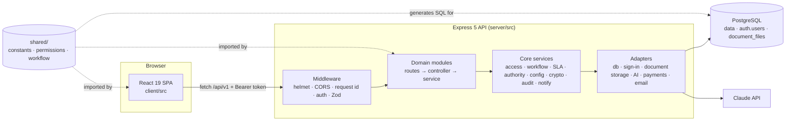
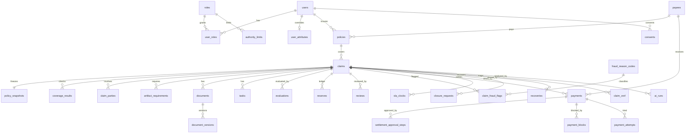
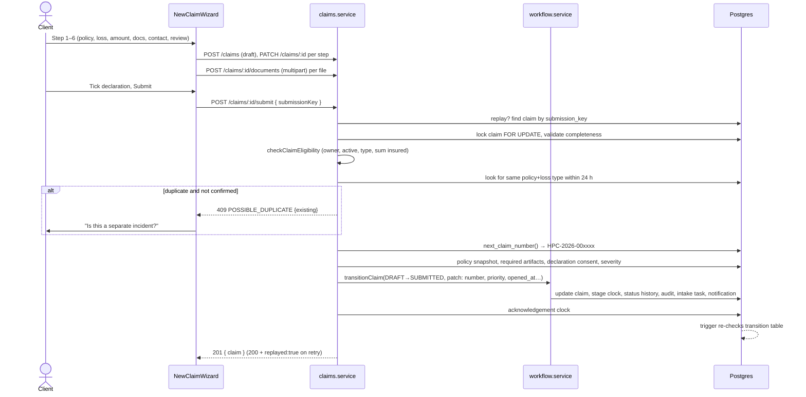

# Code Walkthrough — Claims Operations Hub

This guide explains how the repository is built: what each part does, how a request moves through it, where the rules live, and how to run and test it. It describes the code as of October 23, 2026, after the move to the PRD schema and the seven PRD roles. For what the product must do, see [PRD-enterprise-hub.md](PRD-enterprise-hub.md); Appendix A there maps every requirement to its implementation status. For endpoint examples, see [API.md](API.md); for every table and constraint, see [DATABASE.md](DATABASE.md).

**Contents**
1. [Architecture at a glance](#1-architecture-at-a-glance)
2. [Repository layout](#2-repository-layout)
3. [Shared business rules (`shared/`)](#3-shared-business-rules-shared)
4. [Backend (`server/`)](#4-backend-server)
5. [Database design (`database/`)](#5-database-design-database)
6. [AI functionality](#6-ai-functionality)
7. [Security implementation](#7-security-implementation)
8. [Frontend (`client/`)](#8-frontend-client)
9. [Frontend–backend integration](#9-frontendbackend-integration)
10. [API flows, step by step](#10-api-flows-step-by-step)
11. [Running the application](#11-running-the-application)
12. [Testing](#12-testing)
13. [Extending the code](#13-extending-the-code)

---

## 1. Architecture at a glance

The system is a **modular monolith**: one React single-page app, one Express API, one PostgreSQL database. Business rules that both sides need (roles, statuses, workflow transitions, permissions) live once in `shared/` and are imported by the client, the server and a script that generates SQL.



**One platform: PostgreSQL.** The database holds the application data, the sign-in credentials (`auth.users`) and the claim document files (`document_files`). There is no separate auth or storage service.

| Concern | Implementation |
|---|---|
| Database | PostgreSQL 14+ through a `pg` pool (`DATABASE_URL`); migrations applied at start by the built-in runner |
| Sign-in | The API's own email + password sign-in: scrypt password hashes in `auth.users`, HS256 session tokens signed with `AUTH_TOKEN_SECRET` |
| Files | `public.document_files` (write-once, SHA-256 checked), streamed through the API |
| Email | Console adapter (status `LOGGED_DEV`) until a provider is added |
| Payments | Simulated adapter |
| Demo data | Optional (`SEED_DEMO_DATA=true`), refused in production; the UI then shows a DEMO DATA banner and one-click logins |

---

## 2. Repository layout

```text
package.json             npm workspaces (client, server); root scripts run both
shared/                  Rules used by client, server and SQL generation
  constants.js           Seven roles, statuses, lifecycle stages, segments, loss and document types, artifact,
                         reserve, payment and fraud vocabularies, upload limits
  permissions.js         Permission → roles map, claim workspace tabs, can()/visibleTabs()
  workflow.js            All status transitions, guards, SLA hours
server/
  src/server.js          Process entry: config, dependencies, listen, sweeps, shutdown
  src/app.js             Express app: helmet, CORS, request id, logging, JSON, router, errors
  src/config/            env.js (Zod-validated config), logger.js (JSON logs)
  src/routes/index.js    Mounts /health, auth routes, then authenticate, then every module
  src/middleware/        auth, validate (Zod), upload (multer), requestContext, errorHandler
  src/db/                pg executor, migration runner, repository, query builder, table registry
  src/services/          Cross-module services and adapters (see §4.5)
  src/modules/<domain>/  routes.js · validators.js · controller.js · service.js per domain
  src/seed/              Demo data and a tiny PDF generator for its placeholder documents
  scripts/               db.js (migrate, status, seed-demo), import-supabase.js, generate-transition-sql.js, check-syntax.js
  tests/                 unit/ and integration/ (Vitest + Supertest on PostgreSQL, one cloned database per file)
client/
  index.html, vite.config.js
  src/main.js, App.js    React root, router, auth provider, error boundary, toaster
  src/routes/            AppRoutes.js (lazy pages), guards.js (ProtectedRoute etc.)
  src/context/           AuthContext.js (session, roles, active workspace)
  src/services/          apiClient.js + one service per API area
  src/hooks/             useApiQuery / useApiMutation, useListParams
  src/layouts/           AppShell (sidebar, header, bell), AuthLayout
  src/pages/<area>/      Screens per workspace (customer, operations, manager, payments, config, integrations, …)
  src/components/        claims/, documents/, payments/, tasks/, automation/, common/, ui/
  src/schemas/           Zod schemas for forms (auth, claim wizard)
database/
  migrations/            0000 bootstrap (auth.users, roles), six MVP migrations, 0007 (PRD schema, converts
                         data in place), 0008 (transitions), 0009 (document_files)
  seed.sql               The eight reference roles only
docs/                    PRD (as-built), enterprise PRD v1.2, API, DATABASE, SETUP, this walkthrough
```

---

## 3. Shared business rules (`shared/`)

Everything that would be dangerous to define twice is defined here once.

### 3.1 `constants.js`

- `ROLES`: `CLIENT`, `CLAIMS_OPS_MANAGER` (Claims Operations Manager), `OPS_MANAGER` (Claims Manager), `ADJUSTER`, `DOCUMENT_REVIEWER`, `PAYMENT_OPERATOR`, `DATA_ENGINEER`, `COMPLIANCE_SECURITY`, with labels and `LEGACY_ROLE_MAP` (old MVP codes → new codes, used by the migration and its tests).
- The 18 claim statuses, staff labels and client labels (`CUSTOMER_STATUS_LABELS` shows internal states such as `ON_HOLD` or `COMPLIANCE_REVIEW` as "Under review"), and `STATUS_STAGE`, which maps each status to one of the PRD's nine `LIFECYCLE_STAGES`.
- Segments, severities, coverage results, `LOSS_TYPES` per claim type, `DOCUMENT_TYPES` and `REQUIRED_DOCUMENTS` (defaults; `segment_config.required_artifacts` overrides them).
- Vocabularies for artifact statuses, task types, evaluation decisions, reserve statuses and reason codes, payment statuses and block types, review checkpoints, fraud reason codes and `fraudBand()`, SLA clock types, consents (`PRIVACY_NOTICE_VERSION`), integration sources and AI agents (`confidenceBand()`).
- The intake and investigation checklists, upload limits (MIME types, 10 MB) and `EXTRACTABLE_CLAIM_FIELDS` (`loss_date`, `loss_location`, `loss_description`, `estimated_loss`, `affected_asset`, plus reference-only policy number and insured name).

### 3.2 `permissions.js`

- `PERMISSIONS` maps an action such as `'reserves.review'` or `'settlements.approve'` to the roles allowed to do it. It is the executable form of the PRD authorization matrix (§2.2).
- `CLAIM_TABS` lists which roles see each tab of the claim workspace (Overview, Policy & Coverage, Documents, Evaluation, Tasks, Reserves, Approvals, Compliance, Payments, Closure & Recovery, Automation, Activity).
- `can(roles, permission)` throws on an unknown permission name, so a typo fails loudly instead of denying silently.

The server enforces these on every endpoint. The client uses the **same** map only to decide what to render, so a hidden button is a convenience, never the control. Monetary authority, claim scope and separation of duties are checked on top of these by the services and the database.

### 3.3 `workflow.js`

- `TRANSITIONS`: every permitted `from → to` move with the roles allowed, named guards, whether a reason is required, and whether only the system may make it (payment results). Holds, resumes and client withdrawals are generated for every eligible status, giving 67 transitions in total. Only `OPS_MANAGER` closes and reopens; `INVESTIGATION → COMPLIANCE_REVIEW` is the adjuster's path when the reserve posts within authority.
- `GUARD_DESCRIPTIONS`: the human-readable text for each guard, shown when a transition is blocked.
- `STATUS_SLA_HOURS`: default target time to leave each status. `segment_config.sla_hours` overrides it per segment; the SLA service uses the result for the stage clock and `claims.due_date`.

`npm run db:transitions-sql` turns `TRANSITIONS` into the migration `20261022000008_workflow_transitions.sql`, which fills `claim_status_transitions`. A database trigger rejects any status change not in that table. **If you edit `workflow.js`, regenerate the SQL and ship it as a new migration**, or the API and the database will disagree.

---

## 4. Backend (`server/`)

### 4.1 Startup

1. [server.js](../server/src/server.js) calls `loadConfig()`, builds dependencies, creates the app and listens on `PORT` (4000).
2. It creates upcoming monthly partitions for `audit_logs` and `ai_runs`, then starts one timer (every `OVERDUE_SWEEP_MINUTES`, default 15) that runs the overdue-task sweep (including unclaimed-queue escalation), the SLA escalation sweep, the deadline-reminder sweep and partition maintenance.
3. On `SIGINT`/`SIGTERM` it stops the timer, closes the server and the database, and exits (forced after 10 s).

[config/env.js](../server/src/config/env.js) validates every environment variable with Zod. It refuses to start when:
- `DATABASE_URL` is missing, or `AUTH_TOKEN_SECRET` is missing or shorter than 32 characters;
- `SEED_DEMO_DATA=true` with `NODE_ENV=production`;
- `FIELD_ENCRYPTION_KEY` is missing outside demo and test databases, or any key is not 32 bytes (base64 or hex);
- `AI_PROVIDER=anthropic` and the key is a placeholder.

Demo and test databases fall back to a fixed development encryption key.

### 4.2 Dependency container

[services/container.js](../server/src/services/container.js) builds one object, `deps = { config, db, crypto, email, payments, ai, authProvider, storage }`. Creating `db` applies pending migrations (unless `DB_MIGRATE_ON_START=false`). It then encrypts any `plain:` payee and claim-party fields left by the migration or an import (`encryptLegacyFields`), and with `SEED_DEMO_DATA=true` seeds the demo data on first start. `deps` is stored on `app.locals`, and `authenticate` copies it into `req.ctx` together with the acting user, so every service function receives `ctx` as its first argument:

```js
ctx = { ...deps, actor: { id, email, fullName, roles, type: 'USER', requestId, ip } }
```

This is how services stay testable: tests build the same container with an in-memory database and call the real app.

### 4.3 Request pipeline

[app.js](../server/src/app.js) and [routes/index.js](../server/src/routes/index.js) apply, in order:

| Step | Code | Purpose |
|---|---|---|
| 1 | `helmet()` | Security headers |
| 2 | `cors()` | Only origins listed in `CLIENT_ORIGIN`; no credentials (bearer tokens, not cookies) |
| 3 | `requestId` | Accepts a safe incoming `x-request-id` or generates one; echoed in the response and stored on audit rows |
| 4 | `requestLogger` | One JSON log line per request: method, path, status, duration, user ID (never bodies) |
| 5 | `express.json({ limit: '1mb' })` | Body parsing |
| 6 | `/health` | Mode, AI configured, time; no auth |
| 7 | auth routes + rate limiter | Login, registration, forgot/reset password; 30 attempts per 15 min per IP in production |
| 8 | `authenticate` | Verifies the bearer token, loads the user and roles, rejects inactive or role-less accounts, builds `req.ctx` |
| 9 | Module routers | Each route runs `validate({ params, query, body })` with Zod, then a controller |
| 10 | `notFoundHandler`, `errorHandler` | Map every error to `{ error: { code, message, details, requestId } }` |

Express 5 forwards rejected promises from async handlers to the error handler, so controllers simply `throw`.

### 4.4 Module pattern

Each folder in `src/modules/` follows the same four files. Using claims as the example:

| File | Responsibility | Example |
|---|---|---|
| `claims.routes.js` | URL → validators → controller | `router.post('/claims/:id/submit', byId, validate({ body: submitSchema }), controller.submit)` |
| `claims.validators.js` | Zod schemas for params, query and body | `transitionSchema`, `draftSchema` |
| `claims.controller.js` | HTTP only: read `req`, call service, send `ok()`/`created()` | reads `Idempotency-Key` header and passes it on |
| `claims.service.js` | All business logic, authorization and database work | `submitClaim(ctx, id, { submissionKey, confirmSeparateClaim })` |

Controllers never touch the database, and services never touch `req`/`res`. Service functions start by checking permission and loading the claim within the caller's scope, then do their work inside `ctx.db.tx(...)`.

**Modules**

| Module | What it owns |
|---|---|
| `auth` | `/auth/me` (profile, roles, authority limits, permissions, visible tabs), profile update, consents, login, registration (privacy notice required), password reset |
| `policies` | Policy list/detail (payout accounts masked), eligibility check against the snapshot or live policy |
| `claims` | Drafts (claimant contact encrypted in `claim_parties`), submission (snapshot, required artifacts, declaration consent, severity, acknowledgement clock), listing with stage/segment filters and scope, detail, transitions, coverage checks, SLA clocks, intake checklist, escalation, document exceptions, notes, timeline |
| `assignments` | Assign/reassign owner, reviewer or adjuster (reason required on reassign), eligible assignees, workload |
| `documents` | Upload with content sniffing and versioning (`document_versions`), streamed download of any version, review queue, accept/reject, reviewer assignment, artifact requirements and requests |
| `tasks` | Tasks owned by a user or a role queue, blocking flag, "mine"/"team" views, overdue sweep and unclaimed-queue escalation |
| `evaluations` | Versioned adjuster evaluations; submit with a reserve through the authority decision node; manager return |
| `reserves` | Reserve ledger, adjuster revisions, manager review (approve, modify, reject, return) within authority |
| `settlements` | Settlement creation when compliance clears, approval steps routed by authority, queue and decision history |
| `compliance` | Reviews (`reviews` of type COMPLIANCE), checklist, fraud flags, holds, clear/hold/exception/escalate decisions |
| `payments` | Payment queue, payee verification and bank-detail changes, payment blocks, idempotent issue, block resolution, reconciliation, audited decryption of bank details |
| `closure` | Closure requests (adjuster → Claims Manager) and recoveries |
| `config` | Segment configuration with four-eyes approval, authority limits, fraud reason codes |
| `integrations` | Sync runs, claim cross-references, source precedence |
| `notifications` | Own in-app notifications, unread count, mark read |
| `reports` | All report datasets in SQL over the viewer's claim scope, including stage, SLA attainment and cycle time |
| `audit` | Audit log search, per-claim audit, hash-chain verification |
| `admin` | Users, role grants and authority overrides (never on yourself), deactivation, jobs |
| `customers` | Centralized customer records for Compliance & Security: search, detail (with consents), CSV export, document download, all audited |
| `automation` | Rule-based document checklist and reminders; AI extraction and summaries (§6) |

### 4.5 Core services (`src/services/`)

| Service | What it does | Key functions |
|---|---|---|
| [access.service.js](../server/src/services/access.service.js) | Claim scope per role and access checks | `claimScope` builds a filter: clients see their own claims; Claims Operations Managers, Claims Managers, Compliance & Security and Data Engineers see all submitted claims; Document Reviewers see intake and document-stage claims or those assigned to them; Adjusters see claims they were assigned; Payment Operators see claims from settlement approval onward. `loadAccessibleClaim` returns 404 for both "missing" and "not allowed". `requireNotOwnClaim` blocks staff acting on their own claim |
| [workflow.service.js](../server/src/services/workflow.service.js) | The state machine | `GUARDS`, `availableTransitions`, `transitionClaim`, `lockClaim` |
| [intakeRouting.service.js](../server/src/services/intakeRouting.service.js) | Routing new claims | `assignIntakeOwner` gives each submitted claim to the active Claims Operations Manager with the fewest open claims (then open tasks), keeps on-behalf claims with their creator, records a system-attributed assignment and notifies the owner; with nobody available the intake task waits in the role queue and Claims Managers are told |
| [authority.service.js](../server/src/services/authority.service.js) | Monetary authority and separation of duties | `reserveReviewCapability` / `assertReserveReviewer`, `settlementStepCapability` / `assertSettlementApprover` |
| [config.service.js](../server/src/services/config.service.js) | Segment configuration and limits | `getSegmentConfig`, `requiredArtifacts`, `slaHours`, `severityFor`, `effectiveLimit`, `settlementApproverRole`, `limitsForUser` |
| [sla.service.js](../server/src/services/sla.service.js) | SLA clocks | `recordAcknowledgement`, `recordStageChange` (stops the old clock, starts the next, pauses for client-owed documents and holds), `claimClocks`, `runSlaSweep` (level 1 at breach, level 2 at 1.5× target) |
| [crypto.service.js](../server/src/services/crypto.service.js) | Field encryption | AES-256-GCM with HKDF-derived keys (`v1:` ciphertext), keyed HMAC for duplicate detection, `encryptLegacyFields` |
| [audit.service.js](../server/src/services/audit.service.js) | Audit rows | `recordAudit(t, actor, …)` stores `before`/`after`, `actor_type` (USER, AGENT, SYSTEM), redacts encrypted and secret fields, and must use the same transaction as the change; the database chains the hash |
| [notification.service.js](../server/src/services/notification.service.js) | Notifications | `notify(ctx, t, {...})` writes an IN_APP row and an EMAIL row per recipient; `userIdsWithRole` |
| [eligibility.service.js](../server/src/services/eligibility.service.js) | Policy rules | Ownership, active on the loss date, type/loss-type match, loss vs. sum insured; `policyForClaim` reads the snapshot |
| [authProvider.js](../server/src/services/authProvider.js) | Email + password sign-in on `auth.users` | scrypt password hashes (bcrypt accepted and upgraded for accounts imported from Supabase), constant-time checks including for unknown emails, HS256 session tokens (`AUTH_TOKEN_TTL_HOURS`), single-use reset tokens bound to the password hash fingerprint |
| [storage.service.js](../server/src/services/storage.service.js) | Document storage in PostgreSQL | `put` writes `document_files` inside the caller's transaction (file and metadata commit together); `get` re-checks the SHA-256 |
| [paymentAdapter.js](../server/src/services/paymentAdapter.js) | Simulated payments | Deterministic failures (account ending 0000/9999, amount > 1,000,000) to exercise failure handling |
| [ai.service.js](../server/src/services/ai.service.js) | AI provider abstraction | §6 |
| `email.service.js` | Email adapter | Console adapter reports `LOGGED_DEV`, never `SENT` |
| `presenters.js` | Output shaping | Name lookups, client projection, fraud masking (`maskFraud`: score for Claims Managers and Compliance & Security, band for adjusters), stage labels |

### 4.6 The workflow engine in detail

`transitionClaim(ctx, t, claim, toStatus, options)` is the only way a claim's status changes. It must run inside a transaction with the claim row locked (`lockClaim` uses `SELECT … FOR UPDATE`). In order, it:

1. Finds the rule for `from → to`, or throws `422 INVALID_TRANSITION` listing permitted targets.
2. Rejects system-only moves from users (`SYSTEM_TRANSITION_ONLY`).
3. Authorizes the actor (`authorizeActor`):
   - the actor must hold a permitted role;
   - customers may act only on their own claims, and staff never on their own;
   - an adjuster-only move must come from the assigned adjuster.
4. Requires a reason when the rule says so.
5. Evaluates every guard; any failure throws `409 WORKFLOW_GUARD_FAILED` with the failing conditions.
6. Updates the claim:
   - status (the trigger derives `stage` and counts reopenings);
   - the stage SLA clock and the new `due_date` (`recordStageChange`, from segment SLA hours);
   - `hold_from_status` on hold and resume;
   - rejection, closure and reopen fields.
7. Writes an immutable `claim_status_history` row and an audit row.
8. Runs side effects:
   - on submission, assigns the claim to a Claims Operations Manager (`assignIntakeOwner`) and gives them the intake task; on `ADJUSTER_ASSIGNMENT`, gives the claim owner the assign-adjuster task;
   - opens a compliance review and notifies compliance;
   - cancels open work when a rejected or withdrawn claim is closed;
   - on closure, releases any remaining reserve (`CLOSURE_RELEASE` ledger entries) and marks the pending closure request approved;
   - notifies on holds.
9. Notifies the client only when the client-visible label changes, and never for holds.

The database trigger then re-checks the same transition table, roles, holds and payment rules, so a bug in the service cannot move a claim illegally.

### 4.7 Database access layer (`src/db/`)

- **Executors** expose `query(text, params)` and `transaction(fn)`:
  - [pgExecutor.js](../server/src/db/pgExecutor.js): `pg.Pool` (`DATABASE_POOL_MAX`, default 10; `DATABASE_SSL` disable/require/verify-full). Its type parsers turn `numeric` into Number and keep `date` as a string, so calendar dates never shift by time zone.
  - [migrate.js](../server/src/db/migrate.js): applies `database/migrations/*.sql` in filename order, each in its own transaction under an advisory lock, records them in `app_meta.schema_migrations`, then re-applies `database/seed.sql`.
- **Repository** ([repository.js](../server/src/db/repository.js)) is a small query helper, not an ORM:
  - `findMany/findOne/findById/count/groupCount/insert/update/updateById/remove` and raw `query`;
  - table names are checked against a registry ([schema.js](../server/src/db/schema.js)), and `jsonb` columns are serialized automatically.
- **Query builder** ([queryBuilder.js](../server/src/db/queryBuilder.js)) turns filter objects into parameterized SQL. Example: `{ status: { in: [...] }, $or: [...] }` becomes `"status" = any($1) and (… or …)`. Identifiers must match `^[a-z_][a-z0-9_]*$` and are quoted, and every value is a bound parameter, so filter objects cannot inject SQL.
- **Transactions:** `db.tx(fn)` gives `fn` a transaction-scoped repository. Nested `tx` calls reuse the outer transaction. `t.afterCommit(hook)` registers work, such as sending email, that runs only after commit.
- **Optimistic locking:** claims carry a `version` bumped by trigger; `assertVersion` turns a stale version into `409 VERSION_CONFLICT`.
- **Errors:** `fromDatabaseError` maps Postgres errors (unique violation, check violation, trigger `CODE: message`) to API errors such as `409`.

---

## 5. Database design (`database/`)

[DATABASE.md](DATABASE.md) lists every table, constraint and policy. This section explains how the design fits together.

### 5.1 Migrations

| File | Contents |
|---|---|
| `20261019000000_postgres_bootstrap.sql` | `auth.users` (credential store), `auth.uid()`, the `anon`/`authenticated` roles, `pgcrypto` |
| `20261019000001` … `20261020000006` | The original MVP schema, kept unchanged so an imported Supabase database lines up migration by migration |
| `20261022000007_prd_schema.sql` | The PRD schema (PRD §5.5). Disables the old triggers, converts roles, columns and data, creates the new tables, rebuilds `audit_logs` and `ai_runs` as partitioned tables, installs all triggers and rebuilds RLS |
| `20261022000008_workflow_transitions.sql` | Generated from `shared/workflow.js` |
| `20261023000009_document_files.sql` | Document contents in the database (write-once, no access for user roles) |
| `20261026000010_claims_operations_manager.sql` | The Claims Operations Manager role; `OPS_MANAGER` renamed Claims Manager; scope and policies for the new role |
| `20261026000011_workflow_transitions.sql` | Regenerated transitions with the new role |
| `20261027000012_adjuster_settlement_authority.sql` | Adjuster settlement limits; Payment Operator settlement limits ended; `enforce_settlement_step` lets only the assigned adjuster decide an adjuster step; pending steps re-routed |
| `20261027000013_workflow_transitions.sql` | Regenerated transitions: adjusters release settlements for payment |
| `20261027000014_ui_enhancements.sql` | Loss city and country, INR currency, rejection notification templates, policy renewal requests |
| `20261028000015_claim_agents.sql` | Claim agents: recovery link to AI runs, payment operators may read runs, partial apply of triage |

### 5.2 Entity model



Conventions: UUID keys, `timestamptz` in UTC, money as `numeric(14,2)` with a currency, enumerations as `text` with CHECK constraints, `jsonb` for checklists, configuration values and AI output, `version` for optimistic locking.

Three design choices matter most:
- **Settlements are payments.** A settlement is a `payments` row in `PENDING_APPROVAL` with ordered `settlement_approval_steps`; approval moves it to `PENDING`, ready to issue.
- **Reserves are a ledger.** Every change is a new row; balances are the latest posted or approved entry per coverage line. Payments and closure write their own entries.
- **Configuration over code.** Required artifacts, SLA hours, severity thresholds, the fraud review threshold and the unclaimed-task escalation time come from `segment_config`; monetary authority comes from `authority_limits` and `user_attributes` through `effective_limit()`.

### 5.3 Rules enforced in the database

The database enforces these even when the API is bypassed:

| Rule | Mechanism |
|---|---|
| Only permitted status changes by permitted roles; resume only to the held-from status; no settlement or payment under a compliance hold; no closure with open blocking tasks; `stage` derived | `enforce_claim_status_rules` + `claim_status_transitions` |
| Settlement step approver holds the required role and is within authority; an adjuster step only by the assigned adjuster, a Claims Manager step not by the preparer | `enforce_settlement_step` |
| The settlement approver cannot issue the payment | `enforce_issuer_not_approver` |
| Payment state machine; no issue while a block is open | `enforce_payment_rules` |
| Reverse reviews decided by the right role within authority; decided reviews immutable; no self-review | `enforce_review_rules` + CHECKs |
| Posted reserve amounts never change | `reserves_protect_ledger` |
| Payee verifier ≠ person who changed the bank details | CHECK on `payees` |
| Fraud score equals the weighted sum of open flags | `recompute_fraud_score` |
| AI output cannot change after recording | `ai_runs_protect_output` |
| Audit rows are append-only and hash-chained | `audit_logs_chain` (advisory lock, `seq`, `hash_prev`, `hash`), `verify_audit_chain()` |

### 5.4 Row-level security

RLS is enabled on every table, and partitions cannot be queried directly. The Express API connects with a privileged role and enforces authorization in its services. RLS is defense in depth for any connection that runs as the `authenticated` role with JWT claims set. `can_access_claim(claim_id)` mirrors `claimScope` for the eight roles. Helpers are `security definer` with a fixed `search_path`. `anon` has no table privileges, and `document_files` is closed to user roles.

### 5.5 Moving from Supabase

[scripts/import-supabase.js](../server/scripts/import-supabase.js) (`npm run db:import-supabase`) copies a Supabase project into an empty PostgreSQL database: it rebuilds the project's schema version, copies `auth.users` and every table as text with triggers suspended (so values and the audit hash chain arrive unchanged), applies the remaining migrations, downloads every document from Supabase Storage into `document_files`, and verifies counts, the chain and files. Steps and requirements are in [SETUP.md](SETUP.md) §5.

---

## 6. AI functionality

AI lives in two files:
- [ai.service.js](../server/src/services/ai.service.js) is the provider, which knows how to call Claude.
- [ai-automation.service.js](../server/src/modules/automation/ai-automation.service.js) holds the features, which decide what to send and how to check the answer.

Rule-based automation (missing-document checklist, reminder drafts, deadline sweep) is in [reminders.service.js](../server/src/modules/automation/reminders.service.js) and works without AI.

### 6.1 Provider

`createAiProvider(config)` returns either a disabled provider, which always throws `503 AI_NOT_CONFIGURED` with setup instructions, or the Anthropic provider. The Anthropic provider exposes one method, `generateJson({ system, content, schema, effort, maxTokens })`, which:

- calls `client.beta.messages.create` with model `AI_MODEL` (default `claude-opus-5-5`);
- requests structured output with `output_config: { effort, format: { type: 'json_schema', schema } }`. Opus 5.5 defaults to `medium` effort, so each feature sets effort explicitly;
- turns on server-side refusal fallback (`betas: ['server-side-fallback-2026-07-01']`, `fallbacks: 'default'`);
- handles `stop_reason`: `refusal` → `422 AI_REFUSED`, `max_tokens` → `502 AI_INCOMPLETE` (retryable);
- parses the JSON text, or throws `AI_INVALID_OUTPUT`;
- maps SDK errors, most specific first, to `AI_TIMEOUT`, `AI_UNAVAILABLE`, `AI_PROVIDER_AUTH`, `AI_RATE_LIMITED`, `AI_BAD_REQUEST` and `AI_PROVIDER_ERROR`, each with a `retryable` flag. Messages never echo provider payloads;
- uses the SDK timeout `AI_TIMEOUT_MS` (90 s) and `AI_MAX_RETRIES` (2).

No tools are passed to the model, so nothing it returns can change data by itself.

### 6.2 Every call goes through `runAi`

`runAi` calls the provider, then the feature's `validate` function, which re-checks the output with Zod and applies business rules.
- On any failure it inserts a `FAILED` `ai_runs` row with the error code and returns the run ID in the error details.
- On success the caller inserts a `SUCCEEDED` row with agent (`intake-parser` or `claim-summarizer`), `prompt_version`, `input_hash`, model, numeric confidence, `needs_human`, `human_decision: PENDING`, duration and token counts, and writes an audit row with `actor_type: AGENT`.

Application logs get metadata only: never prompts, document contents or extracted values.

### 6.3 Feature A — document extraction

`runExtraction`:

1. Checks `automation.extract`, the claim scope and the Automation tab, blocks staff on their own claim, and refuses superseded document versions.
2. Reads the file from private storage and sends **only the file, the claim type and the document type**, as a PDF `document` block or an `image` block. No customer contact data is sent.
3. The system prompt (`EXTRACTION_SYSTEM`):
   - tells the model the document is untrusted and that instructions inside it must be ignored;
   - says to return `null` instead of guessing;
   - requires page, quote and a confidence from 0 to 1 for each field (below 0.8 is flagged for confirmation);
   - forbids fraud or coverage judgments.
4. A strict JSON Schema plus Zod validate the shape. `normalizeField` then checks each value against the claim model: real calendar date not in the future, positive amount within range, minimum description length. Policy number and insured name are compared with the policy record as cross-checks.
5. The result is stored for review, and the proposed values (with confidence and page) are saved on the document as `extracted_fields`. **The claim is not changed.**
6. `applyExtraction` writes only the fields a person selects. Each must be marked `applicable` (valid, non-empty, different from the current value, not reference-only), and only while the claim is between Submitted and Investigation. It is audited as `CLAIM_UPDATED_FROM_EXTRACTION`, with the AI run ID in the metadata. `discardExtraction` closes a run without applying it. Both record the `human_decision` (ACCEPTED or REJECTED).

### 6.4 Feature C — claim summary

1. `buildClaimFacts` assembles recorded facts from the database without AI: loss, timeline, documents, missing items, open tasks, requests, pending approvals and holds.
2. `factsForModel` strips names, contact details, claim and policy numbers, accounts and file names before sending.
3. The system prompt forbids recommending approval, rejection or settlement amounts, and forbids implying fraud.
4. As a backstop, `DECISION_LANGUAGE` removes any suggestion that still reads like a decision. If the summary text itself contains such language, the whole result is discarded (`AI_POLICY_VIOLATION`).
5. The UI shows facts and AI suggestions side by side. The AI part is labeled and flagged `stale` when the claim changed after it was generated.

### 6.5 Rule-based automation (no AI)

- `computeDocumentChecklist` compares accepted, pending and rejected documents and open requests with the claim's required artifacts (from segment configuration).
- `createReminderDraft` / `approveReminder` prepare a customer reminder as a **draft**. When a person approves it (optionally editing the text), it creates one artifact request per document type and one notification. The database refuses an approved customer reminder without an approver.
- `runDeadlineReminderSweep` notifies the owner (or the managers, if the claim is unassigned) of claims due within `REMINDER_LEAD_HOURS` or already overdue. A `dedupe_key` makes each reminder unique per claim, deadline and recipient, so repeated sweeps send nothing new.

### 6.6 Configuration

```bash
# server/.env  (never client/.env)
AI_PROVIDER=anthropic
ANTHROPIC_API_KEY=<key>
AI_MODEL=claude-opus-5-5     # default
AI_TIMEOUT_MS=90000
AI_MAX_RETRIES=2
```

`GET /api/v1/automation/status` reports `{ configured, provider, model, setup[] }`; the Automation tab shows setup instructions when AI is off.

---

## 7. Security implementation

| Layer | What is implemented | Where |
|---|---|---|
| Configuration | Zod-validated env; requires a database URL and a ≥ 32-character token secret; refuses demo data in production and a missing encryption key for real data; secrets only on the server | `config/env.js`, `.env.example` |
| Transport and headers | Helmet headers, CORS allow-list, no `x-powered-by`, `trust proxy` for correct client IPs | `app.js` |
| Authentication | Bearer token verified on every route except `/health` and the sign-in endpoints; inactive and role-less accounts refused; rate-limited login | `middleware/auth.js`, `routes/index.js`, `authProvider.js` |
| Password handling | scrypt with random salt, constant-time compare (also against a dummy hash for unknown emails); imported bcrypt hashes upgraded at next login; reset tokens single-use and 30 minutes; no account enumeration | `authProvider.js` |
| Authorization | Permission map on every endpoint; claim scope with 404 for out-of-scope; per-tab checks; conflict-of-interest check; transition-level role and assignment checks | `shared/permissions.js`, `access.service.js`, `workflow.service.js` |
| Separation of duties and authority | Preparer ≠ approver for reserves, settlements, reviews and closure; approver ≠ issuer; bank-detail changer ≠ payee verifier; approvals within `effective_limit()`; four-eyes on configuration; reviewers cannot review their own uploads; nobody changes their own roles; self-registration grants only `CLIENT` | `authority.service.js`, triggers, `config.service`, `admin.service.js` |
| Input validation | Zod on params, query and body; JSON body ≤ 1 MB; parameterized SQL with identifier allow-list | `middleware/validate.js`, `db/queryBuilder.js` |
| Uploads | Extension allow-list + magic-byte sniffing (`file-type`); 10 MB; sanitized file names; SHA-256 checksum, re-checked on read; write-once storage in PostgreSQL in the same transaction as the metadata; downloads streamed after an access check with `Cache-Control: private, no-store` | `documents.service.js`, `middleware/upload.js` |
| Sensitive data | Bank details and claimant contacts encrypted with AES-256-GCM, HMAC for duplicate detection; account numbers masked in responses; decryption only for Payment Operators and audited; redacted in audit diffs; fraud score masked by role; clients never see internal statuses or evidence | `crypto.service.js`, `payments.service.js`, `audit.service.js`, `presenters.js` |
| Integrity | Idempotency keys for submission and payment; compare-and-set on payment status; row locks during transitions; optimistic locking with `version` | `claims.service.js`, `payments.service.js` |
| Audit | Append-only, hash-chained audit rows in the same transaction as the change, with actor and actor type, roles, request ID, IP, before/after; chain verification endpoint | `audit.service.js`, `audit_logs_chain`, `verify_audit_chain()` |
| Database | RLS on every table and no direct partition access, no `anon` privileges, `document_files` closed to user roles, `security definer` helpers with fixed `search_path` | migrations 0007 and 0009 |
| Privacy and export | Privacy-notice and declaration consents with notice version; customer records for Compliance & Security only; 5,000-row export cap, formula-injection guard, audited | `auth.service.js`, `customers.service.js` |
| AI | Keys server-side; documents as untrusted input; schema-constrained output; no tools; minimization; human confirmation; decision-language filter | §6 |
| Errors | Uniform error envelope; unexpected errors logged with stack server-side and returned as a generic `INTERNAL_ERROR` | `middleware/errorHandler.js` |

**Known gaps** (PRD v1.2 Appendix A): no MFA/SSO; no malware scanning; no key rotation tooling for `FIELD_ENCRYPTION_KEY`; in-process timers would run once per instance if scaled out.

---

## 8. Frontend (`client/`)

### 8.1 Build setup

[vite.config.js](../client/vite.config.js):
- **JSX in `.js` files:** a small `jsx-in-js` pre-plugin compiles JSX in `src/**/*.js` with Oxc before the React plugin runs. The project uses `.js` throughout, with no `.jsx`.
- **Aliases:** `@` → `client/src`, `@shared` → `../shared`. The client imports the same permission and workflow rules as the server.
- **Dev proxy:** `/api` → `http://localhost:4000`, so the browser talks to one origin in development.
- **Pre-bundled deps:** dependencies are listed in `optimizeDeps.include`, so lazy-loaded pages never trigger a mid-session re-optimization that would load React twice.
- **Tests:** Vitest with jsdom and Testing Library (`src/test/`).

### 8.2 Entry and app shell

[main.js](../client/src/main.js) renders [App.js](../client/src/App.js). `App.js`:
- wraps the app in `BrowserRouter`, `TooltipProvider`, `AuthProvider`, an `ErrorBoundary` and the toast container.

[layouts/AppShell.js](../client/src/layouts/AppShell.js) provides:
- a fixed sidebar with the active workspace's navigation (a drawer on small screens);
- a header with the workspace switcher and the notification bell;
- the yellow DEMO DATA banner when the API serves demo data, or a red banner when the API cannot be reached.

### 8.3 Authentication and roles

[context/AuthContext.js](../client/src/context/AuthContext.js) holds `user`, `status` (`loading`/`authenticated`/`anonymous`), `activeRole` and what `/health` reports (`demoData`, reachability).
- **On load:** it configures the API client with a token getter and a 401 handler, checks `/health`, then loads `/auth/me` (profile, roles, authority limits, permissions, visible tabs).
- **Workspace:** a user with several roles picks the active one. It is remembered in `localStorage` and only ever chosen from roles the server returned.
- **Sign-in:** [services/authService.js](../client/src/services/authService.js) calls `/auth/login`, `/auth/register` and the password-reset endpoints and keeps the session token in `sessionStorage`, so it ends with the tab.

### 8.4 Routing and guards

[routes/AppRoutes.js](../client/src/routes/AppRoutes.js) lazy-loads every page (one chunk per screen). [routes/guards.js](../client/src/routes/guards.js):
- `ProtectedRoute roles={...}` redirects to `/login` without a session, and to `/unauthorized` without one of the roles;
- `PublicOnlyRoute` keeps signed-in users away from the login pages;
- `RoleHomeRedirect` sends `/` to the active role's home (`ROLE_HOME` in [constants/navigation.js](../client/src/constants/navigation.js)).

### 8.5 Pages by workspace

| Workspace (role) | Navigation and pages (`src/pages/…`) |
|---|---|
| Client | `customer/`: dashboard, My Policies, My Claims, New Claim (six-step wizard), claim detail, requests, settlements & payments |
| Claims Operations Manager | `operations/` dashboard (claims assigned to them), claims queue, unassigned claims, tasks; `automation/RemindersPage`; reports |
| Claims Manager | `manager/` team workload, unassigned claims, reserve reviews, settlement approvals, decision history; claims queue; compliance queue; tasks; reminders; `config/ConfigurationPage`; reports; audit log |
| Adjuster | `adjuster/AdjusterDashboard`, settlement approvals (own claims), tasks (+ shared claim workspace) |
| Document Reviewer | `document-review/ReviewQueuePage`, claims, tasks, reminders |
| Payment Operator | `payments/` queue, payment detail, reconciliation, history; decision history; reports |
| Data Engineer | `integrations/IntegrationsPage`, claims (read-only), configuration (read-only), reports, pipeline audit |
| Compliance & Security | compliance queue, claims, `customer-records/`, decision history, payments, `admin/UsersPage` (roles and authority overrides), configuration, integrations, reports, `admin/AuditLogPage` (with chain verification) |
| Everyone | notifications, profile, unauthorized, not found, auth pages (registration with privacy notice) |

Navigation per role and the roles allowed on each route are in [constants/navigation.js](../client/src/constants/navigation.js) (`NAVIGATION`, `ROUTE_ROLES`, `ROLE_HOME`); [test/navigation.test.js](../client/src/test/navigation.test.js) checks that every link is reachable by its role and that clients never reach staff routes.

### 8.6 Components

- `components/claims/ClaimWorkspace.js` is the unified staff claim view. It renders only the tabs from `CLAIM_TABS` that the active role may see. Each tab is a file in `components/claims/workspace/`: Overview (stage, severity, fraud risk, SLA clocks, coverage verification, case controls), Policy, Documents (versions, required artifacts and requests), Evaluation, Tasks, Reserves (ledger, adjuster revision, manager review with *Modify amount*), Approvals (settlement steps and decision history), Compliance (fraud flags and score), Payments, Closure & Recovery, Automation, Activity.
- `TransitionActions.js` asks the server for `GET /claims/:id/transitions` and renders each available move. Blocked moves are disabled, with the failing guard messages, and moves that need a reason open a dialog.
- `NewClaimWizard.js` saves a server-side draft on each step and sends a submission key, so a double click or retry cannot create two claims.
- `components/ui/` holds shadcn-style wrappers around Radix primitives (dialog, select, tabs, dropdown, …); `components/common/` holds shared building blocks (DataTable, StatusBadge, States, KpiCard, PageHeader, ConfirmDialog).
- `components/dashboard/Charts.js` (Recharts) gives every chart a table view.

### 8.7 Forms and data fetching

- Forms use React Hook Form with Zod schemas from `src/schemas/` (for example, description ≥ 20 characters and loss date not in the future), mirroring the server validators.
- [hooks/useApi.js](../client/src/hooks/useApi.js) provides `useApiQuery(fn, deps)`, which returns `{ data, meta, error, loading, reload }`, unwraps the `{ data, meta }` envelope and ignores stale responses. A matching mutation hook shows toasts on errors.

---

## 9. Frontend–backend integration

| Topic | How it works |
|---|---|
| Base URL | `VITE_API_URL` (default `/api/v1`), proxied by Vite to port 4000 in development |
| Calls | Pages call a service (`claimsService.submit(id, body)`), which calls `api.get/post/patch/delete/upload/blob` in [apiClient.js](../client/src/services/apiClient.js) |
| Auth header | `apiClient` asks `authService.getAccessToken()` before every request and sets `Authorization: Bearer …` |
| Envelope | Success `{ data, meta }`; error `{ error: { code, message, details, requestId } }`. `apiClient` throws an `ApiError` with `status`, `code`, `details`, `requestId` |
| 401 handling | A 401 on an authenticated request signs the user out and clears state |
| Business errors | Pages branch on `error.code`, for example `POSSIBLE_DUPLICATE` (show the "separate incident?" dialog), `WORKFLOW_GUARD_FAILED` (show `details.failures`) or `AI_NOT_CONFIGURED` (show `details.setup`) |
| Permissions and authority | The UI reads `user.permissions`, `visibleTabs` and `limits` from `/auth/me` and the shared map; queue rows carry `canDecide`/`canApprove`/`reason` and payments `canIssue`. The server re-checks everything |
| Idempotency | The claim wizard sends `submissionKey`; payment issue sends an `Idempotency-Key` header (`workflowService.js`) |
| Files | Uploads use `FormData` (`file`, `docType`, optional `artifactRequirementId`/`replacesDocumentId`/`changeReason`); downloads (optionally `?version=`) use `api.blob()` against the streaming endpoint, so there are no public file URLs |
| Health | The client reads `/health` to show the demo banner and quick logins, and disables sign-in when the API is unreachable |

---

## 10. API flows, step by step

### 10.1 FNOL: draft → submit



### 10.2 Document rejection loop

1. A reviewer calls `POST /documents/:id/review { decision: "REJECT", rejectionReason }`.
2. In one transaction the API:
   - marks the document (and its current version) rejected;
   - sets the matching artifact requirement to `REQUESTED` with the reason;
   - creates a follow-up task;
   - notifies the client;
   - moves a claim in `DOCUMENT_REVIEW` back to `DOCUMENTS_REQUIRED`, which pauses the stage clock while the client owes documents.
3. The client uploads a replacement with `replacesDocumentId`. The document's `version` increments, the previous `document_versions` row becomes `SUPERSEDED`, and the requirement becomes `RECEIVED`.
4. When no document requests remain open, `uploadDocument` moves the claim back to `DOCUMENT_REVIEW` itself.

### 10.3 Reserve decision node and settlement approval

1. The assigned adjuster submits an evaluation with a reserve (`POST /evaluations/:id/submit { reserveAmount }`). The reserve must cover the recommended settlement, and the settlement cannot exceed the sum insured.
2. `effectiveLimit(adjuster, RESERVE, segment)` decides the branch:
   - within authority: the ledger entry is `POSTED` and the claim moves `INVESTIGATION → COMPLIANCE_REVIEW`;
   - above it: the entry is `PENDING_REVIEW` and the claim moves to `RESERVE_APPROVAL`.
3. `GET /reserves/queue` returns, for each entry, `canDecide`, `canApprove`, `limit` and a reason for the caller (`reserveReviewCapability`).
4. An Claims Manager calls `POST /reserves/:id/review`. `assertReserveReviewer` refuses other roles (`APPROVAL_NOT_AUTHORISED`), the person who set the reserve (`SELF_APPROVAL_FORBIDDEN`) and amounts above the manager's authority (`APPROVAL_LIMIT_EXCEEDED`). *Modify* writes a new `MANAGER_MODIFIED` entry; *Return* sends the evaluation back with a correction task.
5. A `reviews` row of type `RESERVE` records the decision and the reviewer's limit; `enforce_review_rules` repeats the checks.
6. When compliance clears the claim, `createSettlementRequest` creates the payment in `PENDING_APPROVAL` with one approval step: `ADJUSTER` (the claim's assigned adjuster) if the amount is within the adjuster settlement authority for the segment, otherwise `OPS_MANAGER`. `POST /settlements/:id/approvals` decides the step (`assertSettlementApprover` + `enforce_settlement_step`); approval moves the payment to `PENDING` and the claim to `PAYMENT_PENDING`.

### 10.4 Payment issue (three phases)

```mermaid
sequenceDiagram
  actor P as Payment operator
  participant API as payments.service
  participant DB as Postgres
  participant PA as Payment adapter
  P->>API: POST /payments/:id/issue (Idempotency-Key)
  API->>DB: key seen before? → return recorded result (replayed)
  rect rgb(235,245,255)
  note over API,DB: Phase 1 — transaction
  API->>DB: lock payment + claim; check PENDING, PAYMENT_PENDING,<br/>no open blocks, no compliance hold, caller did not approve the settlement
  API->>DB: UPDATE payments SET PROCESSING WHERE status='PENDING' (compare-and-set)
  API->>DB: insert payment_attempt, audit
  end
  API->>PA: initiateTransfer (outside any transaction)
  PA-->>API: SUCCEEDED + reference / FAILED + reason
  rect rgb(235,255,240)
  note over API,DB: Phase 3 — transaction
  API->>DB: finish attempt; payment PAID (+ PAYMENT_ISSUED reserve entry)<br/>or FAILED (+ PAYMENT_FAILED block)
  API->>DB: transitionClaim(system) → PAID or PAYMENT_FAILED
  API->>DB: audit; notify payment team on failure
  end
  API-->>P: { payment, attempt, replayed:false }
```

The external call sits outside a transaction, so a slow provider never holds row locks. The compare-and-set together with the unique idempotency key guarantees at most one transfer per payment even under concurrent clicks.

After a failure, a Payment Operator may change the payee's bank details (the payee becomes unverified and a `BANK_DETAILS_CHANGED` block opens); another Payment Operator must verify the payee (`POST /payees/:id/verify`); then `POST /payments/:id/resolve-block { resolution }` returns the payment to `PENDING` for a new issue.

### 10.5 AI extraction → human confirmation

1. `POST /documents/:id/extractions`: the intake-parser agent reads the file, and the API stores the validated result in `ai_runs` with `human_decision: PENDING`.
2. `GET /claims/:id/automation/extractions`: the Automation tab shows each field with value, confidence (percentage and band), page, quote, current value and validity issues.
3. `POST /automation/extractions/:id/apply { fields: [...] }`: only the selected, applicable fields are written, in one transaction with an audit row; or `…/discard`.

---

## 11. Running the application

### 11.1 Prerequisites

- Node.js **20.19+** and npm 10
- PostgreSQL **14+** (local, Docker, or managed)
- For AI features: an Anthropic API key

### 11.2 Configure and run

```bash
npm install                          # installs both workspaces from the repository root
cp server/.env.example server/.env   # set DATABASE_URL and AUTH_TOKEN_SECRET (and FIELD_ENCRYPTION_KEY for real data)
npm run dev                          # migrates, then API on http://localhost:4000 and web on http://localhost:5173
```

For a demo, set `SEED_DEMO_DATA=true` (or run `npm run db:seed-demo`): 15 users across the eight roles, 7 policies and claims at every lifecycle stage, with one-click logins (password `HarborDemo!2026`). To reset, drop and recreate the database. To run one side only: `npm run dev:server` or `npm run dev:client`.

### 11.3 Database commands

`npm run db:migrate`, `npm run db:status`, `npm run db:seed-demo`, and `npm run db:import-supabase` for the one-time move from Supabase. Full details are in [SETUP.md](SETUP.md).

### 11.4 Enable AI

Add `AI_PROVIDER=anthropic` and `ANTHROPIC_API_KEY=…` to `server/.env` and restart the API. Open a claim as `ops.olivia` → **Automation** tab → *Extract fields* on a document or *Generate summary*.

### 11.5 Production build

```bash
npm run build        # client/dist (static files for any static host or CDN)
npm start            # API without file watching; set NODE_ENV=production and keep SEED_DEMO_DATA=false
```

There is no Dockerfile or infrastructure code yet (PRD §8.2).

### 11.6 Troubleshooting

| Symptom | Cause / fix |
|---|---|
| Red banner "Cannot reach the claims API", sign-in disabled | API not running on 4000 (check its log for a database error), or `VITE_DEV_API_PROXY` points elsewhere |
| Server exits: "DATABASE_URL is required" / "AUTH_TOKEN_SECRET is required" | Set them in `server/.env` |
| Server exits: "FIELD_ENCRYPTION_KEY is required" | Real data needs a 32-byte key; only demo and test databases may run without one |
| Server exits: "Failed to apply migration …" | The database user lacks a privilege (`CREATEROLE` for the bootstrap migration) or the database is not one this app created |
| `DECRYPTION_FAILED` errors | `FIELD_ENCRYPTION_KEY` differs from the key the data was encrypted with (after a Supabase import: use the old key) |
| Automation tab shows setup instructions | `AI_PROVIDER=none` (the default) |

---

## 12. Testing

```bash
npm test             # server then client
npm run test:server  # Vitest: unit + integration on PostgreSQL (TEST_DATABASE_URL)
npm run test:client  # Vitest + Testing Library on jsdom
npm run lint         # server syntax/import check; client import resolution
npm run build        # production build must succeed
```

Status on Oct 28, 2026: **246 tests passing** (210 server, 36 client; server tests on PostgreSQL 17), lint and build clean.

How the server tests work: [tests/global-setup.js](../server/tests/global-setup.js) migrates and seeds one template database on the server in `TEST_DATABASE_URL`; [tests/helpers.js](../server/tests/helpers.js) `createTestContext()` clones it for each test file (`create database … template …`) and boots the real Express app on the clone, which is dropped afterwards. `ctx.as('ops.olivia')` returns a client that logs in and calls the API with that user's token. Constraints, triggers and RLS therefore run exactly as in production.

| Suite | Covers |
|---|---|
| `unit/workflow.rules.test.js`, `unit/business-rules.test.js` | Workflow rules (eight roles, Claims-Manager-only closure, intake with the Claims Operations Manager); permissions, eligibility, payment adapter, field encryption, query builder, utilities |
| `integration/auth.test.js` | Missing and forged tokens, wrong passwords without account disclosure, client-only registration with privacy notice, consents, password strength, no self-granted roles, deactivated accounts |
| `integration/claims.test.js`, `workflow.test.js` | Drafts, submission (snapshot, artifacts, clocks), duplicates, idempotency, coverage checks, version conflicts, transitions and guard errors per role |
| `integration/documents.test.js` | Upload sniffing, versions, artifact requirements, review loop, access to downloads |
| `integration/approvals-compliance.test.js` | Reserve decision node, manager review and modify, authority limits, settlement steps, self-approval, holds, exceptions, fraud score |
| `integration/payments.test.js` | Idempotency, concurrency, approver ≠ issuer, payee verification, blocks, failures, reconciliation, encryption and masking |
| `integration/customers.test.js` | Compliance & Security only, consents, export, audit |
| `integration/automation.test.js` | Checklist, reminder drafts and approval, sweep dedupe, AI paths with a stub provider |
| `integration/audit-security.test.js` | Audit immutability and hash chain, redaction, conflict of interest, scope 404s |
| `integration/intake-routing.test.js` | Automatic routing to the least-loaded Claims Operations Manager, role-queue fallback, on-behalf claims, the role split, and payee collection and verification at intake |
| `integration/rls.test.js` | RLS policies as the `authenticated` role with JWT claims |
| `integration/lifecycle.e2e.test.js` | One claim from draft to closure, through every stage, with the correct actor at each step |

For manual acceptance testing, follow the 29-step UAT script in [SETUP.md](SETUP.md) §5.

---

## 13. Extending the code

**Add an endpoint:** add a Zod schema in `<module>.validators.js`, a route in `<module>.routes.js`, a thin controller function, and a service function that:
1. calls `requirePermission` (and `loadAccessibleClaim` for claim data);
2. does its work in `ctx.db.tx`;
3. calls `recordAudit` with the same transaction.

Add the permission to `shared/permissions.js` and an integration test with the allowed and a refused role.

**Change the workflow:** edit `shared/workflow.js`, add any new guard to `GUARDS` in `workflow.service.js`, run `npm run db:transitions-sql`, ship the output as a new migration, and extend `workflow.rules.test.js`.

**Add a table:** write a new migration (constraints, indexes, RLS policy for the eight roles, `updated_at`/`version` triggers), register the table and its `jsonb` columns in `server/src/db/schema.js`, and add an RLS test.

**Add an AI feature:**
1. Write a system prompt that marks inputs as untrusted.
2. Define a strict JSON Schema plus a matching Zod schema.
3. Minimize the input, and call through `runAi` so the run is logged.
4. Store the result for human review instead of applying it.
5. Gate it behind a new `automation.*` permission.

**Swap a platform service:** implement the adapter contract (`query/transaction`, `verifyToken/createUser`, `put/get`, `generateJson`, `initiateTransfer`, `send`) and select it in `services/container.js`. Nothing else in the code imports a vendor SDK directly.
